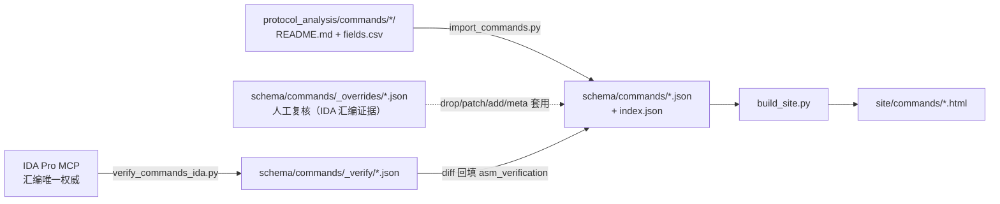

# 01 · 交互命令模型（命令维度）

> 本文件是 `db_design/schema/commands/` 的口径唯一来源。
> **证据只允许来自**：`protocol_analysis/commands/<命令>/`（README / fields.csv / asm.md / notes.md）
> 与 **IDA 汇编**（`unpacked/GundamOnline_CHINA_v15.exe.i64`，ImageBase `0x400000`）。
> 缺 `protocol_analysis/` 时不得引用 `server/` / `api_doc/` 旧结论。

---

## 1. 为什么要有这一层

既有的三层模型（`docs/00-设计原则.md` §2）是**按数据形状**组织的：

| 层 | 回答的问题 | 本目录 |
|---|---|---|
| Wire 字段 | 线上长什么样 | `schema/fields/index.json` |
| Canonical 实体 | 业务上是什么 | `schema/entities/*.json` |
| DB 列（提议） | 该存什么 | `schema/tables/*.json` |

它缺一件事：**这些字段是被谁、为什么、怎么送过来的**。
「一个 `u32` 到底该不该入库」取决于它在**哪条命令**里、客户端读它**干什么**、
服务端写它时**依据什么**。没有命令维度，`tables/*.json` 的 `disposition` 只能靠猜。

本层补的就是这个：**一条命令一份模型**，把「字段 → 结构体 → 行为 → 能力 → DB 影响」串起来。

```
命令（schema/commands/<id>.json）
 ├─ fields[]        逐字段：偏移/线长/线类型/含义/用途/证据 VA/置信度/去向
 ├─ structs{}       包结构体：把 fields 归并成 request / response 的成员序列
 ├─ behavior[]      客户端行为步骤（读→判→闭合→交业务 / 写→提交→发送），每步带 VA
 ├─ capabilities[]  受控能力标签（有汇编证据才写）
 └─ db_effects[]    这条命令对哪个实体做 read/create/update/delete
```

---

## 2. id 与命名

- `id` = `protocol_analysis/commands/<文件夹名>`，形如 `SC-0xF11C-lounge-channel_list_get_r`。
  命名规范见 `protocol_analysis/00-规范-组包格式分析SOP.md` §2；**同一个 opcode 可能跨协议类各有命令**，
  协议类必须保留，否则会撞 id。
- `direction`：`SC`（服务端 → 客户端，recv）/ `CS`（客户端 → 服务端，send）。
- `proto`：协议类短名 `auth` / `battle` / `lounge`。
- `structs` 的键是**角色**，不是协议类：
  - `SC` → `response`（客户端接收的包）
  - `CS` → `request`（客户端发出的包）
  - 一条命令**双向同 opcode** 时（如 `0x20F5`），两条命令各自出一份 `structs`，
    在 `pair` 里互链，**不合并**。
- 配对字段：`pair` 存配对的命令 id（请求↔应答，或同 opcode 反向）；`related` 存同族命令 id。

---

## 3. 字段表（`fields[]`）——必须逐字段解剖

`fields[]` 由 `tools/import_commands.py` 从 `protocol_analysis/.../fields.csv` 落库，
列语义**原样搬运，不得二次解释**：

| CSV 列 | JSON 键 | 口径 |
|---|---|---|
| 序号 | `seq` | 线序，`0` = opcode |
| 偏移 | `offset` | 相对报文体（opcode 之后）；变长段记 `var` 或留空，**禁止编造** |
| 长度 | `length` | **线长**：元素宽×条数（`54·n`）/ 元素线长（`113`）/ NUL 串（`L+1`） |
| 线类型 | `wire_type` | `u8/u16/u32/u64/i8/f32/f64/str/bytes/array<...>/struct<...>` |
| 字段名 | `name` | 有原名用原名，无原名 `f_<偏移>` |
| 含义 | `meaning` | 一句话 |
| 用途 | `purpose` | 去向/来源锚点（`vt[0xNNN]` / 入参 / 成员偏移） |
| 取值或枚举 | `enum` | 范围或枚举表，或 `-` |
| 证据VA | `evidence_va` | 拆 `\|` 成数组；每条都必须能在 IDA 跳到 |
| 置信度 | `confidence` | `确证` / `推测` / `未知`（原文可带修饰，如 `确证（宽度）/枚举待补`） |

**读「偏移」列的两个坑**：① `var` / 留空的行（变长段）偏移不可算，只能用线长顺序递推；
② 聚合体成员（`roominfo.room_type` 这类）的 `+0xNN` 往往是**内存偏移**（取自结构体打印器
`[edi+NNh]`），与线偏移不等价（§8.1.1 第 4 条）。线偏移 = 前面各字段线长之和。

### 3.1 长度列的硬口径（历史坑 ①⑧/㉕）

`长度` 列**只能写线上实际消费的字节数**：

- 变长数组 → `元素宽×条数`（如 `54·n`、`113n`）；
- 定长数组（**循环上界是字面量且无线上 count**）→ `元素线长`，条数写进 `wire_type` 的 `[N]`/`array<X,N>`；
- 结构体 → 结构体**线长**（不是内存跨度 claim）。

**禁止**把容量记账（`32×60` = 槽步进×上限）写进长度列。
容量记账只用于反推漏读段，是**校验工具**，不是线长。
`wire.capacity_note` 专门存容量口径的原文，与本表分开。

**坑㉖ 只写「元素线宽」也是记账坑**：数组行的长度列写 `130`（元素线宽），条数另在线上字段
（`mail_count`）里。此时 `field_sum` 会把 `4 + 4 + 4 + 130` 当成**定长总长**，与 README 的
`12 + 130N` 直接打架。导入期识别出这种行（长度列是纯数字且 == 名字命中的 composite 线长、
尾巴没写条数）就打 `fields[].length_is_elem_width = <count 字段名>`，并在 `build_struct()` 前
把 `wire.length_expr` 重算成 `宽·条数`（同步修 `fixed` / `var_drivers`，记
`wire_len_elem_width_cells`）；站点在数组行下明写「长度列只写了元素线宽：条数 ← X」。
2026-09-22 修正 16 条命令（见 §8.2 案例六）。

**坑㉗ 「父.成员」占位行会被双计**：草稿在写了父行（`missionunit_set`，`struct{12}`，带 composite 引用）
之后，又把它的成员逐行摊了一遍（`missionunit_set.deck_type` 2 / `.deck_set` 2 / `.missionunit_id` 8）。
这 12 字节**已经算在父行的长度列里**，`field_sum` 再相加就是双计：`SC-0x1908` 得出
`4 + 12 + 2 + 2 + 8 = 28`，与 README 的 `4 + 12 = 16` 直接打架，站点还把同一批成员摊两遍。
导入期按 `mark_member_rows()` 识别（三道同时成立：父行存在、父行带 `composite_ref`/
`element_composite_ref`、尾巴名确实是该 composite 的成员名——写 `*` 也算），打
`fields[].is_member_row = <父字段名>`，然后：

- `wire.length_expr` 重算时剔除（记 `wire_len_member_rows_folded`）、`build_struct()` 不建成员、
  `derive_behavior.py` 不出行为步；
- 行**仍保留在 `fields[]`**（可追溯），站点标「成员占位行」并注明「不参与线长求和」。

2026-09-22 修正 8 条（`SC-0x1908` / `SC-0x2AAF` / `SC-0x305D` / `SC-0x271C` / `SC-0x1E2F` /
`CS-0x9527` / `CS-0xA76E` / `CS-0xB235`，全部改后与各自 README 的线长相等）。
**反向形态**：成员摊了、父行没写（`CS-0x9527` 的 `equip_set`、`CS-0xA76E` 的 `ms_set`、
`CS-0xB235` 的 `order`）——线长求和**本来是对的**，但站点看不到「这是一个 N 字节结构体」，
按 `CS-0x7916` 的先例用 `_overrides/` 的 `add` 补父行（见 §8.2 案例七）。

**坑㉘ 长度列写了「非线长口径」的四种形态**（2026-09-22 批次 5 后普查发现，共修 42 处 / 33 条命令）。
坑㉕ 讲的是**容量**被写进长度列；这一坑是同一类错误的另外三种面孔——草稿写的数字确实是个
"字节数"，只是**不是线上实写的字节数**。它们比坑㉕更隐蔽：`asm_verification` 的定长校验认的是
`capacity_relation`（观测下界 ⊂ 容量），**不是**「字段求和 == README 总长」，所以这三种写法
全都能通过汇编复核，却让 `wire.length_expr` 整串失真、`fixed` 误判为 `True`。

判据统一用**草稿自己的措辞**（不解析 README 散文），落盘字段与站点提示如下：

| 形态 | 草稿原话 | 长度列原值 | 改成 | 落盘键 | 例 |
|------|----------|-----------|------|--------|-----|
| ① `str` 的**槽位预算** | 「槽位预算 `0x81`=129」 | `129` | `var(≤129)` | `slot_budget` | `SC-0x5383.battlesv_host` |
| ② `struct` 的**内存跨度** | 「跨度 424B」 | `424` | composite 线长 `398` | `memory_span` | `SC-0xB4B6.pcard` |
| ③ 字面量条数数组只写**单元素线宽** | 类型尾巴 `array<bonus_info,40>` | `29` | 条数×元素宽 `1160` | `length_is_literal_count` | `SC-0xF0AF.bonus_info` |
| ④ 变量条数标量数组只写**元素宽** | 类型尾巴 `u16[N]`（N 是变量） | `2` | `2N` | —（长度列直接带变量） | `CS-0xBCB4.ent_ids` |

- ① C 串在线上写的是 `strlen+1`，槽位只是**分配上限**。全库 34 处「整数长度的 `str`」无一例外
  都写了「槽位预算」，因此判据没有误伤空间；改成 `var(≤N)` 与早已正确的同形命令对齐
  （`SC-0xFB85` 的 `loungesv_host`/`otp` 就是同一形态的正确写法）。预算不丢，落 `slot_budget`
  供溢出边界复核。
- ② 内存跨度**含非线上成员**（对齐填充、仅驻内存的字段），故大于线长：`pcard` 424/398、
  `bracket` 212/166、`AI` 168/165。跨度与线长相等时（`order` 10/10、`rankself` 40/40）不动。
- ③ 条数在**类型尾巴**上而不是线上字段里，所以走不到坑㉖ 的 `length_is_elem_width`（那条要求
  线上有条数字段）：`bonus_info` 写 29 而实为 `40×29`，`mailids` 写 8 而实为 `50×8`。
- ④ 条数写在类型尾巴上且是**变量**（`u16[N]`），坑㉖ 的判据（要求尾巴为空）同样够不着。
  `CS-0xBCB4.ent_ids` 因此 `fixed` 被误判成 `True`、变长数组只算 2 字节。同库正确写法是长度列
  直接带变量（`SC-0xE4DB` 的 `2N (N≤6)`、`SC-0x2775` 的 `N`）。

三类改写统一在 `build_command()` 里**按序**执行（改字节数 → 折叠成员行 → 重建表达式），
表达式重建收口到 `rebuild_field_sum_len()`，避免以后新增长度改写时漏掉重算。

**本坑查完后仍存疑的 3 条**（都不是机械规则能判的，须回 IDA 下钻读写循环的游标步进）：

| 命令 | 模型 | README | 争点 |
|------|------|--------|------|
| `SC-0xDC47-lounge-pilot_record_get_r` | 1857 | 1837 | 前缀是 12 还是 24；`msdeck` 元素是 324（→2×324=648）还是 308（→616） |
| `SC-0x421B-battle-pos_move` | 128 | 132 | README 多出一个 `+4`；模型字段偏移 2→128 **连续无洞**，且本条 `ASM-VERIFIED`，故倾向 README 记错 |
| `SC-0xFA18-lounge-pilot_netcafechallenge_get_r` | 48 | 69(=容量 0x45) | `pdaily` 定长 3 元：线上计 **元素线长 13**（3×13=39）还是 **槽步进 20**（claim 60=3×20）。同形的 `SC-0xF0AF` 走线长口径，但本条 claim 恰好 == 容量，两种都自洽 |

**坑㉙ 长度口径一变，旧复核结论就必须作废**。上面这些改写不动 `_overrides/` 的 `revision`，
而 `merge_previous()` 原本只认 revision——于是「字段字节数改了，旧 `ASM-VERIFIED` 章还留着」，
等于拿旧口径的复核给新模型背书。现在加两道：

- `wire_fingerprint`（字段名/线类型/长度/闭合与成员行标记/线长表达式的 sha1 摘要）随模型落盘。
  字节数一变，指纹就变，旧 `asm_verification` 作废回 `IMPORTED` 并在
  `asm_verification.invalidated_by` 记明原因。只覆盖线长相关量，改 `meaning` 不会触发。
- `WIRE_EPOCH` 常量参与指纹：**规则口径整体一换就 +1**，全部已复核命令一次失配、自动作废，
  不必逐个比字节数。旧模型没有 `wire_fingerprint` 键时按「不能证明未变」处理（缺失即作废）。

原始切片留在 `schema/commands/_verify/_raw/`，所以作废后重跑
`verify_commands_ida.py ingest --batch N --apply` 就能在新口径下重判，**不必回 IDA**。
2026-09-22 本轮 epoch=1 触发，批次 1–5 共 198 条全部重跑并重新 `ASM-VERIFIED`，
其中长度被改正的 4 条（`SC-0xB4B6` / `SC-0xB553` / `SC-0xB463` / `SC-0x8E92`）在**新长度下依然通过**
——汇编侧独立确认了「跨度 ≠ 线长」的改法。

**坑㉛ 去向写在散文里，只扫表格的解析器整条丢掉**（2026-09-22 批次 15 暴露，全库 50 条）。

坑㉚ 是「同一语义换了个键名」，这一坑是**信息压根不在表格里**。`import_commands.py` 的元信息
来自 §1 表格行，但 README 的「去向」有两种写法：

| 写法 | 例子 | 解析结果 |
|---|---|---|
| ① 表格直接给 | `\| 去向 \| `vt[0x58]`(客户端的发送缓冲) @`0x00B0CBA4` \|` | 槽 + VA 都对 |
| ② **路径叙述** | `\| 分发路径 \| **不经 switch**：分发器 `sub_B0CC20` 的**默认分支块** `0xB31252`（`jumptable 0xB22835` 的 default）在 `0xB31256` 调用本函数；函数内部自检 `cmp ax, 20F5h`（`0xB0C256`） \|` | 取「最后一个 VA」⇒ 取到**块内 opcode 自检点**，而**去向根本没进模型** |

写法②的真去向写在 §2/§3 散文里：`交 `vt[0x5A4]`（`0xB530F6`）`。实测写法②共 **50 条**
（`SC-0x045C` / `SC-0x090C` / `SC-0x0E85` / `SC-0x1365` / `SC-0xFF8B` …），
它们的 `dispatch_slot` 全为 `None` —— 判定层于是按 `absent` **跳过**去向检查，
命令照样盖上 `ASM-VERIFIED`。这是比错值更坏的一种失败：**检查从未跑过，章却是真的**。

改法是在 `normalize_meta` 里补一层散文兜底 `dispatch_from_prose()`，**只在表格没给出槽时**启用。
句式与取法（写法②的括号里常有两个 VA：「取虚表项」与「调用」）：

```
交 `vt[0x5A4]`（`0xB530F6`）                                  → 槽 vt[0x5A4]，VA 0xB530F6
交 `vt[0x5A4]`（`0xB530ED` 取虚表项、`0xB530F6` 调用，实参即本值）→ 槽 vt[0x5A4]，VA **取最后一个** 0xB530F6
```

取项点还是调用点不必较真：判定层对手向点的两种写法都认（`mov R,[H+NNNh]` 的 `mov_va` 与
随后 `call` 的 `va`），所以 `0xB530ED` 也能对上。

- 覆盖：散文兜底把 50 条里的 **49 条**填上（剩 `SC-0xA103-auth-authenticate_bnpotp_input`
  ——它的去向写在一张 §4 表格行里、`vt[0x70]` 后面跟的是「，」不是「（」，兜底够不着；
  该条由判定层从汇编回填，`vt[0x70]` @ `0xB04C36`）。
- **正确性靠汇编独立验证**：把 49 条作废重跑后，批次 1–16（703 条）**零 mismatch**；
  全库 702 条已复核命令的 `dispatch_slot` 与汇编取到的槽**逐条相等**，无一条分歧。
  散文口径与 IDA 口径在这个样本上 100% 一致。

**坑㉜ 复核输入变了、线长没变 —— 旧章照样在**。坑㉙ 的 `wire_fingerprint` 只覆盖**字节数**，
可「拿什么去对位」还有一组**独立**输入：`capacity_va` / `closer_va` / `dispatch_slot` /
`dispatch_va` / `handler_va` / `block` / `error_vas`。坑㉛ 就是反例 —— 文件一个字节没变，
只是 `dispatch_slot` 从空变成 `vt[0x5A4]`，判定层从此会真的比对去向，
而旧的「通过」是按 `absent` **跳过**得到的，等于给新输入背了旧书。

加 `check_fingerprint`（同样带 `CHECK_EPOCH`，覆盖上面那组点位/槽位输入）与 `wire_fingerprint`
并列，任一变化即作废旧 `asm_verification`，`invalidated_by` 记 `check_fingerprint_changed:…`。
首轮同样因「旧模型无此键 ⇒ 不能证明未变」把 915 条全打回 `IMPORTED`；
靠 `_verify/_raw/` 里的切片重跑批次 1–16 即恢复，**不必回 IDA**。
`_survey_meta_coverage.py` 已扩到盯 `dispatch_slot`/`dispatch_va`，这类静默缺口以后能一眼看出来。

**坑㉝ 定长数组的宽度证据来自「区域切分器」，而它不消费线长**（2026-09-22 批次 17 暴露）。

批次 17 的 `SC-0x54C6-battle-dynamic_taskforce_info_update` 报了 3 个定宽缺口
（`order_all_number` / `order_all_kind` / `members_order_idx`，模型 `u8[54]` / `u8[54]` / `u8[51]`）。
追到汇编，这三个字段各有一个专用小函数：

```
0xB060E0  mov eax, ecx           0xB41930  mov eax, ecx
          mov ecx, [esp+arg_0]             mov ecx, [esp+arg_0]
          mov edx, [ecx]                   mov edx, [ecx]
          mov [eax], edx                   mov [eax], edx
          mov edx, [ecx]                   mov edx, [ecx]
          add edx, 36h   ← 54              add edx, 64h   ← 100
          mov [ecx], edx                   mov [ecx], edx
          retn 4                           retn 4
```

IDA 反编译形态一致：`*dest = *holder; *holder += N;`。旧口径只认**就地推进** `add [mem],IMM`
（且把立即数限死在 `(1,2,4,8)`），**取值推进**这一族（`mov R,[C]` → `add R,IMM` → `mov [C],R`）
一个字节都算不出来，`consumed` 恒为 `0`，于是 `u8[54]` 在定宽对位里「找不到读写点」而误报缺口。

补 `_cursor_step_by_register()` 认这一族后，`SC-0x54C6` 的 3 个缺口消失。**但它同时踩了第二个坑**：
重跑批次 1–16，**10 条**原本 `ASM-VERIFIED` 的命令冒出 `capacity_relation` 矛盾
（`SC-0x9193` / `SC-0x91C9` / `SC-0xE536` / `SC-0x2AC7` / `SC-0x35F8` / `SC-0x3B34` /
`SC-0x8295` / `SC-0xAF02` / `SC-0xF0AF` / `SC-0xFCD2`），括注里两个容量**写在同一个数上**
（`model='0x12C' asm='0x12c'`）——说明报的不是模型与汇编分歧，而是**观测下界超了容量**。

这 10 条的切分器分别是 `sub_B41760`(300) / `sub_B06140`(112×2) / `sub_B41420`(1280) /
`sub_B41AA0`(4096) / `sub_B41280`(128) / `sub_B412A0`(1024) / `sub_B412C0`(512) …
**它们把容量切得严丝合缝**（`112+112 = 224 = 0xE0`、`1024+512 = 1536 = 0x600`、`100 = 0x64`），
因为切分器分的正是**刚申请的那块解码缓冲**——`mov edx,[eax+78h]`（`+78h` 是解码缓冲分配器，
见 §8.1）→ `mov [holder], eax` → 切分器逐个 `*holder += N` 发块给字段。

所以真相是：切分器**推进的是解码缓冲写指针，不是报文游标**，它**不消费线长**；
真正读线的是随后的循环（`SC-0x35F8` 里 `sub_B02DF0` × 50 趟读 `u16`，`cmp edi,32h`@`0xB5BF08`）。
切分器的 N **确实是字段宽度**（否则 `u8[54]` 对不上 54），但它与同一区域的线读**重复计**：
`SC-0x35F8` 容量 `0x64`=100，切分 100 + 循环可见一趟 2 = **102 > 100**，假报超容量。

改法是把 `consumed_bytes` 的返回值拆成 **`(总线长, 说明, 其中区域切分字节)`**：

- **定宽对位**（`_same_event` / `_prim_consumed`）用**总量** —— 切分器的 N 就是字段宽度的独立证据；
- **观测下界 vs 容量**（`capacity_relation`）**扣掉切分字节** —— 它是「解码缓冲派生量」，
  计进去只会和线读重复，且它按构造必然 ≤ 容量，对硬不变量零信息量。

扣掉后 10 条全部回到 `within`，`SC-0x54C6` 的缺口修复保留，全库 752 条 `ASM-VERIFIED` 零 mismatch。
**教训**：一个量（`consumed`）被两个判据共用时，「它代表什么」要按判据分别定义；
切分器既是「宽度证据」又是「长度噪声」，混用必然一头对一头错。

批次 17 另有一条 `SC-0x5EEA-battle-entity_snapshot_splitdelta` 报「未找到去向虚表调用」：
块范围 `0xB193EA..0xB1B68A`（8816 字节）被 `insn_cap=1500` 截断在 `0xB1A6FF`，
而去向点在块尾 `0xB1B671` —— **切片截断**造成的假「缺失」。
把 `insn_cap` 提到 9000 单独重取该条（`plan --batch 90 --only <id> --redo`）后即通过。
`emit` 的 `block_truncated` 标志就是为识别这类情形留的：报 `absent` 前应先看它。

**坑㉞ 容量数值从「分配器槽位」里抠出来**（2026-09-22 批次 20 暴露，全库命中 1 条）。

批次 20 的 `SC-0xD94A-battle-game_suspend` 报 `capacity` 差异：`model='0x78' asm=None`。
README 同一行明说**没有**申请解码缓冲：

```
| 声明容量（解码缓冲） | （无容量申请：块内无 `vt[0x78]` 分配器调用） |
```

`meta_first(meta, "声明容量")` 是**前缀匹配**，所以 `声明容量（解码缓冲）` 命中；旧写法则直接
`re.search(r"0x[0-9A-Fa-f]+", cell)` —— 抠到的是**分配器槽号** `0x78`，于是模型落了 `capacity = 0x78`，
而汇编侧压根没有分配点（`asm=None`），判定层把它报成「模型与汇编分歧」。
真相是**解析器把槽位当成了容量**，根本不是分歧 —— 这类假分歧会掩盖真分歧。

改法：找容量数字前先剔掉 ``vt[..]`` 槽位，并对「无容量申请」写法直接判无：

```python
cap_probe = unquote_ticks(VT_RE.sub(" ", cap_cell)).strip()
capacity = None
if not NOCAP_RE.search(cap_probe):        # ^[（(]?\s*\**\s*无 | ^\s*[—–]\s*$ | 无容量申请
    m = re.search(r"0x[0-9A-Fa-f]+", cap_probe) or re.search(r"\b(\d+)\b", cap_probe)
    ...
```

⚠ **只剔 ``vt[..]``，不能顺手把地址也剔掉**：`VA_RE` 是 `0x` + 4~9 位，会连 4 位以上的
**容量本身**（`0x1004` / `0x9FC4` / `0xCA90` / `0x5800C` …）一起删掉 —— 那是比原坑更坏的错。
全库普查（`声明容量` 行按写法分类）867 条：`HAS-HEX` 856 / `NO-CAP` 5 / `零负载` 6，
本坑只命 1 条，另 4 条 `NO-CAP` 本来就落 `None`，改后不动。

**坑㉟ 重跑导入会把复核器回填的点位字段冲掉**（2026-09-22 批次 20 暴露，全库 206 容量 + 301 闭合点 + 1 去向）。

这是本轮最重的一条：**`import_commands.py` 不是幂等的**，重跑一次会损伤已复核模型。
起因是「一个字段两个写者」：`capacity` / `capacity_va` / `closer_va` / `dispatch_slot` / `dispatch_va` / `block`
这几个点位字段，**导入层只能从 README 表行/CSV 推导**（README 没那一行、或写在散文里就推不出来），
而复核器能从汇编里**回填**（`verify_commands_ida.py` 的 `_set(...)`，写 `0x%X` 规范形）。
重跑导入时新模型照旧覆写这些键 ⇒ 复核器的结论被冲掉：

| 现象 | 例子 |
|---|---|
| 推不出来 ⇒ 冲成空 | `SC-0x00C7` 容量 `0xC`（汇编 `push 0Ch` @ `0xB51CB1`）→ `None` |
| 推得出来但口径不同 ⇒ 冲成原文 | CS 侧 `0xA`（`0x%X` 规范形）→ README 原文 `0x000A` |

更糟的是**模型与自己的复核存根互相矛盾**：`asm_verification.checks.capacity = {value:12, va:0xB51CB1}`
还在，顶层 `capacity` 却是 `None` —— 存根说「我验过它容量是 12」，模型说「我没有容量」。
（该值仍在 `checks` 里，这也是本轮能**不回 IDA** 就地恢复的原因。）

改法按全库既有口径 —— **只补不覆盖**（同 `behavior` / `asm_verification`）：
`merge_previous` 里对**已复核**（`status != IMPORTED`）的旧模型，旧值非空就沿用到新模型，
并在**沿用之后重算 `check_fingerprint`**（该指纹覆盖这些键，不重算会留下一个「声明的输入 ≠ 实际模型」
的存根）；`capacity` 变了要同步改 `wire.capacity_note`（站上两条并排显示）。
想改这些点必须走 `_overrides/` 的 `meta` —— 覆写文件的 `meta_keys` 会记进
`field_override.meta_keys`，`merge_previous` 见到被钉住的键就**不沿用**，
否则「README 明说无容量、却被旧值复活」这类纠正永远压不进去（`SC-0x6FF7` 的 `closer_va` 覆写同理）。

复核器一侧也要收口：回填改了判定输入就**同步重算** `check_fingerprint`
（直接 `from import_commands import check_fingerprint`，不复制实现 —— 复制迟早漂移）。

**恢复**：`checks` 里那份结论还在，所以**不必回 IDA** ——
`ingest --batch N --apply`（N = 1..20）即可按汇编值重建这几个点位，再 `derive_behavior.py --write` 把
状态提回 `BEHAVIOR-DONE`（`ingest --apply` 会把已 `BEHAVIOR-DONE` 的命令打回 `ASM-VERIFIED`，见 §8.3 跑序）。
恢复后 `_survey_pointregress.py`（**新增的常驻守卫**，比对顶层点位 vs `checks` 里那份结论）计数归零，
连续两次 `import_commands.py` 后模型文件**零改动**（幂等）。

**教训**：有多个写者时，「谁的结论更权威」必须写进合并规则。
这里的答案很明确 —— **汇编是权威**，导入层不得覆盖，更不能清空；
但这也意味着「导入层推导出的更正」不会自动生效，必须留一条显式的纠正通道（`_overrides`）。

**坑㊱ 去向散文回填把「关联命令」格的槽位当成自己的**（2026-09-22 批次 20 暴露，全库命中 1 条）。

`SC-0x14C5-battle-roomlobby_exit_r` 重判时冒出 `dispatch_slot`: `model='vt[0xE0]' asm='vt[0xAC]'`。
查 README：真去向是 `vt[0xAC]()`（`0xB109FB mov eax,[edx+0ACh]` / `0xB10A03 call eax`，无实参），
`vt[0xE0]` 只出现在 **`关联命令`** 格里：

```
| 关联命令 | 同族退出类：`../SC-0x0EC5-battle-room_kill_to/`（… `vt[0xE0]()`） |
```

坑㉛ 的散文兜底 `dispatch_from_prose` 拿到的是**整篇 README**，① 号配对式
（`vt[槽]` 后紧跟括号，括号内可有多个 VA）在 `关联命令` 格里先命中 `vt[0xE0]()`（括号为空也成立），
于是把**别的命令**的去向当成了自己的。

改法：散文兜底**先剔掉元信息表格行**（`l.lstrip().startswith("|")`）——
表格格子的去向另由 `meta_first(meta, "去向", …)` 处理，这一步只该看散文。
全库对比（剔前 / 剔后）差异**恰好 1 条**：`SC-0x14C5` `vt[0xE0] → vt[0xAC]`，与汇编一致。

**教训**：兜底解析器的输入范围要**显式收窄**。给一个「扫全文」的正则配上「找第一处匹配」的
取法，等于把「全文里任何一处提到的东西」都可能算成目标 —— 元信息表格尤其危险，
因为它专门用来写**别的**命令（关联/配对/同族）。

**坑㊲ `index.json` 是三方共写，整份重写会静默抹掉别人的派生键**（2026-09-22 批次 20 收尾时暴露，全库 `DB 影响` 81 → 0）。

坑㉞/㉟/㊱ 修完再跑一遍生成链路，站点没报错、`selftest` 也全过，但 `generate_all` 的统计从
`DB 影响 81` 变成了 `DB 影响 0`：

```
Commands: 915 条 / 字段 2968 / ASM-VERIFIED+ 902 / BEHAVIOR-DONE 902 / DB 影响 0
```

**模型没坏** —— `schema/commands/<ID>.json` 里 `db_effects` 一条不少；坏的是索引那一格。
`index.json` 有**三个写者**，各写各的键：

| 写者 | 它负责的键 |
| --- | --- |
| `import_commands.py` | 命令门面（`wire_length`/`status`/`capacity`/…）与各 `counts.*` 计数 |
| `derive_behavior.py` | 逐条 `db_effects` / `behavior_steps` / `capability_evidence`，以及 `counts.commands_with_db_effects` |
| `verify_commands_ida.py` | `asm_mismatches` |

而导入器是**整份 `index = {…}` 重新构造再落盘**的 —— 它只认得自己那十几个键，
`db_effects` 这些「不是自己写的键」连同 `counts.commands_with_db_effects` 一起被**无声丢弃**。
复现路径极短：**任何一次在 `derive` 之后重跑导入**（坑㉟ 排查时正是"连跑两遍导入验证幂等"），
索引的派生列就归零。这和坑㉟ 是**同因同果**：都是「同一个文件/同一份模型有多个写者，
其中一个把它们当成自己的私有数据整份覆盖」。

改法：索引改成**只覆盖自己产出的键**，认不出的键一律从旧索引原样沿用 ——

- 顶层：先读旧索引，`counts = dict(old_index["counts"])` 再 `update(自己那几个计数)`，
  最终 `index = dict(old_index); index.update(自己的顶层键)`；
- 逐条：`OWN_ENTRY_KEYS` 白名单列出「本脚本产出的门面键」，
  旧条目里**不在白名单内**的键（`db_effects`/`behavior_steps`/`capability_evidence`/…）逐条拷回。

新键的默认取向是**沿用**而非丢弃，所以派生器将来再加键也不需要动导入器。

**教训**：多写者共用的 JSON，落盘必须写成"**读旧 → 覆盖我的键 → 写回**"。
幂等测试（连跑两遍零改动）只能证明"自己这一遍稳定"，**证明不了"没把别人的键抹掉"** ——
后者要靠一次**跨工具的顺序扰动**（derive 之后重跑 import）才照得出来。
因此幂等的验收口径要升级为：`import → derive → import` 之后，
`derive` 写入的列**必须还在**（本坑修完的验收：`commands_with_db_effects` 三次读都是 81）。

**坑㊳ `fields.csv` 手写逗号分隔，值里带逗号就整行错列**（2026-09-22 全库普查，230 行 / 3827 行 = 6%）。

`fields.csv` 以逗号分列，**任何一格内部写了 ASCII 逗号就必须加引号**——手写时没人记得，
于是「多列」的行全都**静默**错位。全库 230 行分四类：

| 类 | 行数 | 畸形原因 | 后果 |
| --- | --- | --- | --- |
| 线类型含逗号 | 103 | `array<item,A1>`、`struct{11,12}`、`struct<X>` 里的逗号把类型劈成两格 | 类型截断；后面所有格**右移一格** |
| 含义/用途含逗号 | 99 | `cmp ebx,68h`、`游标必须==报文末尾（A,B<=52）` 把短语劈成两格 | 含义/用途**互相串位**（前半截在含义、后半截在用途） |
| 闭合行漏「取值或枚举」列 | 30 | 只有 9 格 | 证据/置信度被当成取值 |
| `bytes` + `NUL串` 两格 | 5 | 本该是一格 `bytes(NUL 串)` | 字段名被顶掉，退化成 `f_0`，`NUL串` 混进含义 |

**为什么一直没炸**：导入器 `repair_row` 对每一类都有各自的启发式把它拼回去，所以
形状坏了不报错，只是**悄悄改内容**——`f_0` 这种字段名、含义与用途对调，都是这么来的
（`needs_review` 标了 229 行，但线长没变，所以 §8 的六项复核照样通过）。
`f_0` 不是字段名，是「这一行的字段名格被吃掉了」的化石。

**为什么不能用 `repair_row` 就地修**：它的口径是「按签名套规则」，签名相同就套同一条，
而这些行恰恰是**同签名不同意图**（第 3 类 30 行，含义与取值谁缺一格要看 README 的同一行）。
修法改成 `tools/fix_fields_csv.py`：以**同目录 README 的字段表为锚**，对每种切分打分
（线类型/字段名/含义/用途/取值/证据VA 逐列比 README），取最高分；并加一条**硬约束**——
`证据VA` 格必须含汇编地址，否则该切分直接淘汰（没这条时评分会拿「置信度」当证据、
把证据当取值，`SC-0xF66B:5` 曾被切成 `取值=0xB87296 / 证据=确证`）。

验收（`_csvfix_beforeafter.py`：把修复前的原始行从普查报告里抠回来，逐行对 README 打分）：

| 锚定列 | 修前命中 | 修后命中 |
| --- | --- | --- |
| 线类型 | 218 / 218 | 218 / 218 |
| 字段名 | 110 / 218 | **218 / 218** |
| 含义 | 170 / 218 | 195 / 218 |
| 用途 | 42 / 218 | 182 / 218 |
| 取值或枚举 | 6 / 218 | 207 / 218 |
| 证据VA | 3 / 218 | 102 / 218 |

**回退 0 行**；`fix_fields_csv.py --check` 复跑 0 畸形行（幂等）；形状守卫
`tools/_survey_csvshape.py` 列数分布 `{10: 3827}`、模型 `needs_review` 0 行。

改动只做「挪格/拼格」，**不造词**——逐格核对过 230 行里只有 8 格是新构造的，且全部与 README 相等：
5 格 `bytes(NUL 串)`（README 写作 `bytes（NUL 串）`）、3 格字段名 `config`/`progress`/`bgm_desc`
（从线类型 `struct config` 里取名，README 该命令用 §3.x 子表写成员、没有对应的顶层序号行）。

**只有 3 条命令被这条修复打回复核**：`bytes` → `bytes(NUL 串)` 命中 `wire_fingerprint`（坑㉙ 的机制），
`SC-0x0D24` / `SC-0x1113` / `SC-0x1146` 自动从 `BEHAVIOR-DONE` 降为 `IMPORTED`；其余 43 行的
含义/用途挪格**不进指纹**（指纹只覆盖线长相关量），复核结论照旧有效。
3 条重判后（批次 22）全库回到 `BEHAVIOR-DONE` 915。

**顺带照出一件更大的事**：README 与 CSV 的**文字口径本来就是漂的**。修完做全量对位
（`_validate_csvreadme.py`，证据列按「README 的 VA ⊆ CSV 的 VA」判，因为 CSV 是人手筛过的证据清单），
仍有 396 行对不上，但**全是措辞/详略差**：用途 317（README 写 ``to_pilot_name="``、CSV 写 `'`；README 更啰嗦）、
含义 66（`当前排名赛期（字符串）` vs `当前排名赛期字符串`）、取值 34（`元素结构见 §3.1` vs `元素见同目录 README 3.1`）、
证据VA 74（README 反倒少记几个）、线类型 4。**这批漂移不在本次修复范围内**（本次只修「错列」），
留着单独一轮处理，判据是「以谁为准」需要先定。

**教训**：手写分隔符文件里，「**解析器能吃下**」不等于「**结构是对的**」——
两套启发式读者（`import_commands.repair_row`、`codecgen/main.py`）各自拼回、口径不一，
就会一路静默错到复核层。所以形状要**单独守卫**（`_survey_csvshape.py`：列数 + `needs_review`），
不能指望语义检查兜住——线长没变，六项复核是真看不出来。

### 3.2 闭合行

`（长度闭合）` 行不是线上字段：`is_closure = true`，`seq` 记 `-`，`offset` 存**总长表达式**。
该表达式即 `wire.length_expr`（示例：`4+54n`、`51725+L`、`156+58N1+52N2+4N3`）。
闭合行是 SOP §5.3 的收口证据，**必须保留**，否则无法验证字段表总长。

**闭合行的列口径，CSV 与 README 是反的**（坑㊳ 顺带发现，需留意）：本库 18 条**原生**闭合行
把闭合条件写在**含义**列、用途列留 `-`（如 `含义=游标必须==末尾, 用途=-`），而 README 写
`含义=-, 用途=游标必须 == 报文末尾`。两者只有一列之差、语义等价。
坑㊳ 修的那 30 条 9 格行按**本库原生口径**补 `取值或枚举=-`（`含义` 保留闭合条件、
多出的界式如 `L<=64`/`容量 8==线长 8` 落在**用途**），这样与其余 18 条一致；
若将来决定改奉 README 口径，这 30 行要一起翻，判据写在 `fix_fields_csv.py` 的
`closure_missing_enum_filled` 分支。

### 3.3 opcode 行

`seq = 0` 的 opcode 行保留在 `fields[]` 里（SOP §7.1 要求），但**不进 `structs` 成员**
（结构体成员 = 负载字段）。

### 3.4 `wire.fixed` 的口径（坑：把「定长和式」误判成变长）

`wire.fixed = true` 的定义是**线长恒定**，即 `length_expr` 只由字面量算术构成、不含驱动变量：

- `135` / `4 + 73 + 4 + 1` → `fixed: true`（后者是 `field_sum` 逐字段相加的结果，恒定）；
- `54·n` / `L+1` / `1 + var + 4` → `fixed: false`，变量名同步记进 `wire.var_drivers`。

判定用 `FIXED_EXPR_RE = ^[\d\s+()]+$`。**旧口径只认单一字面量**（`^\d+$`），
把 `4 + 73 + 4 + 1` 这类定长和式全部误标成「变长」——
2026-09-22 修正，538 条受影响命令里 480 条转为定长（余下 58 条含 `var` 占位符，仍为变长）。
站点「定长/变长」徽章与过滤即读此字段。

---

## 4. 包结构体（`structs{}`）

由 `fields[]` 归并而来：把「负载字段 + 数组元素」折成 `members[]`。

- `members[].name` 是建议的 **Go 导出成员名**（`snake_case` → `PascalCase`），
  供服务端 codec 直接使用；原名保留在 `field_ref`。
- 数组成员必须同时给出：
  - `element`：元素类型（标量名，或 `composites/<id>.json` 的 id）；
  - `element_length`：元素**线长**；
  - `count_field`：驱动条数的计数字段（**必须是有证据的字段名**；纯启发式命中的置 `null` 并在 `note` 说明）；
  - `cap`：条数上限（容量记账口径，来自 `array<X,N>` / `u32[N]`）。
- `wire_length` 与该命令的 `wire.length_expr` 一致。
- 结构体**不重复定义成员偏移**：线序即 CSV 行序，偏移只在 `fields[]` 里作为记账。

### 4.1 与 `schema/composites/` 的关系

- 结构体内**可复用**的聚合体（`pilot` / `ms` / `avatar` / `equip_set` …）不在本层重复定义，
  只在 `member.element` / `field.composite_ref` 写 `composites/<id>.json` 的 id；
- 本层只描述**这条命令的包**（哪些成员、什么顺序、多长）；
- 结构体内成员未取证时，标 `note: 成员语义未取证`，`name` 用线序占位（`F0`/`F1`），**不得编造语义名**。

**聚合字段的引用键**（2026-09-22 起，`composite_ref` 是显式键，不再靠线类型字符串猜）：

| 位置 | 键 | 含义 |
|---|---|---|
| `fields[]` | `composite_ref` | 该字段本身是结构体（`struct` / `struct<X>` / `struct(X)` / `struct{...}`） |
| `fields[]` | `element_composite_ref` | 该字段是结构体数组，元素是结构体（`array<X>` / `array<struct,N>`） |
| `structs{}.members[]` | `composite_ref` / `element_composite_ref` | 同上，落在包结构体成员上 |
| `structs{}.members[]` | `members_source: "composite"` | 成员清单出处就是 `composite_ref` 指向的文件 |

解析顺序（`resolve_composite_ref()`）：元素名 → 线类型里的结构名（含 `avatar(18B)` 这种剥括号）
→ **无名聚合**（`struct` / `struct{N}` / `struct(176)` / `array<struct,N>` / `array<elem N>`）退回字段名。
**标量数组不参与**（`array<u32,N3>` 的字段 `missionunit_set` 不许被当成结构体）。

#### 4.1.1 别名壳的成员必须**摊平落盘**（2026-09-22 硬口径）

同一份线体常有两个名字（`clan_eff`/`clan_zeon`、`progress`/`mprogress`、`roominfo`/`coop_room`、
`ms_rokaku`/`ms_lounge`…）。早期做法是只写一句 `layout_same_as` / `prefix_of` 然后
`members: []` —— **站点**能沿别名展开，所以页面上看不出问题，但 **JSON 层是空的**：
读 `composites/coop_room.json` 只能看到「见 roominfo」，恰恰是「不写见 XXX」要禁掉的形态
（代码生成、建库、跨表对列全都要读这份 JSON，不能让它去猜别名）。

`tools/materialize_alias_members.py` 把基座成员**深拷贝**进来，别名键保留作出处与漂移检测：

| 形态 | 摊平规则 | 证据门槛 |
|---|---|---|
| `layout_same_as` | 整份同上 | 别名方与基座的 `reader`/`printer` **是同一对函数 VA**（同函数读同线体） |
| `prefix_of` + `prefix_length` | 按累计线长取前缀，**必须恰好落在边界**，越界即报错不改 | 同上 + 前缀尾部正好是成员边界（`ms_lounge` 303B = `ms_rokaku` 前 36 个成员） |
| 有 `retraction` 的 | **不摊平** | 布局已被汇编证伪（`roominfo_short` 95B：同读取器不可能一处 95 一处 135） |

带 `members_source: "alias:<kind>:<base>"` + `members_materialized_at/note`；
**幂等**：已有命名成员一律跳过（手写成员永远优先），基座改了用 `--check` 抓漂移。
本批结果：24 份摊平（277 条成员），唯一例外是已作废的 `roominfo_short`。

**成员清单只有一处出处**：`schema/composites/<id>.json`。命令层只存 id，**不复制成员**，
所以 `composites` 改了必须重跑 `import_commands.py`（站点读的是命令模型里的 id + 渲染期展开）。

**成员必须就地展开，不许写「见 XXX」**（2026-09-22 口径）：命令页的字段表与结构体表都由
`build_site.py` 直接把成员摊平（含成员的成员，最多 3 层），别名/前缀形也摊平：

- `layout_same_as`（`clan_zeon` → `clan_eff`、`mprogress` → `progress`）→ 展开目标的成员并标注「布局同 X」；
- `prefix_of` + `prefix_length`（`ms_lounge` → `ms_rokaku` 的前 303B）→ 按累计线长截取前缀成员。

数据库本身还在重建期，结构体的内容**不能**用「引用某张表」或「成员见 README/composites」来表达：
要看到成员就在同一页看到。**JSON 层同理**（§4.1.1：别名壳也要摊平落盘）。

由此派生一条**导入期清洗**：草稿把「内部成员未逐一命名（见 `notes.md`）」写进了字段的
`含义`/`用途`。它写在当时是对的（那时没下钻读取器），但成员补齐后站点会在同一行下面展开成员表，
两句并排就自相矛盾。`import_commands.py` 的 `strip_stale_unnamed_clause()` 只在
**该字段引用的 composite 确有命名成员**时摘掉这句与 `notes.md` 指针，记
`stale_unnamed_clause_stripped:<字段>`；引用对象确实没成员时原样保留（那句是事实，不是废话）。
`protocol_analysis` 保持只读，清洗只发生在命令模型层。

### 4.3 数组成员同样要摊平（元素不是副本）

数组元素是结构体时，站点展开的是**元素的成员**（不是 N 份副本），并标出「数组」与「条数×元素线长」：

| 写法 | 出处 | 展开依据 |
|---|---|---|
| `array<news>` / `array<score_ranking,104>` | 命令字段 | `fields[].element_composite_ref`（`import_commands.py` 解析） |
| `bracket_node[15]` / `unlockw[3]` / `cshist_item[32]` | 聚合体成员（手工 `composites/*.json`） | 成员的 `element_composite_ref`，缺失时按线类型现推 |
| `array<X,N>` | 聚合体成员 | 同上 |

解析入口两处（都在 `build_site.py`）：`resolve_members()`（实体/表列树）与
`render_members_table()`（命令页就地展开块）；两者都先认显式 ref，再用 `array_element()`
解 `array<...>` 与 `Type[N]` 两种写法。**标量数组不展开**（`u32[31]`/`char[61]`/`pad[12]`），
线类型本身已写清元素与条数。

元素**未建模**时（`composites/` 里没有对应文件）不静默跳过，写明缺什么：

- 命令字段 → `element_composite_ref` 为空 + `structs[].members[].note`「元素成员未建模…」；
- 聚合体成员 → 表格里标 `<code>X</code> (未建模)`（`render_element()`）；
- 页面「包结构体」一节直接显示 `元素 未建模`，不伪装成已建模。

元素名写法的**兜底口径**：`array<elem 58>`（只有元素线长、无元素名）与
`array<struct,N>` 这类匿名元素，按字段名取单数作 composite id（`respawn_posts` → `respawn_post`）。
`array<u32 N>` / `array<{u32,u32},N>` / `array<4×u32,5>` 这类是 `fields.csv` 的**记法问题**
（把「元素宽」或内联元组写进了元素名），不是结构体：要么走 `_overrides` 改成
`array<u32,N>` 这类规范形，要么确实建一个成员为 2~4 个标量的 composite。

**2026-09-22 元素建模批已完成 30 行**（26 行见 §8.2 案例三，最后 4 行见案例五）：`array<elem NN>` 一律改成
`array<元素名,N>`，元素成员落在 `composites/<元素名>.json`；命令页
「包结构体」显示 `元素 K 个成员：…`，「字段解剖」里就地展开一张成员表（线偏移 + 内存偏移 + disposition）。
成员一律**就地摊平**（含嵌套子结构与数组元素），不写「见 XXX」、不引用数据库 —— 页面对 `composites/`
本身有链接，但成员清单不靠链接传达。
元素**线长**取元素读取器整函数消费量，元素**槽**取数组预留器函数体的 `add [edx], IMM`，两者必须分开记。

#### 4.3.1 元素引用必须与长度列自洽（2026-09-22 加硬）

「元素名命中」不等于「挂对了」：同名不同体很常见（两个域各有 `ranking` / `item_list`，
`item_list` 在商店是 23B、在开箱结果是 8B）。所以 `import_commands.py` 落
`element_composite_ref` 前做一次**算术对账**：

```
元素线宽 = 长度列的系数（`8×15=120` → 8、`73N` → 73）
        或 纯数字长度 ÷ 草稿尾巴条数（`648` + `array<msdeck,2>` → 324）
要求：元素线宽 == composites/<ref>.length
```

| 情形 | 落法 | 站点表现 |
|---|---|---|
| 自洽 | `element_composite_ref` + `element_composite_ref_source: "name"` | 就地展开成员表 |
| 不自洽，但线宽能唯一命中另一个 composite（日志成员名 ≥2 命中作旁证） | 改挂该 id，`element_composite_ref_source: "width"`，记 `elem_ref_rebound` | 表前一行「元素引用按**元素线宽**重挂」；例：`SC-0x9193` 的 `item_list(23B)` → `item_info(8B)`（日志 `ritem={id_type,itemid,is_itmbox,amount}` 四项全中） |
| 不自洽且线宽无候选 / 长度列拆不出条数 | `element_composite_ref: null` + `element_composite_note`（列出候选） | 「**元素未建模**：…须进 IDA 下钻元素读取器再建 composite」；2026-09-22 起本仓**已无此类残留**（最后 3 行 `rank_pilot`(188B) / `rank_pilot_light`(73B) / 赛季排行项已建完模，见 §8.2 案例五），机制保留给后续批次 |

长度列**拆不出条数×元素宽**时（历史例：`array<ms>` + 长度 `401`），保留名字命中的引用但记
`element_composite_warning`，站点标「引用存疑：…两数不符处待 IDA 核」—— 这比静默展开一份
对不上的成员清单诚实，也比直接抹掉引用有用。机制保留，当前无实例：唯一的 `SC-0x48A4` 已按
§8.2 案例五 订正成 `array<ms_rokaku,ms_count>`（`_overrides/` 覆写）。

渲染期**不重复兜底**：`build_site.py` 的 `field_composite_ref()` 只在元素名是 `struct` / `elem`
（真无名）时才退回字段名猜结构；元素名是具体名字（`rank_pilot`）而 composites 里没有，就显示
「元素未建模」，不再按字段名硬挂 —— 否则导入期刚摘掉的错引用会在页面上复活。

#### 4.3.2 草稿数组记法的规范化

`fields.csv` 的数组线类型有两套混用记法，导入时按长度列统一成 `array<元素名,条数>`：

| 草稿写法 | 含义 | 规范后 |
|---|---|---|
| `array<struct,14>`（长度 `6×14=84`） | 14 是**条数**，元素宽 6 在长度列里 | `array<buffitem,14>` |
| `array<struct,84>`（长度 `80·n₁`） | 84 是**槽步进**，不是条数 | `array<recruits,n₁>` |
| `array<score_ranking,104>`（长度 `61n`） | 104 是槽步进（元素线长 61） | `array<score_ranking,n>` |
| `array<item_list,24>`（长度 `23·n₂`） | 24 是槽步进（线长 23） | `array<item_list,n₂>` |
| `array<hack_check,1>`（长度 `79`） | 纯数字长度，条数取草稿尾巴 | `array<hack_check,1>` |

原写法一律留在 `wire_type_draft` 备查。判断「尾巴是不是条数」只看长度列：长度列是
`宽×条数` 或 `宽·符号` 时系数就是元素宽，尾巴里的数字只能是槽步进（或笔误）。

### 4.2 包结构体表里的 `count_field`

`count_field` 的**硬约束**（2026-09-22 修正）：**线长是字面量的成员不可能是重复项**，
故 `count_field` 必须为 `null`（`count_field_source = "fixed"`）。变长数组的线长按 §3.1
必写成表达式（`54·n`），字面量即“只出现一次”。旧实现在 `struct{...}` / `bytes` / `str`
分支上一律跑 `guess_count_field()`，于是给「只出现一次的聚合体」安上邻近字段当条数，
站点会显示「条数 ← `is_new`」「条数 ← `result`」这类假信息（89 个成员受影响，已收窄到
`array<...>` 分支的 27 个：那里字面量写的是**元素宽**而线长本应是 `元素宽×条数`，计数猜测有意义）。

---

## 5. 行为（`behavior[]`）

`behavior[]` 是按**执行顺序**排列的步骤，每步必须有汇编证据。它回答
「客户端拿到这个包之后，先做什么、再做什么、怎么判定结束」。

- `SC`（消费即真相）典型序列：
  `guard`（按协议类的守卫函数）→ `alloc`（`vt[0x78]` 容量）→
  `read_scalar`/`read_string`/`read_count`/`read_array`/`read_struct` →
  `close_check`（游标 == 报文末尾）→ `dispatch`（`vt[0xNNN]` 交业务）→ `notify`。
- `CS`（写线即真相）典型序列：
  `guard`（编解码器对象 `[obj+0Ch]` 判空）→ `alloc`（容量）→
  `write_scalar`/`write_count`/`write_array`/`write_struct` → `commit`（`sub_B02FF0`，或按游标差发送）→
  `send`（`vt[0x58](buf, len)`）→ `notify`（`[obj+79A8h]` 回调模块 id）。

`kind` 取值是受控枚举（见 `_schema.json` 的 `behavior_step.kind`）。
`error_path` 用于记录关键失败出口（不看它容易把失败路径当成功路径，见坑 ⑱/㉑）。

### 5.1 按协议类的守卫函数（坑 ⑦，必须区分）

| 协议类 | 守卫 | 收尾/释放 |
|---|---|---|
| `lounge` | `sub_B41120`（取容量） | `sub_B41110` |
| `battle` | `sub_B05DA0(模块id)` | `sub_B05D90(模块id)` |
| `auth` | `sub_B02C90(模块id)` | **无收尾函数**（闭合在读取后的成功分支） |

**不能**把守卫/收尾当成「字段窗口的结束点」去截字段窗口。

---

## 6. 能力（`capabilities[]`）与 `capabilities_derived[]`

- `capabilities[]`：**受控标签**，必须能指回 `behavior[]` 的步骤或 `db_effects[]` 的条目。
  词表与判定规则见 `docs/02-命令能力表.md`。**没有证据时必须留空数组**。
- `capabilities_derived[]`：仅由命令名后缀推断的粗分类（`_get_r`→`query`、
  `_notice`/`_update`→`notify` 等）。**命名学，不是证据**，只用于站点筛选，
  不得写进 `capabilities`，不得作为下结论的依据。

---

## 7. DB 影响（`db_effects[]`）

把命令与既有实体/表接起来，是「为数据库建模」这一目标的直接产物。

| 键 | 说明 |
|---|---|
| `entity` | `schema/entities/<id>.json` 的 id（无对应实体写 `null`） |
| `table_ref` | `schema/tables/<id>.json` 的 id（提议表；无对应写 `null`） |
| `op` | `read` / `create` / `update` / `delete` / `none`（`none` = 只读内存/仅广播，不触库） |
| `fields` | 涉及的业务字段名（用 `entities/*.json` 的字段名，不用线体偏移） |
| `disposition` | 沿用 `docs/00-设计原则.md` §3 的七值 |
| `evidence_va` | 支撑该 op 的汇编 VA（去向槽 / 写入点） |

判定规则：

- `SC` 的 `op` 由**去向槽**决定：`vt[0xNNN]` 交业务的方法名/实参里出现的实体 → 该实体被 `read`
  （服务端读库组装）或 `update`（通知客户端已变更，服务端已写库）；
  仅战斗 ephemeral → `op=none` + `disposition=EVENT`。
- `CS` 的 `op` 由**服务端语义**决定，但客户端侧只给证据：字段来源 + 上限 → 服务端据此
  `create`/`update`。`op` 标 `?`（`none`）直到服务端逻辑侧确认；**不得凭命令名断定写库**。
- 同一条命令可以有多个 `db_effects` 条目（如 `result_info` 同时涉及战绩、道具、机体）。

---

## 8. 汇编复核（`asm_verification`）

`protocol_analysis` 的结论是**输入**，不是终审。本层要求逐条用 IDA 汇编复核，
所以 `asm_verification.status` 有三级台阶：

| status | 含义 | 达成条件 |
|---|---|---|
| `IMPORTED` | 仅从 `protocol_analysis` 导入 | `checks` 各项为 `null` |
| `ASM-VERIFIED` | 已用 IDA 汇编逐项复核 | `checks` 六项全非 `null` 且 `mismatches` 为空 |
| `BEHAVIOR-DONE` | 行为/能力/DB 影响已补齐 | `behavior[]` 非空 + `capabilities[]` 非空 + `db_effects[]` 非空 |
| `BLOCKED` | 取证不到 | `mismatches` 写明阻塞原因 |

`checks` 六项（缺一不可）：

| check | 内容 | 踩坑提示 |
|---|---|---|
| `capacity` | 容量指纹 `mov <reg>,[X+78h]` + `push IMM; call <reg>` | 分配器寄存器不定；IDA 行尾 ASCII 注释会打断匹配（坑 ⑥⑲_1⑲_2） |
| `field_window` | 字段窗口起止 + 守卫函数 | 守卫按协议类不同（坑 ⑦） |
| `primitive_widths` | 每字段的读写原语与游标步进 | 只认「有 call 的唯一 `add <mem>,IMM`」不够；内联推进也要算（坑 ⑮） |
| `closer` | 闭合点 VA + 分支形态 | `jz` 与 `jnz` 都要认（坑 ②） |
| `dispatch_slot` | 去向槽 + 实参个数 | `vt[0x78]` 双宿主（坑 ⑧）；实参按分支边界向前清点 |
| `log_strings` | 块内日志格式串 | 日志名 ≠ 字段（坑：日志串有、线体无） |

复核证据落在 `schema/commands/_verify/<id>.json`（含 VA 与字节切片），
`asm_verification.evidence_file` 指向它。

### 8.1 复核口径（批次 1 固化，后续批次必须沿用）

`protocol_analysis` 的 README 与 IDA 的**记法不一致**是差异的主要来源，以下 5 条为
**已认账的等价记法**，命中等价记法即算复核通过，不再报差异：

| 项 | README 常见记法 | 本工具规范口径 | 处理 |
|---|---|---|---|
| VA 前缀 | 裸十六进制 `B6B8C8` | `0xB6B8C8` | 导入器两种都认（要求「6~9 位、含字母」） |
| 闭合点 | `cmp` 址 / 紧随 `jcc` 址 / 闭合序列起点（`mov`/`lea` 装载游标处）/ **收尾（释放）调用点** / **跳转落点（`jcc` 的目标标签）** | `cmp` 址 | 五种全认；`closer.va_convention` 记实际命中哪种 |
| 去向槽 | 零填充不一（`vt[0x0CC]`） | `vt[0xCC]` | 比较前归一（`norm_slot`） |
| 去向 VA | `mov <reg>,[vt+NNh]` 址 | `call <reg>` 址 | 两址皆认 |
| 聚合线长 | `struct{95/缓冲 144}` | 取**第一个**数字（95） | 正则只吃 `struct{` 后第一个数；**该数本身也要复核**（见 §8.1.1：`clan_eff` 的 `struct{12}` 是槽，真线长 11） |

**字段窗口**右端必须取「块内释放函数的**调用点**」，不能用 `guard.release_va`（那是函数入口 VA，
在 lounge 会跳到 `0xB41110` 之外）。C→S 的右端取提交点（`sub_B02FF0`）或发送点。

**成员级复核（下钻读取器）**：`父.成员` 形式的字段，其宽度由**父读取器函数体内部**的线读按
**字节预算**对齐（`asm_verification.checks.primitive_widths.pairs[].kind == "nested"`）：

- 读取器里「游标对象寄存器」由 `add dword ptr [CO],N` 识别，「游标值寄存器」由 `mov CV,[CO]` 识别，
  线读 = `mov rN,[CV]`（`[CO]`/`[CO+4]` 是游标自身的记账读，不算字段）；
- 读取器内部还会 `call` 定宽读原语（`sub_B02DD0`=u32 等），**也要算**（`via: primitive_call`）；
- 回跳循环按 `cmp reg,IMM` 的行程展开（`2×u32` 记成 `u64` 是常态）；行程 > 256 的循环（字符串/名字表）
  只记一条并标 `trip_unknown`，**不参与定宽对位**（否则会凭空造出几十条线读）；
- 聚合整体宽度对不上、但**成员逐个对上** ⇒ 以成员级证据为准（读取器常读得比该字段多，尾部还有别的结构），
  记 `kind: "aggregate_members"` 并在 `note` 写明两侧字节数。

**差异处置分类**（`schema/commands/_meta/待复核清单.md` 每批重写）：

- **可回填**：纯地址记账差异，`ingest --apply` 即闭合，旧值留在 `asm_verification.previous`；
- **须人工**：字段宽度/窗口/容量下界的**结构性**差异。这类记录必须附「汇编侧复合读取器
  的名字 + VA + `consumed`」，否则人工无法复核。

**结构性差异若判明是 `fields.csv` 本身错了**，不要改 `protocol_analysis`（只读），
走下面的 `_overrides/` 层。

#### 8.1.2 判定规则的两个坑（批次 2 固化）

**去向槽 `vt[0x78]` 是双宿主，不能一律排除**：解码缓冲对象上 `[X+78h]` 是**分配器**
（`mov ecx,[esi+0Ch]; mov eax,[ecx]; mov edx,[eax+78h]; push 4; call edx` —— §8.1.1 那个
bump 分配器），客户端对象自身虚表上它就是**业务去向**
（`mov edx,[esi]; mov edx,[edx+78h]; …; call edx`，`SC-0x8F36` 即此形，实参 1 个 = `result`）。
故 `find_dispatch` 的选法是：分配点由容量 claim 的 `alloc_va` 单独排除，`0x78` **只降权**
（存在非 `0x78` 候选时不选它）；SC 取块内最后一个候选（业务去向在块尾，错误路径都以 `jmp` 出块），
CS 优先 `vt[0x58]`。早期「见 `+78h` 就跳过」的写法会把 `SC-0x8F36` 的既有结论判成差异。

**零负载命令的「双方都无」形态**：零负载（只有 opcode）命令没有容量/闭合点/去向，
`checks.capacity` / `checks.closer` / `checks.dispatch_slot` 记成 `{"absent": true, "reason": …}`。
回填时**必须跳过**这种形态（它没有 `value`/`va`/`slot` 键），否则 `ingest --apply` 直接崩
（批次 2 首跑即此坑）。这类形态参与状态判定：模型侧也没有该键 ⇒ 视为已核对。

**同一条坑在报告器里又踩了一次**（批次 16 后发现）：`backfill`/`analyze` 修好之后，
`selftest` 的**打印**仍写 `hex(cap["value"]) if cap else None` —— `{"absent": true}` 是真值，
`if cap` 为真、`cap["value"]` 就 `KeyError`，于是 `selftest` 整个崩掉。
**判定路径改容错了、打印路径没跟着改**，是这类「同一形态有多处消费点」的典型漏改。
现在三处都统一成先判 `absent` 再取值。教训：给某个 `checks.*` 定义新形态时，
`rg` 一遍所有下标点（`analyze` / `backfill` / `report` / `selftest` / `build_site`），别只修一个。

#### 8.1.1 「槽步进」不是线长（坑：把落地缓冲当线上字段）

`sub_B41440`/`sub_B41460`/`sub_B41210`… 这一族 `mov eax,ecx / mov ecx,[arg] / mov edx,[ecx] /
mov [eax],edx / add dword ptr [ecx],N` 是**落地缓冲的 bump 分配器**：它的 `[ecx]` 指向
由 `push <size>; call [X+78h]` 分配出来的目标缓冲，`+= N` 是「划出 N 字节的落地槽」，
**不是**从线上游标取走 N 字节。线上消费量只由读取器（如 `sub_B44880`）自己的游标推进决定。

误判后果：槽尺寸 = `sizeof(struct)`（成员按各自对齐补齐到 4 字节），会比线上打包长度大，
于是凭空造出「第 N 字节 / reserved」这种幽灵字段。

判别方法（三条互证）：

1. 分配器返回值直接存进 F0，随后 `[F0] += N` 读出指针 F1、F1 被当作**读取器的 dest** 参数；
   而读取器另有自己的游标对象（闭合点 `cmp cur,end` 用的那个）作为 src —— 两个对象不同即为槽；
2. 结构体打印器（如 `sub_B4EC50`）逐成员 `mov/movsx` 读 `[edi+ofs]` 直到打印 `"}"`，
   **它不读的偏移就不是线上成员**；
3. 槽尺寸 == 线上长度按自然对齐补齐，但**只对齐、不是同一份字节**：
   `clan`（成员 4+4+1+1+1 连续，无内部填充）→ 线上 11、槽 `align4(11)=12`；
   `roominfo`（成员偏移来自打印器 `[edi+NNh]`，**中间有对齐填充**，`room_name` 后空 3 字节、
   `master_name` 结束于 `[edi+0x8C]`）→ 线上打包 135、内存跨度 141、槽 `align4(141)=144`。

4. 由此得出一条**读 `fields.csv` 的注意事项**：聚合体成员的「偏移」列
   （`+0x50`、`+0x64`…）是**内存偏移**（打印器的 `[edi+NNh]`），**不是线偏移**——
   `roominfo.room_type` 内存 `+0x50`、线偏移却是 `77`。线偏移只能按成员线长**顺序累加**得出，
   所以 `members[]` 只记线长、不记偏移（§4）。

### 8.2 人工复核覆盖（`schema/commands/_overrides/<id>.json`）

当 IDA 汇编证明 `fields.csv` 的口径有误（漏字段 / 宽度错 / 把槽当线长），在
`schema/commands/_overrides/<CMD-id>.json` 里落一条**带证据的覆盖**，由
`import_commands.py` 在 `build_struct()` **之前**套用：

| 键 | 作用 |
|---|---|
| `drop[]` | 删掉 `fields.csv` 里不存在的行（幽灵字段）；支持通配（`roominfo.*` / `clan_*.*`），用于一次性删掉某结构的**成员占位行** |
| `patch{name: {...}}` | 改某行的 `length`/`wire_type`/`meaning`/`enum`/`evidence_va`/`confidence` |
| `add[]` | 补漏行；可带 `after: "<父字段名>"` 定位；成员名沿用 `父.成员` 形式。补「父结构行」时用 **`before: "<父>.<第一个成员>"`**，父行才落在成员之前 |
| `wire_length_expr` | 覆盖 `wire.length_expr`（`length_source` 记 `override`） |
| `meta{key: value}` | 覆盖 README 元信息里的**具体地址/槽位**（`capacity`/`capacity_va`/`closer_va`/`dispatch_slot`/`dispatch_va`/`handler_va`/`block` 等）。只用于「README 把点指错了」（≠ §8.1 的等价记法：那是同一个点的另一种写法），见**案例八**。这些键都不是线长量，改它们不动 `wire_fingerprint`（但会动 `check_fingerprint`，见 §3.1 坑㉜） |
| `evidence[]` | **必填**：每条改动对应的 VA 与判定理由（写给下一个人看） |

**用覆写还是改规则？** 见**案例九**的判据：先普查「这是孤例还是某类形态的第一例」。
孤例用覆写；某类形态必须改规则，并**把已被规则覆盖的覆写删掉**——`_overrides/` 的价值
就在于它精确等于「哪些命令真的需要人出手」这一个集合。
| `revision` | 覆盖版本号；**变号即判定字段口径已变**，旧 `asm_verification` 作废、必须重跑复核 |

被覆盖过的字段行带 `override_verified: true`，模型里另有 `field_override` 摘要指向覆写文件。
覆盖是**幂等**的：重跑 `import_commands.py` 会重新套用，不会丢。

案例一（`SC-0x244E-lounge-btlroom_info_one`，revision 1）：
`clan_eff`/`clan_zeon` 由 `struct{12}` 订正为线上 `struct{11/槽12}`（删掉幽灵行 `clan_*.[11]`），
`roominfo` 由 `95` 订正为 `135` 并补 7 个成员（`is_vsclan`/`count_eff`/`count_zeon`/`count_max`/
`master_pilotid`/`master_worldid`/`master_name`），报文体线长 `120 → 1 + 135 + 11 + 11 = 158`。

案例二（`SC-0x1FC7-lounge-clan_msgboard_news_get_r`，revision 1）：
**数组元素**的线长由草稿的 `242·N` 订正为 `244·news_num`，删掉占位行 `news.*`
（长度 `?`、置信度「推测」，只列了成员名、从未建模）。成员清单落在 `composites/news.json`
（9 个成员：`msg_id` u64 / `date` u32 / `kind` `nice_count` `child_count` u16 /
`body` 193B / `pilot_id` `npc_id` u32 / `name` 25B），元素读取器 `sub_B45D20` 逐字段消费 244B。

兜底口径：**元素线长以元素读取器的消费量为准**。草稿的 242 既不是线长也不是槽步进，而是
把 `kind`/`nice_count`/`child_count` 三个 u16 只计了两个的**求和笔误** —— 聚合线长的
`readme_conclusion` / `field_sum` 都只是草稿（§8.1「聚合线长」行）。槽步进 248 来自数组循环
`add <ptr>,0F8h`，是内存口径（§8.1.1）。

案例三（元素建模批，2026-09-22，`_overrides/` 18 份 + `composites/` 22 份）：
把 26 行「只有元素线长、没有元素结构」的数组字段逐行进 IDA 补成员，判据固定为三方对齐
——**元素读取器整函数消费量**（线长）+ **元素打印器成员名/内存偏移** + **数组预留器槽步进**（槽）。
本批订正出的三类错：

| 类型 | 例子 | 错在哪 | 正确口径 |
|---|---|---|---|
| 漏算尾部 | `clan_ranking_entry`（`elem 77`）、`msdeck` | 读取器尾段（`score`+`avatar` 22B；`+0x120/+0x130/+0x140` 22B）没进求和 | 元素线长 77 → **99**；msdeck 308 → **324**（== 槽） |
| 槽当线长 | `fire_point`（`array<fire_point,12>`） | 12 是槽/条数口径 | 元素线长 **6**（3×u16） |
| 记法问题 | `array<u32 N>` / `array<u32 N3>` / `array<{u32,u32},N>` / `array<4×u32,5>` / `array<struct(3×u16),N>` | 把「元素宽」或内联元组写进元素名 | `array<u32,N>` / `array<navi_entry,N>` / `array<examination_info_entry,5>` / `array<fire_point,N>` |

元素**落地槽**一律从预留器函数体的 `add dword ptr [edx], IMM` 读，不能拿元素线长当槽：
`sub_B05F50` 的 `0BCh`=188（`mapgimmick_entry` 线长只有 52，槽按最大变体预留）、
`sub_B05FC0` 的 `20h`=32（`gimmick_progress_entry` 线长 7）、`sub_B06090` 的 `14h`=20（`parts_exec_entry` 线长 17）。
反之 `msdeck`/`pbadge`/`fire_point` 三者线长 == 槽。

同时清掉「成员占位行」：`fields.csv` 里 `roominfo.*` / `worlds.*` / `members.*` / `parts_exec.*` /
`snapshot_arr.*` / `pclanchlg.*` / `clan_*.*` 这类行只是成员名的重复记账（长度列还常带过期值），
成员已由 `composites/*.json` 承载 → 在 `_overrides/` 里用 `drop` 删除（支持通配）。
`CS-0x7916` 是反例：`fields.csv` 只摊了三行 `snapshot.*` 而没有父行，站点看不到「这是一个 10B 结构体」，
故用 `add` 补一行 `snapshot`（`struct<funnel_snapshot_entry>`）并复用同元素读取器证据。

案例四（匿名数组记法的规范化与「同名不同体」摘引用，2026-09-22，31 行规范化 + 3 行摘引用）：
`fields.csv` 里有 19 行数组写成 `array<struct,NN>`（元素名丢了）。它们不是新结构，而是
**元素名被元素宽/槽步进/条数占了位**。按长度列（§4.3.1 的算术对账）还原后：

- 14 行是纯记法问题，尾巴是槽步进或条数 → 规范成 `array<元素名,条数>`（`array<struct,84>`
  → `array<recruits,n₁>`、`array<struct,24>` → `array<item_list,n₂>`、`array<struct,14>` → `array<buffitem,14>`）；
- 1 行挂错了结构：`SC-0x9193` 的 `item_list` 字段长度列是 `8×15=120`（元素 8B），但字段名命中了
  商店的 `item_list`（23B）→ 按线宽改挂 `item_info`（8B，成员 `id_type/itemid/is_itmbox/amount`
  与日志 `ritem={…}` 四项全中）；
- 3 行是真未建模（`SC-0x9F9B` 73B 的赛季排行项、`SC-0xC5A9` 188B 的 `rank_pilot`、
  `SC-0xC664` 73B 的 `rank_pilot_light`）→ 摘掉引用、记下候选，站点显示「元素未建模」，
  待后续批次进 IDA 下钻 —— 这 3 行已在**案例五**建完模。

案例五（残留元素批，2026-09-22，`composites/` 3 份 + `_overrides/` 1 份）：

上一批（案例三/四）收尾时留下的 3 行「元素未建模」+ 1 行「引用存疑」全部下钻完毕：

| 行 | 草稿 | 订正 | 证据 |
|---|---|---|---|
| `SC-0xC5A9` 的 `ranking` | `array<struct,100>` + 长度 `188n` | 元素 = `rank_pilot`（线 188 / 槽 200，18 个成员，含嵌套 `avatar` 18B 与 `msdeck` = `msdeck_entry[2]`） | 读取器 `sub_B46840` 逐字段消费 188B；打印器 `sub_B4FE20`（`msdeck={` 后跟分隔再一份） |
| `SC-0xC664` / `SC-0x9F9B` 的 `ranking` | `array<struct,N>` + 长度 `73N` | 元素 = `rank_pilot_light`（线 73 / 槽 76，7 个成员），`_overrides` 里规范成 `array<rank_pilot_light,N>` | 读取器 `sub_B469F0` 消费 73B（与 `SC-0x9F9B` README 的「元素 73 / 槽 76」互证）；打印器 `sub_B501C0` |
| `rank_pilot` 内的 `msdeck` | `msdeck` 元素 308B（漏尾部 16B） | 元素 = `msdeck_entry`（线 36 / 槽 36，3 个成员：`msma_id`/`color`/`is_heroms`），`msdeck_entry[2]` 共 72B | 读取器 `sub_B467C0`、打印器 `sub_B4FD20` |
| `SC-0x48A4` 的 `ms[]` | 长度 `401`（`array<ms>`） | 元素 = **`ms_rokaku`**（线 401 / 槽 416）—— `ms`（battle 域 244B）是**同名不同体**；`_overrides/SC-0x48A4-*.json` 把线类型改成 `array<ms_rokaku,ms_count>`、线长 `401·ms_count`，并按同一覆写把后续字段 `is_firstonetime` 的偏移置 `var` | 元素读取器 `sub_B43A80`：`sub_B43570`(303, = `ms_lounge` 前缀) + 3×`sub_B439D0`(30, = `weapons[3]`) + 2×u32 = **401**；容量 `0x11108`=69896 = 4 + 168×416 + 4 正是**槽**口径 |

覆写里的 `wire_length_expr` 与 `wire_note` 要写清「草稿的总长是槽口径，不是线长」，否则
README 的「总长 69896 == 容量」会与订正后的线长并列显示、互相矛盾（站点对 `override_note`
存在的命令会把 README 结论标成「草稿口径，见下行订正」）。

案例六（数组长度的「元素线宽」记账坑，2026-09-22，16 条命令）：

`fields.csv` 的数组行常常只写元素线宽（`130`、`113`、`267`、`303`…），条数另在线上字段里。
`field_sum` 会把它当**总长**相加，于是出现两类错：`wire.fixed` 被误判成 `true`、线长与
README 的 `12 + 130N` 打架。导入期按 §3.1 坑㉖ 修正：

- 打标：`length_is_elem_width = <count 字段名>`（只在「长度列是纯数字、尾巴无条数、
  且该数字 == 名字命中的 composite 线长」时打，避免误伤真定长数组）；
- 重算：`wire.length_expr` 的对应项改成 `宽·条数`，同步修 `fixed` 与 `var_drivers`，
  记 `wire_len_elem_width_cells:<旧> → <新>`；
- 站点：数组行下明写「长度列只写了**元素线宽**（X）：条数 ← Y，按 §3.1 总长应为『宽·条数』」。

16 条：`SC-0x1D02`（159·pilots_num）、`SC-0x356F`（95·ms_set_count）、`SC-0x3620`（66·favms_count）、
`SC-0x36D9`（12·missionunit_count）、`SC-0x3AD4`/`SC-0x467F`（21·prize_count）、
`SC-0x4DE7`（4×267·comment_*_count）、`SC-0x4F43`/`SC-0x5A2F`（113·friend_count）、
`SC-0x5092`（37·support_spot_count）、`SC-0x5281`（130·mail_count）、`SC-0x568A`（39·snapshot_count）、
`SC-0x5696`（55·invite_count）、`SC-0x5800`（113·leader_count / 113·subleader_count）、
`SC-0x5A3D`（356·activity_count）、`SC-0xFE46`（303·ms_list_count）。
其中 3 条（`SC-0x36D9`/`SC-0x5696`/`SC-0x5800`）已在批次 1 过 ASM 复核：复核记的是
`capacity_relation`（观测下界 ⊂ 容量）而非定长等式，故线长由定长改变长**不作废**既定复核结论
（`mismatches` 仍为空、状态仍为 `BEHAVIOR-DONE`）。

案例七（成员占位行与缺父行，2026-09-22，`_overrides/` 3 份）：

坑㉗（§3.1）把「成员摊了、父行也在」的双计版本在导入期一次性折叠（8 条命令，其中 5 条已是
`BEHAVIOR-DONE`：`SC-0x1908`/`SC-0x2AAF`/`SC-0x271C`/`SC-0x1E2F`/`SC-0x305D`）。
折叠会改 `wire.length_expr` 与 `primitive_widths.expected`，所以**改完必须重跑所属批次的
`ingest`**：批次 1/2/4 重跑后仍全部 `ASM-VERIFIED`、`mismatches` 空，未作废既有结论。

另有 3 条是**反向形态**：成员摊了、父行缺席，线长求和本来正确，但站点看不到那个结构体
（`CS-0x7916` 的 snapshot 先例）。走 `_overrides/` 的 `add` 补父行（新增 `before` 锚，
父行才落在成员之前），补完那几行自动被折叠、线长不变：

| 行 | 缺的父行 | 补法 | 证据 |
|---|---|---|---|
| `CS-0x9527-lounge-msma_equipset_store` | `equip_set`（121B，偏移 10） | `add` + `before: equip_set.uniq_id` | 复合写入器 `sub_B41C60`（0xB41C60..0xB41D92）逐成员写 121B = 8+2+12+4+4+40+4+4+43；打印器 `sub_B4AA30` 给成员名 |
| `CS-0xA76E-lounge-msma_msset_store` | `ms_set`（95B，偏移 2） | 同上 | 复合写入器 `sub_B41B10` 整块写出 95B；打印器 `sub_B4A7E0`；S→C `SC-0xB8BB` 线长 95 互证 |
| `CS-0xB235-lounge-season_rankerbattle_get_entitled_pilot_list` | `order`（10B，偏移 2） | 同上 | 复合写入器 `sub_B42060` 5×u16 = 10B；打印器 `sub_B4F620`（`kind=`/`term=`/`filter=`/`reason=`/`troops=`） |

三条改后线长与 README 等式一致：`8 + 121 = 129`（容量 `2+8+121=131 ≤ 134`）、`95`（`2+95+1=98`）、
`10`（`2+10=12 ≤ 14`）。

案例八（`meta` 覆盖：README 把「闭合点」指到了校验**失败**分支，2026-09-22，`_overrides/` 1 份）：

`SC-0x6FF7-lounge-clan_emblem_update_r` 的 README 写「长度闭合点 `0xb65b65`」，但块内那一段是：

```
0xB65B4D  mov ebx, [esp+2C5Ch+var_2C44]     ; 游标
0xB65B51  cmp ebx, [esp+2C5Ch+var_2C40]     ; ← 真闭合点（游标 == 报文末尾）
0xB65B57  jz  short loc_B65B73              ; 成立 → 落到释放守卫
0xB65B59  mov edx, [esi]
0xB65B5B  mov eax, [edx+64h]                ; vt[0x64] = 报错槽
0xB65B65  call eax                          ; ← README 记的「闭合点」其实是这条
```

`0xB65B65` 是校验**不成立时**走的报错调用点，不是闭合点。这类**不属于**§8.1 的「等价记法」
（那是同一个语义点的另一种写法），不能在判定层再认一种「记法」把它认过去——必须在 `meta`
里改模型。`_overrides/SC-0x6FF7-*.json` 写 `meta: {closer_va: "0xB65B51"}`，导入后
`override_meta:closer_va 0xb65b65 → 0xB65B51` 记进 `field_override.notes`，该命令随即复核通过。

全库扫描「模型闭合点 == 块内 `vt[0x64]` 报错调用点」只此 1 例，属孤立笔误；
反过来说**这条扫描值得留着**：以后新批次若再出现，一眼能挑出来。

案例九（`meta` 覆写的**撤回**：规则补上后就不该再留人工覆写，2026-09-22）：

批次 15 的 `SC-0x20F5-battle-entity_msma_fix` 报 `dispatch_va` 不符（模型 `0xB0C256`，
汇编 `0xB0C542`）。`0xB0C256` 是块内 opcode 自检 `movzx eax,[eax]; cmp ax,20F5h`，
不是去向；真去向 `0xB0C542` 就在同一块的 `mov edx,[edx+68h]; call edx`。

第一反应是照案例八加一份 `_overrides/` 改 `meta.dispatch_va`。但先做了全库普查：
**698 份已提取切片里，「模型 dispatch_va 恰好落在 `cmp r16,<本命令 opcode>h`」只有这 1 条**
——说明不是判定规则缺口，而是**这份模型是旧加载器留下的**（`import_commands.py` 只补不覆盖，
它 `behavior`/`capabilities` 非空就被整体保留了）。

循着这条线往上查，才发现根因是坑㉛（README 用「路径叙述」写法 + 只扫表格的解析器），
而且**影响 50 条**、其中 46 条已经盖上 `ASM-VERIFIED`。于是把覆写撤掉，改补规则
（散文兜底 + `check_fingerprint`）：修的是**一类**，不是一条。

留作判据：**出现单条不符时，先普查「这是孤例还是某类形态的第一例」**。
孤例（案例八那种「README 把点指错」）用 `_overrides/`；
某类形态（本案例）必须改规则 —— 否则同一个坑会在后面 900 条里反复出现，
而且每一次都长成「一条人来改一下」的样子，看不出是规则问题。
覆写文件一旦被规则覆盖就应删掉：留着会让 `_overrides/` 目录失去审计意义
（它存在的价值正是「哪些命令**真的**需要人出手」）。

---

### 8.3 复核批次进度

| 批次 | 命令数 | 范围 | 结果 | 本轮新增判定规则 |
|---|---|---|---|---|
| 1 | 48 | lounge / ms / clan / 排行（结构最重的一批） | 全部 `ASM-VERIFIED` → `BEHAVIOR-DONE`，`mismatches` 空 | §8.1 五条等价记法、成员级下钻、`_same_event` LCS 对位、聚合按成员对位 |
| 2 | 50 | 登录/认证（`authenticate_*`、`login_*`）、战斗（`battle/*`）、大厅余量 | 同上（`SC-0x8F36` 的去向槽是 `vt[0x78]`，见 §8.1.2） | §8.1.2 两条（`0x78` 双宿主降权、零负载命令 `absent` 形态） |
| 3 | 1 | `SC-0x244E-lounge-btlroom_info_one`（批次 1 重跑口径） | 同上 | — |
| 4 | 50 | lounge 47 / battle 3（`pilot_record_get_r` / `game_begin` / `clan_search_sortfilter` …） | 50 条一次过（`mismatches` 空），无新增规则 | — |
| 5 | 50 | lounge 50（`speedhack_check_request` / `storage_msma_extend_r` / `cpf_authenticate_r` …） | 50 条一次过（`mismatches` 空） | — |
| 5 后普查 | — | 全库长度列口径普查（本期最大的一次规则修正） | 42 处长度改写 / 33 条命令；epoch=1 触发，批次 1–5 全部作废重跑，198 条重新 `ASM-VERIFIED`；普查后仅余 3 条存疑（须回 IDA 核游标步进） | §3.1 坑㉘（槽位预算/内存跨度/字面量条数/变量条数标量数组）、坑㉙（`wire_fingerprint` + `WIRE_EPOCH`） |
| 6 | 50 | lounge 50（`msma_sort_list_r` / `clan_text_notice_set_r` / `pilot_favms_get_r` / `gacha_prize_lineup_r` …） | 49 条一次过；`SC-0x3075` 的闭合点记的是**跳转落点**，补第 5 种等价记法后 50 条全过（`mismatches` 空） | §8.1 闭合点第 5 种记法（`jcc_target`）；批次 1–5 顺带重跑 `ingest` 刷新证据（结论不变） |
| 7 | 50 | lounge 50 | 50 条一次过（`mismatches` 空），无新增规则 | — |
| 8 | 50 | lounge 50（`clan_emblem_update_r` / `msgboard_msg_insert` / `ckrankerbattle_*` …） | 49 条一次过；`SC-0x6FF7` 的 README 把闭合点指到了校验**失败**分支的报错调用点，加 `meta` 覆写能力订正后 50 条全过 | §8.2 新增 `meta` 覆写（案例八） |
| 8 后普查 | — | README 元信息键的**拼写变体**普查（导入器白名单缺口） | 4 种变体共 **883 行**此前被静默丢掉：`名字串引用点`×500、`报错码`×200、`容量申请证据`×163、`名字字符串`×20。补进白名单 + 映射后，`capacity_va` 恢复 163 条、`name_str`/`name_str_va`/`error_vas` 按 README 实际写法全部落库（剩余空值都是 README 本身没记 VA，非导入缺口） | §8.4 元信息键白名单（坑㉚） |
| 9 | 50 | lounge 50（`ranking_init_get_r` / `quest_clear_r` / `msma_adop_decide` / `byword_rate_get` …） | 50 条一次过（`mismatches` 空），无新增规则 | — |
| 10 | 50 | lounge 50 | 50 条一次过，无新增规则 | — |
| 11 | 50 | lounge 50 | 50 条一次过，无新增规则 | — |
| 12 | 50 | lounge 50 | 50 条一次过，无新增规则 | — |
| 13 | 50 | lounge 50 | 50 条一次过，无新增规则 | — |
| 14 | 50 | lounge 36 + **battle 14**（首次大批量进入战斗协议） | 50 条一次过，无新增规则 | — |
| 15 | 50 | **battle 50**（`entity_msma_fix` / `weapon_fire__*` / `roomlobby_*` / `commander_*` …） | 49 条一次过；`SC-0x20F5` 暴露「去向写在散文里」（坑㉛），补散文兜底 + `check_fingerprint` 后 50 条全过 | 坑㉛ 去向散文兜底、坑㉜ `check_fingerprint` |
| 16 | 4 | battle 4（补齐缺切片的 `SC-0xFD8A` / `SC-0xFE02` / `SC-0xFE50` / `SC-0xFEBB`） | 4 条一次过 | — |
| 15–16 后重跑 | 703 | 批次 1–16 在坑㉛/㉜ 新口径下全部重判 | **703 条零 mismatch**；49 条散文回填的去向与汇编逐条相等 | — |
| 16 后清理 | — | `selftest` 打印路径的 `{"absent": true}` 容错（§8.1） | 修前 `selftest` 直接崩，修后 **702/702 全部 `ASM-VERIFIED`、mismatches 空** | — |
| 17 | 50 | **battle 50**（`dynamic_taskforce_info_update` / `entity_snapshot_splitdelta` / `battle_buffitem_list` / `pilot_avatar_edit_r` …） | 49 条一次过；`SC-0x54C6` 暴露「区域切分器」坑㉝（`consumed` 拆分修好）；`SC-0x5EEA` 是切片截断的假缺失，`insn_cap` 提到 9000 重取后全过 | 坑㉝ `_cursor_step_by_register` + `consumed` 拆「线长/切分」 |
| 17 后重跑 | 752 | 批次 1–17 在坑㉝ 新口径下全部重判 | **752 条零 mismatch**；切分字节从 `capacity_relation` 下界里扣除后，10 条假 `over` 全部回到 `within` | — |
| 18 | 50 | **battle 50** | 50 条一次过（`mismatches` 空），无新增规则；切片零截断（`block_truncated` 全假） | — |
| 19 | 50 | **battle 50** | 50 条一次过（`mismatches` 空），无新增规则 | — |
| 20 | 50 | **battle 50（SC 31 + CS 19，首个 SC/CS 混合批）** | 49 条一次过；`SC-0xD94A` 报容量差异，查出**坑㉞**（把分配器槽号 `0x78` 当容量）；`SC-0x14C5` 报去向差异，查出**坑㊱**（散文兜底读了「关联命令」格）；排查中又暴露**坑㉟**（重跑导入冲掉复核器回填的点位字段） | 坑㉞ 容量剔 ``vt[..]``、坑㊱ 散文剔表格行、坑㉟ 点位只补不覆盖 + `check_fingerprint` 同步 |
| 20 后修复重跑 | 902 | 批次 1–20 在坑㉞/㉟/㊱ 新口径下全部重判 | **902 条零 mismatch**；206 容量 + 301 闭合点 + 1 去向全部按汇编重建，`_survey_pointregress.py` 归零，连续两次导入模型**零改动** | 坑㉟ 恢复：`ingest --batch N --apply`（1..20）→ `derive --write` |
| 20 后收尾 | — | 生成链路统计回归普查（`DB 影响` 81 → 0） | 模型无损、索引丢列：查出**坑㊲**（`index.json` 三方共写，导入器整份重写抹掉 `derive` 的派生键）；改成「只覆盖自己的键」后，`import → derive → import` 三读 `commands_with_db_effects` 恒为 **81** | 坑㊲ 索引合并式落盘 |
| 21 | 13 | **battle 13（收尾批，全库最后 13 条）** | **13 条一次过**（`mismatches` 空），无新增规则；切片零截断。至此**全库 915/915 复核完毕** | — |
| 21 后 | 915 | 全库收口 | **`BEHAVIOR-DONE` 915 / `IMPORTED` 0 / 有差异 0**；`selftest` **915/915 命中 `ASM-VERIFIED`**；两个常驻守卫归零/OK | — |
| 21 后 CSV 整形 | 230 行 | `fields.csv` 畸形行普查与修复（**坑㊳**，本轮主体） | 230 行错列全部就地修好：`fix_fields_csv.py --write` 修 129 份文件，`--check` 复跑 0 畸形；README 锚定命中率 字段名 110→218、取值 6→207、用途 42→182、含义 170→195；**回退 0 行**；模型 `needs_review` 229→**0**；仅 3 条（`bytes`→`bytes(NUL 串)` 命中 `wire_fingerprint`）降为 `IMPORTED`，其余 43 行含义/用途挪格不动指纹 | `tools/fix_fields_csv.py`、`tools/_survey_csvshape.py`（新守卫）、`tools/_validate_csvreadme.py`、`tools/_csvfix_beforeafter.py` |
| 22 | 3 | 坑㊳ 降级下来的 3 条重新复核 | **3 条一次过**（`mismatches` 空）；`bytes(NUL 串)` + 真字段名后容量/闭合/去向/宽度依旧逐项相等。`ingest --apply` → `derive --write` 后全库回到 **`BEHAVIOR-DONE` 915** | — |

**批次 14 后 lounge 与 auth 两协议复核至 100% 覆盖**（lounge 600/600、auth 16/16），
此后剩余的全部是 battle。批次 9–13 共 250 条**连续五批零 mismatch**，是规则面稳定的直接证据。

合计 `ASM-VERIFIED` 915 / `BEHAVIOR-DONE` 915 / `IMPORTED` 0（`schema/_meta/进度.md` 为准，
由 `generate_all.py` 从磁盘现读统计生成）。**覆盖 915/915 = 100%**，`ASM-VERIFIED` 与
`BEHAVIOR-DONE` 双双打满，命令维度**复核阶段收官**。
`ASM-VERIFIED` 与 `BEHAVIOR-DONE` 是**递进**状态：批次 5 的 50 条在下游 `derive_behavior.py`
跑过之后从前者升到后者，所以两个计数相等不代表有一条命令没过复核。

**跑序**：`ingest --apply` 会把已 `BEHAVIOR-DONE` 的命令**打回** `ASM-VERIFIED`（它重写
`asm_verification`），所以「重判」的标准顺序是 **`ingest --apply` → `derive_behavior.py --write`
→ `generate_all.py` → `build_site.py`**；只跑 `ingest` 不跑 `derive` 会让 `status` 与
`generate_all` 的统计对不上（坑㉟ 恢复时就是这样跑回 902 的）。

批次的**切片提取**与**判定**是两台机器上的两个阶段：`ida_verify_batch.py` 在 IDA 侧把每条的
`block`/`reader`/`writer`/`callees` 逐函数导出成 `_verify/<id>.json`，`verify_commands_ida.py ingest`
在本地做对位与回填。**判定规则每批都会演进**，所以旧批次要跟着重跑 `ingest --apply` 复核
（幂等：结论不变则不动模型，变了才写新差异）；批次清单本身也要留存，
`_meta/batch_N.json` 丢了会丢「这批是谁、按什么口径过的」这段历史。

#### 8.3.1 收官状态与「复核完成」意味着什么（2026-09-22）

批次 21 一次过 13 条后，命令维度的**复核阶段结束**。三个口径同时打满：

| 口径 | 值 | 含义 |
| --- | --- | --- |
| `ASM-VERIFIED` | **915 / 915** | 每条命令的容量指纹、闭合点、去向槽位、逐字段宽度都与 IDA 汇编逐条对位过 |
| `BEHAVIOR-DONE` | **915 / 915** | 每条命令都从汇编派生出「守卫 → 容量 → 逐字段 → 闭合 → 去向」全链行为 |
| `有差异` | **0** | `asm_verification.checks` 与模型顶层**零矛盾**（两个常驻守卫归零/OK） |

必须说清这**不**等于「模型已经无需再动」：

- `ASM-VERIFIED` 是**相对当前口径**的结论。§8.1 的判定规则每批都在演进（本库 37 个坑里
  大部分来自规则细化），`wire_fingerprint` / `check_fingerprint` + `WIRE_EPOCH` / `CHECK_EPOCH`
  的作用正是「口径一变，旧结论自动降级为 `IMPORTED` 并要求重判」——所以这个 100% 是**可维持**
  的，不是一次性的。**任何改动导入/判定规则的人，都要把相关批次重跑一遍**。
- 覆盖的是**线上字节**（字段类型、线长、去向）。字段的**业务语义**（`meaning`/`purpose`）
  里仍有 229 行标着 `needs_review`（见 §3 的 `fields_needing_review`），那是**下一阶段**的活。
- `db_effects`（DB 影响）只有 81 条（战斗域 struct 默认 `EVENT`，不入库候选），
  这是「命令 → 表」映射的**起点**，不是终点；真正的数据库改造要在这层之上继续往下推。

**下一阶段的入口**：以本层（命令/字段/包结构的**字节级**模型）为地基，向上做
「字段 → 规范实体 → DB 列」的映射（§1 的三层模型），并消化 229 行待复核语义。

---

### 8.4 README 元信息键的白名单（坑㉚：拼写变体会静默丢整行）

导入器不是「README §1 表里有什么就收什么」，而是按 **白名单**收（`META_KEYS` + `META_KEY_PREFIXES`），
因为同一个语义点在 900 多份 README 里有多种写法，无白名单会把 `## 2` 之后的普通表格也收进来。
代价是：**新写法不进白名单就会被静默丢掉**——README 明明写了分配点，模型里 `capacity_va` 却是空的。

批次 8 后普查（`_survey_meta_keys.py`）发现 4 种变体，共 883 行从来没进过模型：

| README 写法 | 行数 | 等价于 | 影响 |
|---|---|---|---|
| `名字串引用点`（少「符」） | 500 | `名字符串引用点` | `name_str_va` |
| `报错码` | 200 | `错误码` | `extra.error_vas` |
| `容量申请证据` | 163 | `容量旁证证据` | `capacity_va`（后续批次把分配点单列一行，`声明容量` 行就只有数值） |
| `名字字符串`（多一个「字」） | 20 | `名字符串` | `name_str` |

同时修了同族的一个口径问题：`声明容量` 行的写法有两种——`0x784`（`0xB864BB`）和 `0x27`（`B23F9D`）。
后者的容量值太短、不进 VA 正则，于是「取第二个 VA」的旧写法拿不到分配点；
改成**取「第一个不等于容量值本身的 VA」**，两种写法都对上了。

普查脚本留在 `tools/_survey_meta_keys.py`（白名单缺口）与 `tools/_survey_meta_coverage.py`
（落库覆盖率：按方向分组看 `name_str_va`/`capacity_va`/`closer_va` 的空值率，
并区分「README 没写」与「README 写了但没落库」）。补完白名单后仍空的，都是 README 本身没记 VA，不是导入缺口。

**坑㉟ 的常驻守卫**：`tools/_survey_pointregress.py` —— 逐条比对**顶层点位字段**
（`capacity` / `closer_va` / `dispatch_slot`）与 `asm_verification.checks` 里那份**判定层结论**，
两者不一致即说明顶层被导入重跑冲掉了。它与上面两个普查脚本同属「静默损坏的防线」：
坑㉟ 正是因为**没有**这个守卫，才在模型被冲掉一整轮之后才被发现（发现时已经是「模型与自己的存根互相矛盾」）。

**坑：模块级常量名撞车（同一个教训的一面）**。给 `_overrides` 加 `meta` 支持时，新常量起名
`META_KEYS`，与 §1 元信息白名单**同名**——Python 后定义者生效，于是 `read_meta` 的白名单被悄悄
换成那 10 个英文键，**900 多份模型的门面字段（`opcode`/`方向`/`dispatch_slot`/`closer_va`…）全被写空**，
而脚本只吐了一句 `UnicodeEncodeError`（GBK 控制台编不出备注里的 `₁`）就退出，看不出模型已坏。
两条都要记：

- 新增模块级常量前先 `rg` 一下名字；`META_OVERRIDE_KEYS` 这类**带上自己的命名空间**更安全；
- 打印统计行也要能容错（`sys.stdout.reconfigure(encoding="utf-8", errors="replace")`），
  否则「文件已落盘、末行统计崩」会以非 0 退出掩盖真实失败。
  事后靠 `_survey_meta_coverage.py` 复查才发现——**普查脚本是这类静默损坏的唯一防线**。

**坑㊲ 的常驻守卫**：`tools/_survey_indexdrop.py` —— 拿模型（真身）对索引（门面），
逐条查 `db_effects`/`behavior_steps`/`capability_evidence` 是否在索引里丢了，
并核对 `counts.commands_with_db_effects` 与模型实数（当前 81）是否相等。
此外，多写者文件（`index.json`）的幂等验收必须**跨工具做顺序扰动** ——
`import → derive → import` 之后去读 `derive` 写下的键。「连跑两遍同一脚本零改动」只能证明**自己**稳定，
照不出「把别人的键抹了」；本坑就是这样漏过一轮幂等自检的。

**坑㊳ 的常驻守卫**：`tools/_survey_csvshape.py` —— 只查两件事，都不依赖 README，跑得飞快：
① 每份 `fields.csv` 每行**恰好 10 格**、表头字面一致；② 模型里 `needs_review` 的字段数为 0。
两条都是「形状」判据，因为坑㊳ 的错法是**语义检查看不出来的**（线长没变，§8 六项全过）。
修复工具 `tools/fix_fields_csv.py` 与它对偶：前者**只读**报形状，后者**带 README 锚**改内容
（`--check` 干跑 / `--write` 落盘，报告默认分 `_fixcsv_check.txt` / `_fixcsv_report.txt` 两份——
早前共用一个默认路径，`--check` 一回就把 `--write` 的逐行明细覆盖成空表）。
另有两个**只读诊断**脚本用于验收与后续那轮措辞漂移：`_csvfix_beforeafter.py`
（从普查报告抠回修复前的原始行，逐行对 README 打分，用来证明「无回退」）、
`_validate_csvreadme.py`（全量 3827 行对 README 对位，证据列按「README 的 VA ⊆ CSV 的 VA」判）。

---

## 9. 生成链路



固定口径：`import_commands.py` **幂等**且**只补不覆盖**——
`asm_verification.status != IMPORTED` 的命令、非空的 `behavior/capabilities/db_effects`
一律保留，不被重跑冲掉（与 `generate_all.py` 的 `cleanup_stale()` 同精神）；
唯一的例外是 `_overrides/` 的 `revision` 变号，那会**有意**作废旧 `asm_verification`
（字段口径已变，旧复核结论无意义）。`meta` 覆盖的键都不是线长量，所以单改它们不会动
`wire_fingerprint`；但 `revision` 一变仍按口径变更处理（保守）。

`index.json` 是**多写者共用文件**（导入器写命令门面与计数、`derive_behavior.py` 写
`db_effects`/`behavior_steps`/`capability_evidence` 与 `commands_with_db_effects`、
复核器写 `asm_mismatches`），所以它**不是整份重写**，而是「读旧 → 只覆盖自己产出的键 → 写回」：
顶层从旧索引起步再 `update`，逐条按 `OWN_ENTRY_KEYS` 白名单覆盖、**白名单外的键原样沿用**（坑㊲）。

**跑批动作的顺序不能乱**（批次 18 收尾时踩到）：`ingest --apply` 会重写 `asm_verification`，
把该批命令从 `BEHAVIOR-DONE` **退回 `ASM-VERIFIED`**。所以「重跑某个旧批次」（比如换新口径
复核、或把补丁批次的切片并回原批次）之后，**必须再跑一次 `derive_behavior.py --write`**，
否则 `derive` 派生出来的 `behavior[]` 与状态会和 `asm_verification` 脱节。
完整顺序：`plan → emit → IDA 提切片 → ingest --apply → derive --write → generate_all → build_site`，
末尾再用 `verify_commands_ida.py status` 和 `selftest` 收口（`selftest` 应等于 `ASM-VERIFIED` 总数）。

**改上游文本（`fields.csv` / README）时的额外一步**：先跑 `fix_fields_csv.py --check` 与
`_survey_csvshape.py` 确认形状，再 `import_commands.py` 看 `needs_review` 是否为 0。
`fields.csv` 一改就会动 `wire_fingerprint`（线类型/字段名/长度都在里面），
所以**受影响命令会自动降级为 `IMPORTED`**，必须补一次 `plan/emit/ingest --apply` 重判（坑㊳ 就是 3 条）。

---

## 10. 质量门（命令维度）

一条命令达到 `ASM-VERIFIED` 必须全过：

- [ ] C1 `wire.length_expr` 与闭合点 VA 处的校验一致（或已说明为何无法闭合）。
- [ ] C2 每个字段的线类型都能指回一条汇编 VA，且未使用伪代码类型。
- [ ] C3 每个字段都有含义与用途，或明确标注「仅回显/仅日志」并给证据。
- [ ] C4 `长度` 列是线长，不是容量记账，**也不是落地槽步进**，更不是成员的求和漏项值（定长/变长由循环上界是字面量还是寄存器判定；元素/聚合线长以读取器的消费量为准，槽 vs 线长见 §8.1.1）。
- [ ] C5 不确定项显式标 `?`，`evidence_file` 有对应记录；无空白、无臆造。
- [ ] C6 `structs` 成员集合与 `fields[]` 负载字段一一对应（数组元素成员允许展开）。
- [ ] C7 有配对/同族命令的，`pair`/`related` 已互链。

达到 `BEHAVIOR-DONE` 额外要求：

- [ ] C8 `behavior[]` 覆盖「守卫 → 容量 → 逐字段 → 闭合 → 去向」全链，每步带 VA。
- [ ] C9 `capabilities[]` 每一项都能指回 `behavior[]` 或 `db_effects[]`。
- [ ] C10 `db_effects[]` 的 `entity`/`table_ref` 能在 `schema/entities`、`schema/tables` 里找到。

**形状门（在 C1–C10 之前，是它们的前提）**：

- [ ] S1 `_survey_csvshape.py` 报「形状完好」——每份 `fields.csv` 每行 10 格、表头字面一致。
- [ ] S2 模型 `needs_review` 字段数为 **0**（>0 说明有字段是从畸形行里猜出来的，字段名/含义/用途都不可信，
      此时 C1–C10 全过也不能算数——坑㊳ 的 229 行正是「标记着 `needs_review` 却又 `ASM-VERIFIED`」）。

C1–C10 都是**语义**检查，S1/S2 是**形状**检查，两者不能互相替代：
坑㊳ 的错列不改变线长，所以 C1–C10 全都照过，只有 S1/S2 能拦住它。
