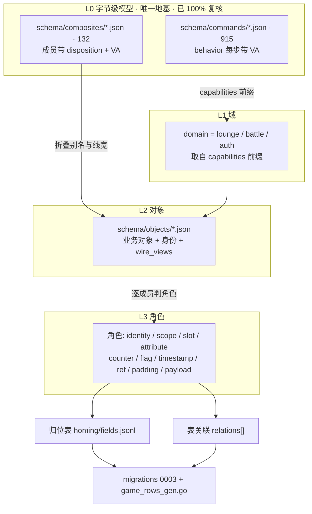

# 05 · 字段功能归位与数据库重做（域 → 对象 → 角色）

> 上游：[`00-设计原则.md`](00-设计原则.md)（三层模型、`disposition`）、[`01-命令模型.md`](01-命令模型.md)（915 条字节级模型，全部 `ASM-VERIFIED`）。
> 本篇是**数据库重做**的开工口径：先说清现库为什么乱，再定「字段功能怎么归位、表怎么关联」，
> 最后给推翻 `game.*` 的路径。命令模型本身**不动**。

---

## 1. 为什么必须重做

### 1.1 今天的链路是「线形 → 表」，不是业务建模

```
composites/(132 线布局) → entities/(73 规范线形) → tables/(76) → plan.py → migrations/*.sql + game_rows_gen.go
```

每一步都是**按线结构体一对一映射**，中间没有任何一步回答「这是什么业务对象、这个字段是什么角色」。
后果是六个可实测的缺陷：

| # | 缺陷 | 实测数字 |
|---|---|---|
| 1 | **表 ≈ 线结构体，不是业务对象** | 「机体」被切成 5 张表（`tbl_ms` / `tbl_ms_rokaku` / `tbl_ms_set` / `tbl_equip_set` / `tbl_missionunit_set`）；「机师」被切成 4 张表（`game.pilot` / `pilots_list` / `pilot_detail` / `pilot_meta`） |
| 2 | **零关联** | `schema/relations.json` 的 `relations[]` 是**空数组**：76 张表、0 条外键 |
| 3 | **字段功能无处可查** | 命令层 `fields[].disposition` = **3779/3782 TBD**（99.9%）。只有 composite 成员有口径：1284 `PERSIST` / 225 `EVENT` / 61 `TBD` |
| 4 | **命令→库覆盖仅 9%** | 81/915 条命令有 `db_effects`（213 条 effect），且只到**实体级**、不到字段级 |
| 5 | **行键靠字段名猜** | `plan.py:36` 的 `SLOT_SOURCES=("slot","inv_place","db_index")`；只有 **8/76** 张表显式声明了 `row_key` |
| 6 | **20 张 `EVENT` 表是死重**（收口 §2 时补判 `fire_point`，实际 21 张） | §3 明写 `EVENT` 不建列，它们却在 DDL 里；而 `battle/room.go` 的 `Room.Settle` 是 **no-op**（注释：字段级持久化推迟到 B6） |

### 1.2 最刺眼的物证：「机体」家族的折叠链

`entities/ms.json` 的 `wire_forms` 直接写明**同一个对象有两种线宽**：

```json
"wire_forms": [
  {"name":"battle","length":244,"memory_claim":264,"commands":["SC-0x1E2F-battle-msma_spawn_list_get_r_one","SC-0x717D-battle-entity_msma_appear"]},
  {"name":"lounge","length":299,"memory_claim":312,"commands":["SC-0xA832-lounge-msma_add"]}
]
```

而 `composites/` 里同一族的线布局有三个宽度，**成员名字大量重叠**：

| 复合体 | 线长 | 槽 | 成员数 | 关系 |
|---|---|---|---|---|
| `ms` | 244 | 264 | 43 | 战斗快照线形 |
| `ms_lounge` | 303 | — | 36 | `prefix_of: ms_rokaku` |
| `ms_rokaku` | 401 | 416 | 39 | 机库全量线形（持久化本体） |

`ms.json` 成员（`uniqid` / `msma_id` / `decal` / `color` / `cost` / `is_costover` / …）与
`ms_rokaku.json` 成员**逐名重合**，只是 disposition 不同（前者 `EVENT`、后者 `PERSIST`）。

**这说明**：`tbl_ms`（EVENT）与 `tbl_ms_rokaku`（PERSIST）是**同一个业务对象**的两个线宽视图，
不是两张表。今天的建模把它们建成两张表 + 两张 EVENT/PERSIST 表，纯属按线形切。

对照服务器侧手写代码——`store/ms_rokaku.go` 的 `msRokakuScalarCols` 白名单（30 列）
里就有 `decal` / `color` / `is_costover` / `cost` / `msbits` …，正是 `ms.json` 里被标成 `EVENT` 的那些字段。
**同一个字段在两处被标了相反的 disposition**，而两边都没有权威来源。

### 1.3 归纳

现库的问题不是「列设计得不好」，而是**缺一层业务模型**。字段没有角色、表没有边界、表之间没有关系，
所以：服务器不知道该在哪张表找什么；GM 后台只能靠 `information_schema` 动态猜；
两个人写同一份数据（`pilot_avatar.go` 里三处镜像 UPDATE）而没有任何约束。

**结论：不修补，重做。** 以 915 条字节级模型为**唯一地基**重新推导——因为字节模型是唯一
「每条结论都带汇编 VA」的权威层，而它现在刚好 100% 复核完毕。

---

## 2. 地基：字节级模型里已经存在的判据

重做**不需要回 IDA 重取**。归位需要的四类信号在复核完的模型里已经全在：

### 2.1 数据流向是干净的二分（最重要的判据）

对 915 条命令的 `behavior[]` 做全量统计：

| 方向 | `write_*` 步数 | `read_*` 步数 | 按命令 |
|---|---|---|---|
| **CS**（客户端→服务端） | **1304** | **0** | 351/351 全部 `write>read` |
| **SC**（服务端→客户端） | **0** | **2616** | 564/564 全部 `read>write` |

**零反例。** 于是：

> **CS 字段 = 客户端供给的写入值；SC 字段 = 服务端供给的读取值。**

这就是「谁拥有这个字节」的直接答案，也是「字段功能归位」的第一根支柱：
一个字段出现在 CS 侧，它就是**写入值**（应落库）；只出现在 SC 侧，它就是**读出值**（可能落库、也可能算出来）。
`SC` 侧字段一律**不得**由客户端写入，`CS` 侧字段一律**不得**当权威读出源。

### 2.2 函数标签已经存在

`schema/commands/*.json` 的 `capabilities[]`（**915/915 条都有**）分两类：

- **域对象标签**（`域.对象`，260 种）：`lounge.clan`(16) / `lounge.pilot`(14) / `battle.commander_support`(14)
  / `lounge.mail`(13) / `battle.ai`(13) / `lounge.xwar_booking`(12) / `lounge.item`(11) …
- **动词标签**（闭集）：`query`(249) / `update`(192) / `unclassified`(185) / `create`(112)
  / `battle_action`(97) / `flow`(77) / `settle`(62) / `delete`(58) / `notify`(39) / `validate`(20)

域对象标签是**现成的对象枚举抓手**（口径见 [`02-命令能力表.md`](02-命令能力表.md) §2.2）。

### 2.3 配对命令给出读写对

202 条命令带 `pair`，其中 **181 条是 CS↔SC 跨向配对**（`pair` 方向组合：CS→SC 153、SC→CS 28）。
一对「CS 写 + SC 读」就是**同一个对象的一次完整事务**，这是校验归位正确性的天然锚点。

### 2.4 可达性近乎完整

- **126/134** 个 composite 可从命令侧（`composite_ref` / `element_composite_ref` / `struct_ref`，扫 `schema/commands/*.json` 全文）触及；
- **1119/1182** 个 `PERSIST` 成员属于可达复合体（按 `homing/objects/*.json` 的 `lifetime` 与 `views` 统计）。

> **重算（2026-09-30）**：本行原先记的「128/133、1280/1284」是更早一次人工点名 —— 成员总数
> **1284** 与引擎今天的 **1182**（`derive_homing.py --report` 的 `PERSIST=1182`）已对不上，说明
> 那两个数是旧状态的快照。上表按 `composite_ref`/`element_composite_ref`/`struct_ref` 三键重扫，**以本行为准**。

仍不可达的 **8 个**：`bracket_node` / `clan` / `cshist_item` / `cupteam` / `evflag3` /
`examination_state` / `msdeck_entry` / `party`。它们要在归位引擎里单独登记，不许静默丢掉
（`missionunit` 一族有手写写入路径 `lounge/missionunit_write.go` → `game.missionunit_set`，
且今天已由 `SC-0x36D9` 引用，**不在本清单**）。

★ `sort_info_invite` **已从清单移出**（2026-09-30）：`CS-0x49D1` 的 `sort_info` 字段类型已按打印器
`sub_B4EEF0` 改正为 `struct<sort_info_invite>`（`composite_ref` 指向它）。改正前该行挂的是 18B 的
`struct<sort_info>` ⇒ 9B 短形在"命令侧"没有第二只眼，才被算成不可达。同批被移出的还有 `ms` /
`ms_lounge` / `missionunit`。详见 §9.19 末节与 `长期记忆` §73。

### 2.5 已知数据缺口（顺手登记，不在本轮修）

- `schema/待补清单.md`：**23 条命令**的元素复合体在 `composites/` 里没有一致定义，下游只能按不透明块搬；
- **3 条** CS 命令的 `pair` 指向不存在的命令；
- **185 条** 命令的动词标签是 `unclassified`（无函数名可锚，只能靠字节结构推）；
- `entities/ms.json` 的 `lounge` 线形记 **299**，而 `composites/ms_lounge.json` 记 **303** —— 两处不符，需单独取证。

---

## 3. 目标模型：三层



| 层 | 是什么 | 出处 | 落在哪 |
|---|---|---|---|
| **L1 域** | 大分类 | `capabilities[]` 的 `域.` 前缀 | `objects[].domain` |
| **L2 对象** | **业务对象**（可持久化的实体） | `entities` 折叠（别名/同构/前缀 + 多线宽合并） | `schema/objects/*.json` |
| **L3 角色** | 字段在对象里**干什么** | 字节结构与 `behavior` 读写方向 | 归位表 `role` 列 → DDL 列 |

**与旧三层的关系**：

| 旧 | 新 | 变化 |
|---|---|---|
| Wire 字段（`schema/fields/index.json` 草稿） | **保留**，只作证据索引 | 不变 |
| Canonical 实体（`entities/` 73） | **折成对象**（`objects/`，预计 40–60） | 别名/前缀/多线宽合并 |
| DB 列（提议）（`tables/` 76） | **废**，降级为 `_legacy_tables/` 留档 | 不再驱动 DDL |

> **`tables/` 不是被删，是被降级**：它记录了「当年按线形提过哪些表」，有价值可追溯；
> 但 DDL 的唯一来源改为 `objects/`。

---

## 4. 归位规则

规则分五组，**能判定的优先自动判定，判不定的进 `unresolved.md` 走人工批次**（口径同
[`01-命令模型.md`](01-命令模型.md) §8 的批次纪律）。每条推导都必须带 VA 证据，**禁止臆造**。

### A. 对象边界（折叠 vs 拆分）

| 规则 | 判定 | 例子 |
|---|---|---|
| **A1 别名折叠** | `layout_same_as` / `alias_of` / `prefix_of` 链 → 同一对象 | `dcpoint_detail`→`dc_point`；`ms_lounge`→`ms_rokaku`；`mprogress`→`progress` |
| **A2 多线宽折叠** | 同一对象的不同 `wire_forms` → **一个对象 + N 个 `wire_views`** | `ms`：battle 244 / lounge 299 / rokaku 401 |
| **A3 声明键拆出** | 有独立 `row_key` 声明 → 独立对象（当前 8 张） | `adop_list` / `buildup_info` / `equip_set` / `missionunit_set` / `ms_rokaku` / `ms_set` / `unlocked_navi` / `unlockw` |
| **A4 子对象** | 共享父身份（`uniqid`）但自带槽位键（`deck_slot` / `equip_set_slot` / `db_index`）→ 子对象 + FK | `ms_set.deck_slot` → 父 `ms_rokaku.uniqid` |
| **A5 判不定** | 上述都不命中，且无 `capabilities` 域对象可锚 → `unresolved.md` | — |

### B. 字段角色（十类，闭集）

| 角色 | 判定规则 | 落列 |
|---|---|---|
| `identity` | 在 `row_key.columns`，或名 ∈ `{uniqid, uniqid_ms, item_id, msma_id}`，或被他对象当外部键引用 | **PK/唯一键** |
| `scope` | `world_id` / `pilot_id` | **PK 前缀**（见 §6 硬约束） |
| `slot` | ∈ `{slot, deck_slot, db_index, inv_place, equip_set_slot, elem_index}` | **PK 一部分** |
| `counter` | 值驱动同结构数组条数（模型里已有 `count_field` / `length_is_elem_width`） | 普通列（**不落长度**） |
| `flag` | `is_*` / `has_*` / `*_bits`，或 u8/u16 且枚举仅 2 值 | `BOOLEAN` 或 `SMALLINT` |
| `timestamp` | `tm_sec` / `tm_usec` / `*_time` / `expires_at` | 普通列（**注意 `tm_sec`/`tm_usec` 是游戏内时刻，不是墙钟**） |
| `ref` | 角色为 `identity` 且名字匹配另一对象的身份成员 | **FK** |
| `padding` | `pad[N]` / `tail_pad` / `reserved` | **不落库**（编码补零） |
| `payload` | `shape ∈ {opaque, opaque_array}` | 未分解块，**标缺口**（禁 `BYTEA`，按整型数组搬） |
| `attribute` | 兜底：其余标量/文本/原生数组 | 普通列 |

### C. 生命周期（`PERSIST` / `EVENT` / `TBD`）——**按对象级合并，不按线形视图**

这是从 §1.2 的 `decal` / `color` 冲突得到的口径修正：

> 一个字段的 disposition 若在不同 `wire_views` 里不一致，**取 `PERSIST` 优先**，
> 并在归位表里记下「哪些视图标了 EVENT」。理由：`ms.json`（战斗快照）把 `decal`/`color` 标 `EVENT`
> 是因为**快照本身**是 ephemeral，不是因为**这个字段**不持久化——
> `store/ms_rokaku.go` 的白名单证明它们是要落库的。

- `PERSIST` → 进 `game.*` DDL；
- `EVENT` → **不进 DDL**（口径同 [`00-设计原则.md`](00-设计原则.md) §3）。战斗侧持久化是**另一轮**工作
  （对应 `battle/room.go` 注释里的 B6）；`EVENT`/`TBD` 根对象现在的确切清单（21 个：域 / 线长 /
  CS 写方 / SC 读方 / 现成身份候选列）见 [`schema/_meta/b6_event_tables.md`](../schema/_meta/b6_event_tables.md)，
  由 `tools/report_b6.py` 生成，B6 开工时按它逐条定「身份列 + 写入方」；
- `TBD`（62 个成员）→ 进 `unresolved.md`。

**「不建表」在两处同时兑现**（缺一处就会长出幻影表或野表）：`derive_homing.py::build_table_graph`
对非 `PERSIST` 对象不建表、非 `PERSIST` 子对象不建子表（且把 `table` 置空、写 `no_table_reason`）；
DDL 生成器 `schema_design/plan_objects.py` 只收 `disposition == PERSIST` 的对象。
`serverv/tools/verify_no_blob.py` 的「表集合双向一致（禁幻影表）」门把这两侧钉在一起：
**非 `PERSIST` 对象不得带任何表**，且 **DDL 里每张 `game.*` 表都必须能被模型解释**
（例外只有手写迁移建的表，登记在 `HANDWRITTEN_GAME_TABLES`）。

### D. 写入归属（对象 × 命令 × op）

| 规则 | 判定 |
|---|---|
| D1 | CS 命令 + 动词 ∈ `{create, update, delete, settle}` + 可触及该对象 → **写入者**，`op` = 动词 |
| D2 | SC 命令 + 触动该对象 → **读取者** |
| D3 | 已有 `db_effects`（81 条 / 213 effect）为**权威覆盖**，优先于任何推导 |
| D4 | `pair` 对（CS↔SC）→ 校验：写入者与读取者应指向同一对象，否则进 `unresolved.md` |

产出「**谁写谁读**」矩阵——这是服务器业务逻辑直接可用的部分，也是替代今天靠人肉维护
`store/*.go` 里那些手写 SQL 的基础。

### E. 行键与关联

- **PK** = `scope`（`world_id`, `pilot_id`）+（`identity` 与/或 `slot`）；
- **FK** = `role=ref` 的字段 → 目标对象的身份列；跨 schema 的 `pilot_id` → `core.pilot_registry`；
- **父子**：数组元素的复合体 → 子表 + `elem_index`（沿用现 `plan.py` 的处置）；
- **悬空 FK**（目标对象不存在）→ `unresolved.md`，**不许静默丢**。

### F. 线布局的三种形态（根 / 子 / 内联）——P2 从旧 DDL 反推的判据

`composite_ref` 与 `element_composite_ref` 是**两种不同的东西**，旧 `plan.py` 已经在这么做，
但 `tables/` 那一层没有把它显式化。归位时必须显式判定，否则会把「内嵌结构」和「数组元素」
都建成分立表（`game.avatar` 这种没有自己身份的壳表就是这么来的）。**引擎已按本表判定形态**
（`assign_shapes()`），但**尚未据此改表集**——「不建内联表」这条要等 P3 定稿才生效：

| 形态 | 线里的写法 | DDL 处置 | 旧库物证 |
|---|---|---|---|
| **根** | 命令顶层（或其 `array<...>` 元素） | 独立表 `game.<对象>`，PK = scope + own | `game.pilot` / `game.ms_rokaku` |
| **子** | 被另一复合体当 `element_composite_ref` | 子表 `game.<父>__<子>`，PK = 父键 + `elem_index` | `game.ms_rokaku__weapons` / `game.bracket__nodes` |
| **嵌套** | 只被当 `composite_ref`（无数组） | **每个父一张 1:1 表** `game.<父>__<子>`，PK = 父键（无 `elem_index`） | 旧库内联成 `game.pilot.avatar_*` |

> **口径已定（人工裁决）**：嵌套结构**独立成表 + FK 到父**，不内联。代价是父表不再有 `avatar_*` 列，
> `store/pilot_avatar.go` 的三条镜像 UPDATE 要在 P5 改成写 `game.<父>__avatar`（本轮已确认可改）。
> 好处是 `avatar` 这种被 8 个对象引用的结构不必在 8 张父表里重复一套列、且能建真外键。

判定优先级：**根 > 子 > 嵌套**（一个复合体可能既被嵌套引用又被当数组元素，如 `pilot`：
被 8 个复合体当 `composite_ref`、同时是命令顶层的 `array<pilot>` 元素 → 判「根」）。

`avatar` 是最干净的判据样本：`composites/avatar.json` 被 **8** 个对象（16 个复合体）当
`composite_ref` 引用、从没当过数组元素 → 8 张 1:1 表。
它的 `avatar_id` 语义是「外观**模板** ID」（master data），**不能**当行身份——行身份只能来自父键。

#### F.1 三条列命名约定（旧库已如此，P4 必须照抄）

这三条不是洁癖，是**手写面正在依赖的既成事实**：

| 约定 | 规则 | 旧库物证 |
|---|---|---|
| **scope 恒注入** | 每张 `game.*` 表**无条件**注入 `world_id` + `pilot_id` 两列（§6.1 不变量）。非机师维度的表（军团/排行）`pilot_id` 填 **0** 哨兵 | `game.clan_eff` / `game.ranking` 都有 `world_id,pilot_id` |
| **scope 撞名加前缀** | 线成员自己叫 `pilot_id` / `world_id` 而表已注入同名 scope 列时，成员列改为 `<表>_<成员>` | `ranking.pilot_id`（线）→ `ranking_pilot_id`（列）；`clan_eff.world_id`（线）→ `clan_eff_world_id`（列） |
| **内联加前缀** | 内联子结构的成员 → `<子结构>_<成员>` | `pilot.avatar.gender` → `pilot.avatar_gender` |

> 注意 `game.ranking` 同时有注入的 `pilot_id`（行主）与线成员 `ranking_pilot_id`（被排行的那个机师）——
> **两者语义不同**，前者是行主、后者是数据。归位时 `ranking_pilot_id` 是 `ref`（→ `core.pilot_registry`），
> 注入的 `pilot_id` 是 `scope`。混为一谈就会把「谁的排行」和「排行里是谁」写反。

### G. P2 实测结果（引擎首轮 + 旧库对账）

引擎：`tools/derive_homing.py --write`；对账：`tools/reconcile_legacy_ddl.py`；守卫：`tools/_survey_homing.py`。

| 折叠 | 132 线布局 → **105 对象**（98 根 / 3 子 / 4 嵌套），**18 个折叠束**。效果最大的是 `lpcard`——7 个线布局（`block_detail` / `clan_member_card` / `friend_detail` / `friend_histories` / `lpcard` / `member_info` / `mshipbid_card`）全折成 **1 个对象**；`challenge_info` 折 4 个 |
|---|---|

**表账**：对象投影出 **112 张表** ——
`PERSIST` **93**（79 根 + 11 嵌套 + 3 子表，全部可进 DDL）、`EVENT` 13（不建表）、`TBD` 6（不建表）。
其中 `PERSIST` 根的 79 张里，66 张沿用旧表名、13 张是新建。
56 张旧 `PERSIST` 表 → 46 张沿用 + 10 张被折叠吸收（`tbl_toppilots`→`ranking`、
`tbl_ranking_info`→`order`、`tbl_trchallenge_info`→`challenge_info` …）；另有 24 张全新表。
`avatar` 按「独立成表」口径展成 **8 张** 1:1 表（`game.pilot__avatar` / `game.ranking__avatar` …）。

**自然键对账**（新 PK vs 旧库 UNIQUE 索引，同名根表；`tools/reconcile_legacy_ddl.py`）：

| 结果 | 数量 | 说明 |
|---|---|---|
| **完全一致** | **31** | 自然键推导与旧库唯一索引完全吻合（含 `item`，见下） |
| 新键比旧键**细** | 5 | `bracket_info` / `clan_eff` / `challenge_info` / `replay_info` / `roominfo`——新模型多一个自身身份列。多半是新模型更准（旧库把多行压成一行），但仍需人判 |
| 新键比旧键**粗** | 6 | `lpcard` / `leaders` / `ranking` / `recruits` / `party_member_stat` / `item_list`——旧库多一列 `slot` |
| 新建表（无旧索引可对） | 37 | — |

那 6 张「新键比旧键粗」**不是回归**，证据在旧 `plan.py`：

* `plan.py:318-320` 自陈「实体在命令里以 `array<...>` 出现、但表本身没有槽位字段：保留合成的 slot 列（**旧行为，值恒为 0**）」；
* 实测现网 `game.pilot` 全表 2 行、`slot` 全为 0。

即旧 UNIQUE 的 `(world_id, pilot_id, slot)` 中 `slot ≡ 0`，与新的 `(world_id, pilot_id)` **语义等价**，不会丢行。
（但这批实体在线上是 `array`，理论上应按数组下标分行——旧库没做。是否改判 `elem_index`，见 `_meta/batch_06.md`。）

`item` 是唯一的**真差异**，已用 `_overrides.json` 钉死：`pk:item=["inv_place"]` + `colname:item.inv_place="slot"`。
依据是 `plan.py:36` 的 `SLOT_SOURCES = ("slot","inv_place","db_index")`——旧库 `game.item.slot` **就是** `inv_place` 的值
（不是恒 0 的合成列），且 `store/shop_buy.go` 按 `slot` 寻址、现网有 `uq_game_item_world_pilot_slot`。
引擎另有配套改动：**锚点旧表的非复合体列会并入对象**（`inv_place` 不在 `item` 复合体里，靠这条才没丢），
这样 `item` 的 6 列与现网 DDL 逐列对齐。

`avatar` 的差异是另一个方向：`avatar_id` 的语义是「外观**模板** ID」（master data），
不该当行身份；它已被判为内联对象，不再是表。

**其它指标**：`fields.jsonl` **1513** 行；`relations.json` **81 条真实 FK**（+ 48 主数据 / 13 战斗句柄 /
16 已归类模型外引用，见 §9.2）；无出处成员 **0**。

### G-未决（需人工拍板，已抽成批次）

| # | 未决 | 批次 | 说明 |
|---|---|---|---|
| 1 | ~~33 个 PERSIST 根对象无行键~~ **已收口（0 未决，判据已收紧到 62 条）** | `_overrides.json.reviewed.batch_10/batch_12` | 62 个无自身行键的 `PERSIST` 根逐条裁完：**25 单行** + **37 暂无写入方**。`coverage()` 现在只认 `pk_members`（不再因对象带 scope 列而豁免），所以「SC 当顶层数组下发的他人卡片/排行/成员列表」也被收进来，见 §9.3 |
| 2 | ~~65 条引用未解析~~ **已收口（0 真未决）** | `_overrides.json.ref_stem` / `reviewed.batch_11_ref_closure` / `batch_14_party_root` | **76 条全部归类**：48 主数据（`cfg.*` + `srv.shop_lineup`）+ 13 战斗期句柄 + 14 已归类模型外（候选主数据 5 / 世界级实体 3 / 本地表资源 4 / 值对象 2）+ 其余落 `game.*` FK 或自指身份。其中 `clan_id` 一族与 `cupteam_id`/`win_team_id`/`party_id` 已随「声明式根对象」升为**真 FK**（§9.5），`world_entity` 只剩 `tournament_id`（3，0 个 CS 写方，**枚举式证明**见 §9.7）。解析顺序：作用域维度 → 词干人工裁决 → 对象索引 → **身份列名命中**（`room_id` → `roominfo.room_id`）→ 词干模糊（多命中时先问 cfg 主数据，再认「命中对象里唯一同名身份列」）→ cfg 主数据 / 战斗句柄。详见 §9.2 |
| 3 | 20 组同形线未折叠 | `homing/_overrides.json.reviewed.batch_09_same_shape_write_read` | `bmgpack`↔`item_list`、`favms`↔`favms_add`、`pcard`↔`pilots_list` 等，已逐组核过写方/读方/视图归属：只折了 `missionunit`→`missionunit_set`，其余保持不折 |
| 4 | ~~**数组成员与根对象重叠**~~ **已收口（只留一张根表）** | `_overrides.json.reviewed.batch_16_member_rows_in_root` + `member_rows_in_root` | `ms_rokaku.weapons` 的元素类型 `unlockw` 自己又是根对象（有行键），旧库同时建了 `game.unlockw` **和** `game.ms_rokaku__weapons`——同一批行两张表。裁决 **只留 `game.unlockw`**，退役 `game.ms_rokaku__weapons`，父记录里的 `weapons[3]` 降为**指向根表的线形视图**（`view_of_root` + `view_rows`）。判据：① 行身份在元素自己身上（`db_index` =「数据库索引」，写方 `CS-0x550A`/`CS-0xA28F` 不带数组上下文，服务端分配后经 `SC-0x45E4`/`SC-0x81FB` 回告三元组）；② 全量读法只有 `SC-0xA832` 的顶层数组 `unlockw[30]`（同报文的 `ms` 是 303B 轻量形，不含 `weapons`）；③ `ms_rokaku` 是 401B 定长记录、偏移 303 只带 `3×32B` 槽 ⇒ 那是窗口不是行集。详见 §9.8 |
| 5 | ~~**`item` 的键必须是 `slot`**~~ **已钉死** | `_overrides.json` | `store/shop_buy.go` 用 `WHERE world_id,pilot_id,slot` 寻址并 `INSERT ... slot`；模型里对应成员是 `inv_place`。已用 `pk:item=["inv_place"]` + `colname:item.inv_place="slot"` 订正为列名 `slot`，对账已一致 |
| 6 | ~~**33 个 PERSIST 根对象无自身行键**~~ **已收口** | `reviewed.batch_10/batch_12` | 25 单行 + 37 暂无写入方；判据只认 `pk_members`（scope 列不再是豁免理由） |
| 7 | **`is_root` 口径已修** | — | 曾用「有 PK/有 scope/有旧表」判根，导致 `bmgpack` 这类「命令顶层 `array`、但线里无 scope 列」的对象被误判成非根，**守卫漏检其表名**。现改为结构判定（`shape == root`），并把 `roots_without_pk` 指标限定在 `PERSIST`（`EVENT`/`TBD` 不建表，计入会虚高） |
| 8 | **引用已分三类** | `relations.json` | `relations[]` 只放 `game.*` 真外键（85 条：`scope_fk` + 身份列名命中 + 词干裁决出的真 FK，本轮新增 4 条 `party`）；`master_refs`（48）/`runtime_refs`（13）/`categorized_refs`（14）单列。判据见 `§4.E`——**禁止**把主数据或战斗句柄混进悬空集合，否则会虚报「缺了一批外键」 |
| 9 | **11 张表与旧库 UNIQUE 对账不一致** | `_meta/batch_06.md` | 5 张「新键更细」（新模型更准还是旧库压行？）+ 6 张「新键更粗」（旧 `slot` 恒 0，见 §4.G）。**P3 定稿前必须逐张过**——「新键更粗」若判错方向会静默丢行 |
| 10 | **锚点旧表的非复合体列并入对象** | — | `tbl_item` 的 `inv_place` 不在 `item` 复合体里，原先被丢掉 → `game.item` 少一列、PK 错判。现按表定义的列并入（`anchor_column`），`item` 6 列与现网 DDL 逐列对齐 |
| 11 | ~~**40 个无自身行键的 PERSIST 根**~~ **已收口（0 未决）** | `_overrides.json.reviewed.batch_10_pk_closure` | 逐条过「旧库 UNIQUE 列序 / 成员 / CS 写方 / SC 读方 / `multi` / 命令顶层数组」后分三类落定：**25 单行**（旧库 UNIQUE 就是 `(world_id,pilot_id)`，或旧 `slot` 是恒 0 合成列）+ **14 暂无写入方**（0 个 CS 写命令，只在 SC 下发；接入写入方前必须先定身份列）+ **1 改判 `EVENT`**（`fire_point`：一次齐射的弹着点数组，战斗 ephemeral，本就不该建表 → 见 `§9` 的 EVENT 表移除项）。`coverage()` 现在把 `singleton`/`no_writer` 两类从 `roots_without_pk` 里移出单列（`§2b`/`§2c`），留下的才是真未决——守卫从「等拍板」变成「回归即失败」 |

---

## 5. 交付物

| 文件 | 内容 |
|---|---|
| `schema/homing/fields.jsonl` | **归位表**（主交付）。一行一个字段实例（1520 行） |
| `schema/homing/objects/*.json` | **对象模型**（129 个：根 118 / 值 11），含 `shape` / `tables[]` / `keys` / `columns[]` / 证据，**取代 `tables/` 成为 DDL 唯一源**。其中 3 个是**声明式根对象**（`clan` / `cupteam` / `party`，来自 `_overrides.json.new_objects`，成员取自手写复合体，见 §9.5） |
| `schema/homing/relations.json` | `relations[]`（85 条 `game.*` 真外键）+ `master_refs`（48，`cfg.*`/`srv.*` 主数据）+ `runtime_refs`（13，战斗句柄）+ `categorized_refs`（14，已归类模型外）+ `dangling`（0） |
| `schema/homing/roles.json` | 角色词表 + 角色 → PG/Go 类型映射 |
| `schema/homing/summary.json` | 门指标（`gates`）+ 覆盖率，供 CI 与 P6 覆盖率门消费 |
| `schema/homing/unresolved.md` | 引擎判不了的，**分栏**：§3 真未决引用（已空）/ §3b 主数据 / §3c 战斗句柄 / §3d 已归类模型外 / §4 TBD / §5 对象边界 / §6 跨线形宽度差异 |
| `schema/homing/_overrides.json` | **人工裁决**（引擎不清它）：`pk`（item/news/party_member/party_member_stat）/ `colname` / `fold` / `disposition` / `singleton`（25）/ `no_writer`（35）/ `new_objects`（3 个声明式根对象，§9.5）/ `inject_members`（外部行键注入，§9.6）/ **`ref_stem`（47 条词干级引用裁决：主数据 22 / 外键 14 / 模型外 9 / 战斗句柄 1 / 非引用 1）** |
| `schema/composites/*.json` | **线复合体**（134 个）。除从命令字段表自动生成的之外，`clan` / `cupteam` / `party` 是**手写件**（`status=complete`，成员逐列带 `wire_sources` + VA），`generate_all.py` 只补缺、不覆写 |
| `schema/_legacy_tables/` | 旧 75 表降级留档（不再驱动 DDL；表声明由 `_meta/legacy_evidence.json` 冻结） |
| `schema/_meta/legacy_evidence.json` | **冻结的旧库证据**（旧表声明 + 旧库实况列序/列类型/列注释、唯一键列序）：旧库删除后，`singleton`/`slot`/`reserved` 这些裁决的依据就只剩这一份（§9.4） |
| `schema/_meta/ida_send_names.txt` | **客户端发方全集**（IDA 扫断言串导出，345 条）：证明「0 个 CS 写方」这类否定断言的底账，与 `commands/` 的 CS 命令集**一一对应**（§9.7，守卫 14 每次重比） |
| `tools/derive_homing.py` | 归位引擎（幂等：同输入同输出，逐字节一致） |
| `tools/freeze_legacy.py` | 冻结旧库证据 → `_meta/legacy_evidence.json`（`--check` 进 CI；只增不减：无 dump 时复用冻结值） |
| `tools/review_homing.py` | 批次化复核 + `_overrides.json` 校验（`--check`） |
| `tools/_survey_homing.py` | **常设守卫**：折叠完整性 / 证据 / 角色闭集 / 表名唯一 / overrides 可解 / `singleton` 证据对得上快照 / **发方表面 ↔ CS 命令集一一对应** |
| `tools/reconcile_legacy_ddl.py` | 与旧库 UNIQUE 对账（列名口径，读冻结证据，不再需要数据库） |
| `tools/build_gm_catalog.py` | 从迁移的 DDL 头注释 + `_legacy_tables`/`cfg/tables` 生成 `serverv/static/gm_catalog.json`（GM 工具的表说明：用途 / 线形 / 行键来源 / 字段列数）；退场表逐条带 `retired` 标记（`folded`/`DERIVED`/`EVENT`/`CONFIG`/`TBD`/`never_live` + 一句理由），`--check` 另守「现役 `game.*` 都有说明条目」——见 §9.12 |
| `tools/report_b6.py` | 非 `PERSIST` 根对象清单 → `schema/_meta/b6_event_tables.md`：**四个桶分别列**（`EVENT` 24 / `TBD` 5 / `DERIVED` 17 / `CONFIG` 2 = 48），前两桶带身份候选与 CS/SC（B6 开工用），后两桶带 `no_table_reason` 首句（已裁决退场）。`--check` 过期即失败（§9.13.5） |
| `tools/report_no_writer.py` | no-writer 桶清单 → `schema/_meta/no_writer_roots.md`（0 CS 写方、无自身身份列）。`--check` 同上 |
| `docs/05-...md`（本篇） | 口径文档 |

### 归位表列定义

```
command        发起命令 id
direction      CS | SC
field_path     对象内的路径（Struct.Member 或 数组元素路径）
wire_type      线类型（照抄，不改）
length         线长（照抄，不改）
object         归入的业务对象 id
wire_view      出现在哪个线形视图（244 / 303 / 401 …）
role           identity|scope|slot|attribute|counter|flag|timestamp|ref|padding|payload
lifetime       PERSIST | EVENT | TBD
writer_cmd     写入者命令（CS 侧）
readers[]      读取者命令（SC 侧）
op             create|update|delete|read|settle|none
table          目标表 game.<x>
column         目标列
is_row_key     bool
fk_target      FK 目标（object.column）
evidence_va    汇编证据地址
```

---

## 6. 硬约束（推翻 schema 也不能碰）

这几条是**服务器侧的既有不变量**，重做 schema 时必须全部保住：

### 6.1 `pilot_id` 语义 = 行主（最危险的一条）

`store/pilot_purge.go` 是**动态扫描 `information_schema`、按 `pilot_id` 删行**的：

```sql
SELECT c.table_schema, c.table_name FROM information_schema.columns c
 WHERE c.column_name = 'pilot_id' AND c.table_schema IN ('game','core','srv')
   AND EXISTS ( ... world_id ... )
```

**每个 `game.*` 表必须保留 `world_id` + `pilot_id` 两列，且 `pilot_id` 必须是行主。**
破坏这条的后果是**静默留下孤儿行**（删号删不干净）。已有 test `TestPilotIdColumnMeansRowOwner` 钉住它。

### 6.2 DDL 与 store SQL 必须逐列相等

`store/no_blob_test.go` 的 `TestGeneratedDDLMatchesStoreSQL` 解析 `0003_game_persist.up.sql`
与 `game_rows_gen.go` 的 `const *SelectSQL`，要求两边的列集**完全相等**。
→ 结论：DDL 与 store **必须同源于 plan**，重生成即可保持绿。

### 6.3 三条「禁 blob」硬门

`no_blob_test.go` + `tools/verify_no_blob.py`：

- `game.*` 禁 `BYTEA`；语义未定的块按整型数组搬（`_OPAQUE_PG`）；
- 源码里禁标识符 `wire_blob` / `WireBlob` / `wire_len` / `WireLen` / `SaveWire` / `GetWire` / `ListWire` / `DeleteWire` / `WireRow`；
- 业务层（`wire`/`gate`/`conn`/`handoff` 之外）禁 `binary.LittleEndian` / `BigEndian`。

### 6.4 GM 动态层假设了键列名

- `internal/gm/server.go`：通用 `GET/PUT /api/game/<table>`，`slot` 特判，列集读 `information_schema`；
- `internal/gm/dbmeta.go`：`pickRowKey` 把行键写死为 `(world_id, pilot_id[, slot|elem_index])`；`gameDomainRules` 按**表名前缀**分类。

→ 改行键命名/表名前缀，必须同步改这两处，否则 GM 后台直接坏。

### 6.5 必须逐个复核的手写面

| 文件 | 硬编码内容 |
|---|---|
| `store/ms_rokaku.go` | `msRokakuScalarCols` —— **30 列白名单**，列名变了就写不进（只增不减会失配） |
| `store/pilot_avatar.go` | 两条 `INSERT … SELECT` 写 `game.pilot__avatar`（行键 `(world_id,pilot_id,slot)`，`slot` 从宿主行 `pilot.slot` 取）/ `game.pilots_list__avatar`（行键 `(world_id,pilot_id)`）+ `pilot_detail` 三列窄写（`hav_avatar` / `hav_voice` / `comment`） |
| `store/pilot_money.go` | `game.pilot_detail.money` 读写 + 守卫写 |
| `store/pilot_rank.go` | `game.pilot` / `pilots_list` 的 `level` / `mil_class`（`GREATEST` 单调升） |
| `store/shop_buy.go` | `game.item` 的 `SELECT/UPDATE/INSERT` + `game.item_uniqid_seq` |
| `store/pilot_monthlypassport.go` | `game.pilot_monthlypassport` 读写 |

### 6.6 洗库口径

- `game.*` **无生产数据、无 seed**（`0003` 本就 `DROP SCHEMA IF EXISTS game CASCADE`），可整块重建；
- **必须保住** `core.*`（`accounts` / `worlds` / `pilot_registry` / `pilot_meta`）与 `srv.*`；
- `game.item_uniqid_seq` 在 `0020`，drop schema 会连它一起掉（已发号不回收）→ 切换流程要**显式重建**；
- 重建后要**删 `meta.schema_migrations` 里 version=3 那行**，否则 `Migrate` 不会重放 `0003`。
- **`Migrate` 现在带一把会话级咨询锁**（`store/migrate.go`）：`go test ./...` 并行跑多个包，
  每个包 `Open` 都调一次 `Migrate`，两个会话同时看到「version=3 未应用」时会出现「一侧刚 `DROP SCHEMA`、
  另一侧正在读表」——实测过一次真库用例偶发失败（`remaining_days` 读到空）。锁挂在**独占的一条连接**上
  （`pool.Exec` 可能换连接，会放不掉锁）；生产只有一个进程迁移，锁只对并行测试有意义。
- `derive_homing.py::_clean_outputs` 也改成了**逐个删文件**：Windows 上 `objects/` 目录可能被别的进程
  按句柄占着，`shutil.rmtree` 会**删完里面的文件之后**才在 `rmdir` 上抛 `WinError 32`——
  重跑半途而废，模型处于「已清空、未重写」的破损态（本轮实际踩到一次）。

### 6.7 执行结果（P4–P6 实做记录，2026-09-23）

先生成备份再动生成器：`_backup_before_p4_20260923-071043/`（`plan.py` / `0003` / `game_rows_gen.go` 等原件）、
`_backup_before_modelregen_20260923-074704/`（`composites_gen.go` 等）。仓库无版本控制，回滚点靠这两份目录。

**生成器改造**

| 改动 | 位置 | 为什么 |
|---|---|---|
| 换源：读 `homing/objects/*.json` + `relations.json` | 新 `tools/schema_design/plan_objects.py`（适配器） | 旧 `tables/*.json` 已降级为 `_legacy_tables/`；`plan.py` 的 `TablePlan`/`ChildTable` 接口保持不变，生成器下游零改动 |
| **保留字列名加引号**（`pg_ident`） | `plan.py` + `gen_migration/main.py` + `codecgen/gen_store.py` | `game.world_entry.desc` 触发 `syntax error at or near "desc"`；DDL 与 SQL 文本统一走 `pg_ident`。`pgx.CopyFrom` 要**裸名**（pgx 自己 quote），故只在拼 SQL 处引用 |
| 列名撞车改名 | `derive_homing.py::_finalize_tables` | 对象自身成员与 `world_id`/`pilot_id`/`id`/`updated_at`/`version` 同名时按 `表名_列名` 前缀（`clan_eff.world_id` → `clan_eff_world_id`），保住旧 DDL 里 GM 能看到的行键命名 |
| 「不落库成员」显式化（`notStored`） | `plan.py` / `plan_objects.py` / `gen_store.py` | 模型里有、库里没有的成员（`lifetime=EVENT/TBD`、`padding`、`memory_only`、人工排除）以前会让 `TestRowModelRoundTrip` 报「字段缺失」。现在生成 `notStored []string` 路径表，测试比对前先按路径清零 |
| 内嵌复合体 → `own_table` | `plan_objects.py` 递归建表 | 按拍板（`nested=own_table`）：`avatar` 这类内嵌结构落成 1:1 子表 + 外键回宿主，不再内联成宿主列 |
| 旧表守恒 | `derive_homing.py::build_table_graph` | `schema/tables/*.json` 里每个 `PERSIST` 表都要有自己的根表，除非在 `_overrides.json` 里显式退休；否则 `block_detail` / `friend_histories` / `toppilots` 这类会被 `layout_same_as` 折没 |

**归位定案（本批改写 DDL 形状的两条）**

- `missionunit` → `missionunit_set`：同形「未折对」（`batch_09_same_shape_write_read`），
  `missionunit_set` 为规范形。不折的话 `game.missionunit.deck_set`（`role=slot`）不在主键里，
  `verify_no_blob.py` 的槽位门直接红——折了以后 `deck_set` 进 `game.missionunit_set` 主键。
- `layout_same_as` **不折**：`build_fold` 只认 `prefix_of` / `alias_of`。`lpcard` 那族
  「同布局」不足以说明是同一个业务对象，折了会吃掉一批旧表。

**洗库（drop-replay）实做**

1. `DROP SCHEMA game CASCADE` → `0003_game_persist.up.sql` 重放（`Migrate` 全量）；
2. `game.item_uniqid_seq` 显式重建（原本在 `0020`，随 schema 一起掉）；
3. 删 `meta.schema_migrations` 里 `version=3` 那行，否则不会重放；
4. `core.*` / `srv.*` 未动。

**判据全部满足**：

- `go build ./...` / `go vet ./...` 干净；
- `go test ./...` 真库（`MSGO_TEST_DSN` 指向 `msgo`）全绿——含 `store`（DDL↔store SQL 逐名相等、行模型 round-trip）、
  `lounge`（建号 / 删号归档 / 商店 / 外观链 / msset 装配）、`gm`（动态层行键推导 + 表名分类全覆盖）；
- `tools/verify_no_blob.py` 绿（含槽位键门）；
- 手写面复核：`msRokakuScalarCols` 30 列对 `game.ms_rokaku` 逐列存在，手写裸 SQL 的
  `game.*` 表名 / INSERT 列清单 / UPDATE SET 列名对最终 DDL 全解析（扫描脚本一次性跑，0 问题）。

**知识库同步**：`site/homing/` 新增「归位库」栏目（由 `tools/build_homing_site.py` 渲染，
127 张对象页 + 总览 + 逐列覆盖率 + 关联 + 未决清单）。它把 DDL 侧事实（解析 `0003`）与
归位侧推理（`homing/*.json`）并排渲染，两边的列名/类型/出处对不上会立刻看出来；
旧提议表页降为「旧表留档」。首页与导航已改指向新栏目。

**收口补充（2026-09-23 第二轮：无身份根 + 生成物漂移）**

| 改动 | 位置 | 为什么 |
|---|---|---|
| 无身份根三类裁决 | `_overrides.json.singleton` / `.no_writer` / `.disposition` + `derive_homing.py::{pk_gap_decisions,coverage,apply_overrides}` | 40 条逐条裁完（25 / 14 / 1），`roots_without_pk` 归零；`§2b`/`§2c` 单列已裁项，避免每跑一次守卫重看同一份清单 |
| 对象级 `disposition` 订正 | 同上 | `fire_point` 自动导入随了 `PERSIST`，按 `docs/00 §3` 改判 `EVENT` → 从 `0003` 移除（EVENT 表移除批次第 21 张），DB 侧 `DROP TABLE game.fire_point` 对齐 |
| `multi` 只看 **CS** 顶层数组 | `derive_homing.py::wire_shapes` | SC 读侧下发数组也曾让对象变成「根」→ 多出 `game.rental_module` / `game.favms` / `game.examination_item` 三张没有客户端写入方的重复表。收窄到 CS 后它们退回各自父表的子表（`game.pilot_detail__hav_rental_modules` / `game.pilot_detail__favms_arr` / `game.exam_state__examination_list`） |
| 协议编解码换用具名复合体类型 | `serverv/tools/codecgen/main.py` 重生成 + 手写面 2 处（`internal/agent/server.go`、`internal/lounge/b1_lists.go`） | `db_design/schema/commands/*` 补齐证据后，`composite_index` 为 `SC-0x298E` 解析出 `world_entry`、`SC-0x0906` 解析出 `navi_entry`，生成物从匿名 `…WorldsElem` 换成 `[]model.WorldEntry`；手写面跟着换类型（`[]byte` 字段也变 `string`） |
| 非 `PERSIST` 对象不再带幻影表 | `derive_homing.py::{_project_base,build_table_graph,coverage}` + `serverv/tools/verify_no_blob.py::check_table_sets` | 21 个 `EVENT`/`TBD` 根此前在 `objects/*.json` 里仍写着 `tables: ['game.xxx']`，站点照渲染成一张「库里没有的表」。现在它们 `table=""`、`tables=[]`，并写 `no_table_reason`；另加**双向门**：非 `PERSIST` 对象不得带表，且 DDL 每张 `game.*` 表都要能被模型解释（手写迁移建的表登记在 `HANDWRITTEN_GAME_TABLES`）。测过门会真的报红 |
| B6 入口清单 | 新 `tools/report_b6.py` → `schema/_meta/b6_event_tables.md` | 21 个不建表的根对象逐条列 域/线长/成员数/CS 写方/SC 读方/身份候选，B6 开工时不必重翻命令表；`--check` 可作 CI 一致性校验 |

**收口补充（2026-09-23 第三轮：引用归类 + 守卫收紧）**

| 改动 | 位置 | 为什么 |
|---|---|---|
| **引用全归类** | `_overrides.json.ref_stem`（新段，48 条）+ `derive_homing.py::{_id_forms,_stem_verdict,_identity_hit,resolve_ref,assign_roles,explained_refs}` + `_survey_homing.py` 两道新门 | 当前已裁定 76 条引用：49 主数据 / 12 战斗句柄 / 13 模型外 / 2 非引用；本轮补齐 `mapgimmick_entry.local_ctrl_id` 后归类门禁 **0 未归类**（§9.2；世界级实体 24 → 建根表后剩 5）。`kind=notref`（名以 id 结尾但不是引用 → 转 `attribute`）与 `kind=dangling`（**判过**但目标不在本轮模型，照常落普通列、只是不指 FK 目标，须带 `category`） |
| **身份列名命中** | `derive_homing.py::_IDENT_INDEX / _identity_hit` | `room`→`roominfo.room_id` 这类「词干撞不上对象名、但字段名就是对方身份列名」的引用现在能自动解，不必逐条人工裁决 |
| **裁决过期检测** | `derive_homing.py::apply_overrides`（`_REF_STEM_HITS`） | 词干裁决是数据，对象改名后可能变成死条；跑完若某条裁决没被问过就报警，逼着清 |
| **无身份根守卫收紧** | `derive_homing.py::{pk_gap_decisions,coverage,apply_overrides}` | 不再用「有 scope 列」豁免 → 又暴露 22 个「SC 顶层数组但按单行建表」的根（他人卡片/排行/战果附属），全部判 `no_writer`（§9.3）；`news` 补身份列 `msg_id`，`comment` 无 id 列仍留 `no_writer` 并记欠账 |
| 主数据目标存在性门 | `_survey_homing.py::_master_tables` + gate 11/12 | `master_refs` 的 `cfg.*`/`srv.shop_lineup.*` 目标必须真在表里（`srv` 表带 schema 前缀，须兼容裸表名）；且每条 `role=ref` 必须有归宿（`fk_target` 或闭集 `ref_kind`），杜绝「静默丢引用」 |
| **DDL / store 跟着行键重生成** | `serverv/tools/gen_migration/main.py` → `0003`、`tools/codecgen/gen_store.py` → `game_rows_gen.go` | `news` 有了自身身份列后 DDL 从 `uq_game_news_world_pilot` 变 `uq_game_news_world_pilot_msg_id (world_id, pilot_id, msg_id)`、`msg_id` 加 `NOT NULL`。同一份 `TablePlan` 也让 store 换形：`Get/DeleteNewsRow(..., msgId)`、`NewNewsRow` 从线结构体取 `msg_id`、`ON CONFLICT` 跟唯一索引逐字对齐。**只改 db_design 不重生成 = 生成物漂移**，本轮一并跑完 |
| `fire_point` 改判流进生成物 | `tools/codecgen/main.py` | C4 修的是生成器根因（字段名不当类型名），产物得跟着重写：`SC-0xA78D…FirePoints` 由 `[]model.FirePoints` 变 `[]model.FirePoint`（含 roundtrip 夹具） |
| 站点不再留孤儿页 | `build_homing_site.py` / `build_site.py` | 生成器只会写当前对象/表/实体的页，删对象（`fire_points`）、删表（`tbl_fire_points`）后旧页留在 `site/` 里——磁盘上「还有这一页」、导航里却没有，看图/搜索时会被当成模型里的东西。三个生成处各加一次 prune（按当前 id 集合清，保留 `index.html`），本次清掉 48 个陈旧页；全站链接体检只剩 2 条历史死链（`commands/db-effects.html` 指向不存在实体 `evflag3`/`ms_rokaku`，与本次无关；这 2 条同族问题已在第五轮一并清掉，见下） |
| `review_homing.py --verify` 跟上 5 元组 | `tools/review_homing.py` | `resolve_relations()` 增了 `categorized_refs` 后仍按 4 元组解包 → 该门直接崩（`ValueError: too many values to unpack`）。改成 5 元组并打印「模型外 16」 |
| B6 清单刷新 | `tools/report_b6.py` → `schema/_meta/b6_event_tables.md` | `--check` 报过期（`comment`/`news` 身份列裁决改了清单里的身份候选与 CS/SC 列） |

**收口补充（2026-09-23 第四轮：冻结旧库证据 + 声明式根对象 + 非默认作用域）**

| 改动 | 位置 | 为什么 |
|---|---|---|
| **冻结旧库证据** | `tools/freeze_legacy.py` → `schema/_meta/legacy_evidence.json` | `singleton`（25）/ `slot` 合成列 / `reserved` 的**依据原本只在旧库**（`_backup_before_p4_*/…live_game_schema.sql`，不在 git 里）。按「无兼容」删库后只剩结论没有依据，故把旧表声明 + 旧库实况（列序/类型/NOT NULL/唯一键列序/列注释）搬进模型；三条保命性质与消费方换源见 §9.4 |
| **声明式根对象** | `_overrides.json.new_objects`（`clan` / `cupteam` / `party`）+ `derive_homing.py::declared_objects/apply_declared` | 自底向上推不出「只有引用、没有线体」的世界级实体（§9.5）。声明只写 `composite` + `scope` + 写/读方，**成员一律取自手写复合体**（单一真源），`clan_id` 一族 24 条引用与 `party_id` 4 条引用随之从 `dangling` 升为真 FK（后者含 §9.6 注入的两个元素行键列） |
| **外部行键注入** | `_overrides.json.inject_members`（`party_member.party_id` / `party_member_stat.party_id`）+ `derive_homing.py::injected_members` | 元素自身不带队伍 id（写在报文兄弟字段上）⇒ 旧键只能退到 scope，同队成员互相覆盖（§9.6）。注入列的 `meaning`/`evidence_va` 还要带进 `columns[]` 与 DDL 列注释，否则 GM 只看到「行键/兄弟字段」而读不出这一列是什么 |
| **非默认作用域贯通** | `plan.py`（`scope_cols_of`）→ `plan_objects.py::slot_source_of` → `gen_migration::_scope_cols_of/_scope_suffix` → `codecgen/gen_store.py` | 氏族/杯赛队伍是**跨机师共享**实体：按默认 `(world_id,pilot_id)` 建表会按机师复制行。`scope=["world_id"]` 要一路走到 PK/唯一索引/`ORDER BY`，任一段漏了都会静默生成错键（本轮真出现过 `ORDER BY , id`） |
| 合成 `slot` 的来源写进 DDL 注释 | `plan_objects.py::slot_source_of` + `gen_migration` | `item.slot` 的值来自锚点行成员 `inv_place`（§4.G）。生成器现在额外写一行 `-- slot 行键来源：inv_place`，GM 表说明才回答得出「这个 slot 从哪来」；`build_gm_catalog.py` 也已能同时保留「声明行键」与「slot 来源」两类注释 |
| 声明式对象不写假线宽 | `gen_migration`（`wire_len==0` 省略 `wire=` 段） | 声明式对象没有单一线宽，写 `wire=0B` 会让 GM 目录把「无单体」读成「0 字节」 |
| GM 域名归类 | `serverv/internal/gm/dbmeta.go` | 新表 `game.cupteam` 未归类会让 `TestGameTablesAllClassified` 变红；归入 `mission` 域 |

**收口补充（2026-09-23 第五轮：站点自检——死链从 930 条归零）**

| 改动 | 位置 | 为什么 |
|---|---|---|
| **站点生成后自检死链** | `build_site.py`（生成末尾调 `check_site_links.run`，有死链非零退出，`--no-link-check` 跳过）+ 新脚本 `tools/check_site_links.py` | 站点是生成物：模型裁掉对象/命令后，别处指向它的 `<a href>` 会**静默变成死链**——HTML 不报错，看图时才发现。生成即自检，把「下游有没有 404」变成生成器必须过的门；体检输出带**出处**（引用方页面 + 链接文本）与修法提示（改生成器，不手改 HTML）。判据改为「站点内文件表 + 词法归一化」，全站 1358 页 / 25599 条链接约 3 秒 |
| **证据切片链回仓库原件** | `build_site.py::repo_file_html` | 915 条死链的根因：命令页把 `schema/commands/_verify/<id>.json` 当 href 用，而站点根下没有 `commands/_verify/`——那是**不随站点发布**的 ASM 原始切片（1830 个文件 / 113MB，发布是笑话）。改成按 `proto_prefix` 链到仓库内真实路径（与 `.go` 源码 / `README.md` 链接同一种站点外相对路径，`file://` 打开站点时可用）；两种写法（`commands/_verify/…` 与 `schema/commands/_overrides/…`）按「哪条存在用哪条」解析，都解析不到就退化成纯 `<code>` 并标注「仓库内路径，未随站点发布」 |
| **实体/对象页按存在性解析** | `build_site.py::page_kind/ref_page_html` | 4 个名字（`evflag3`/`ms_rokaku`/`equip_set`/`ms_set`）的**协议实体页**在归位库收编后被裁掉，但命令页仍按老规矩拼 `../entities/<名>.html`。解析顺序定为「协议实体页优先、其次归位对象页」（72 个实体名里 71 个两侧都有，语义上命令页引的是协议实体），两侧都没有才退化成纯 `<code>` |
| **配对名兜底** | `build_site.py::fmt_pair` | 3 条 `SC-0x…` 死链：模型里 `pair` 记的是 `<名>`（如 `dailycup_get_bracket`），而 SC 命令 id 是 `<名>_r`。先试原名、再试 `_r` 变体，落链时标出「配对名记作 …」——**配对名仍是模型侧数据**，这里只做显示侧兜底，不掩盖数据本身的出入 |

---

## 7. 迁移路径

| 阶段 | 做什么 | 判据 |
|---|---|---|
| **P0 分析定稿** | 本篇文档 | 口径被确认 |
| **P1 归位引擎** | 新 `db_design/tools/derive_homing.py`：读 `commands` + `composites` + `entities` + `capabilities`，落 homing / objects / relations / unresolved | 覆盖率、悬空 FK、无出处列三项归零 |
| **P2 归位复核批次化** | 仿 `verify_commands_ida.py` 的批次纪律：抽批 → 人工只判 `unresolved` → 订正回写 → 复核器校验；配常驻守卫盯覆盖率 | 每批零未决 |
| **P3 对象模型定稿** | `objects/*.json` + `relations.json` 定案；旧 `tables/` → `_legacy_tables/` | 对象数稳定、FK 全解析 |
| **P4 生成器改造 + 重生成** | `schema_design/plan.py` 改读 `objects/`（新增 `roles.py`）；`gen_migration` 与 `codecgen/gen_store.py` 重生成 `0003` + `game_rows_gen.go`(+2 测试) | §6.2 门保持绿 |
| **P5 服务器侧接线** | 逐个核改 §6.4 / §6.5 的手写面；GM 行键推导对新 schema 全部成功 | 编译过 + GM 可用 |
| **P6 门禁与切换** | 归位覆盖率门 + drop-replay 洗库（重建 seq、删 v3 记录） | 全门绿 |

**顺序依赖**：P1 必须在 P2 前（要有东西可审）；P3 必须在 P4 前（生成器要有源）；
P4 完成后才能做 P5（否则手写面没有目标列名）。

**执行状态（2026-09-23）**：P0–P6 已全部落地。P1 `derive_homing.py` / P2 六批裁决（`homing/_overrides.json`）
/ P3 `homing/objects/*.json` 定稿 + `_legacy_tables/` 降级 / P4 生成器换源（`plan_objects.py`）与重生成
/ P5 手写面逐处核改 / P6 覆盖率门与 drop-replay 洗库，判据见 §6.7。

---

## 8. 验收门

| 门 | 判据 |
|---|---|
| **归位覆盖率**（正向） | 新 DDL 的**每一列**都能指回 `(命令, 字段路径, VA)`。禁止无出处的列 |
| **反向覆盖** | 每个 `PERSIST` 成员都落到某列，或被**显式登记**为「不落库 + 理由」 |
| **关联完整性** | 每条 FK 解析到已存在对象的身份列；悬空进 `unresolved.md`，不许静默丢 |
| **不变量** | `no_blob` 全绿；`TestPilotIdColumnMeansRowOwner` 过；GM 行键推导全成功 |
| **回收口径** | 命令模型**零改动**（`WIRE_EPOCH` / `CHECK_EPOCH` 不动）；本次只在字节模型之上叠归位 |

---

## 9. 未决与风险

| 风险 | 说明 | 处置 |
|---|---|---|
| **对象边界有判断成分** | 「机体」家族折叠成 1 个对象还是保留 `ms` / `ms_rokaku` 两个（战斗态 vs 机库态）——两者都说得通 | P2 把这批**单独抽批**，人工定 |
| **`ms` 线宽 299 vs 303 不符** | `entities/ms.json` 记 299、`composites/ms_lounge.json` 记 303 | ✅ 已回 IDA 订正（**299→303**）：`ms` 的落库线体取 `composites` 宽度，成员宽度差异记进 `wire_variants`，并加「同一成员跨线形宽度必须落在 `wire_variants`」的门。同批订正 `pilot_response` 176→159 |
| **185 条 `unclassified`** | 无函数标签可锚 | 靠字节结构与相邻命令推，判不定进 unresolved |
| **20 张 EVENT 表从 DDL 移除** | 战斗持久化是 B6 的工作，本轮不做 | ✅ 已移除（P4 换源起，DDL 生成器只收 `PERSIST`；模型侧也不再留幻影表，见 §4.C 的双向门）。B6 入口清单见 `schema/_meta/b6_event_tables.md`（21 个对象 = 15 `EVENT` + 6 `TBD`）。收口 §2 时 `fire_point`（弹着点数组）也按 `docs/00 §3` 从 `PERSIST` 改判 `EVENT` 并入这一批：它是 `generate_all.py` 自动导入时随的默认值，唯一写方是战斗命令 CS-0xFBC1，旧库无表、无锚点、除数组下标外无可区分处 |
| **旧 `tables/` 降级的连带** | `build_site.py` 的表设计页、`generate_all.py` 的统计、`schema/_meta.json` 都要换源 | ✅ 已换源：脚本统一读 `_legacy_tables/`，站点新增「归位库」栏目并降旧页为「旧表留档」 |
| **P4 会重写 `game.*` 全库** | 需停机洗库；业务侧 40+ 手写调用点要跟着 P5 重接 | ✅ 已做：`game` 无生产数据，drop-replay 洗库 + 手写面逐处核改，全测试绿（§6.7） |
| **仓库没有版本控制** | `git rev-parse` 报 `not a git repository`——`plan.py` / `0003` / `game_rows_gen.go`（425 KB）都**没有回滚点** | ✅ `db_design` / `serverv` 已各自进 git（回滚点由历史承载）；工作区根的 `_backup_before_p4_*`（旧库 dump + P4 前文件）已按 §9.4 退场，`_backup_before_modelregen_*` 保留为模型回滚点 |
| **`reserved` 列的去留** | `PAD_RE` 把 `reserved` 判成 padding（不落库），但旧 `game.clan_eff` **真有** `reserved` 列 | 逐个核：真补位才丢；若线里当预留字段用则改判 `attribute` |
| **`tournament` / `party` 缺身份列载体** | `tournament_id`（3，`dailycup_conf`/`dailycup_conf_next`/`season_rb_conf`）与 `party_id`（2，`recruit`/`recruits`）挂在 `world_entity`：旧判是「前者线里只有 `mkhash`（1024B 串）、后者 `party_create` 响应不带 id，**没有可用作主键的列**」 | ✅ `party` 已建（§9.5 第二批）：回 IDA 取到 `party_id` 的**读写两侧**载体（写 `CS-0x1F3E-party_enter@0xB921E4`、读 `SC-0x5F18-cupteam_party_get_r`），照 clan/cupteam 同一套建根表，4 条引用升真 FK。`tournament` **仍不建**（§9.5 末）：`tournament_id` 其实**有** u32 载体（三张 conf 表逐列带 VA），但 **0 个 CS 写方**（**枚举式证明**：345 个 `send_*` 名 ↔ 已建模 345 条 CS，双向差集皆空，赛事一族 CS 侧只有 6 条查询——见 §9.7）、属性已被这三张 conf 表承载 → 归入 `no_writer` 同类，等赛事调度写入方落地再建（届时按 `srv.*` 运营态口径）。**两批都不许凭空造 id 列** |

### 9.1 B6 入口：不建表的 21 个根对象

站点「归位库」首页的 **不建表清单** 与 `schema/_meta/b6_event_tables.md`（`tools/report_b6.py` 生成）
是同一份数据：15 个 `EVENT` + 6 个 `TBD`。它们**不是漏了**，是刻意不建表；B6 开工时每个对象各自定两件事：

1. **身份列**——现在只有 `world_id, pilot_id` 兜底，同一 `(world_id, pilot_id)` 的第二条记录会
   `ON CONFLICT DO UPDATE` 覆盖。报告里的「身份候选」是命名候选，不能照抄：
   `*_id` 多半是**指向别人的引用**（`ent_id`/`item_id`/`quest_id`/`param_id`），当 PK 会把
   「一个实体一行」错钉成「一个引用目标一行」（§4.B）。真正的身份列往往是「数组下标 + 作用域」，
   或干脆要在服务端新造行号。
2. **写入方**——报告的「CS 写方」列为空的（15 个 `EVENT` 里 13 个为空），说明服务端**现在根本没有落库路径**
   （`battle/room.go` 的 `Room.Settle` 还是 no-op）。没有写入方，「什么时候写、写哪一行」无从谈起，
   键也没有意义；先落写入方，再定键。

### 9.2 引用收口：76 条未决引用全部归类（0 真未决）

| kind | 条数 | 判据 | 例 |
|---|---|---|---|
| `fk` | 落 `relations[]` | 目标对象有**单一**身份列 | `room`→`roominfo.room_id`（**身份列名命中**，不再是「词干无对应对象」）、`rokaku_uniq_ms`/`heroms_uniq`/`fight_ms_uniq`→`ms_rokaku.uniqid`、`winners_bracket`/`losers_bracket`→`bracket_info.bracket_id`、`leader`→`core.pilot_registry.pilot_id` |
| `master` | 49 | cfg/srv 主键列（含驼峰→下划线回退） | `pay_byword_id`→`cfg.BYWORD.byword_id`、`missionId`→`cfg.MISSION_COOP/MISSION_VS.mission_id`、物品一族→`cfg.ITEM.item_id`、机体一族→`cfg.CHARA_PARAM.msma_id`、`post_chara_id`→`cfg.CHARA_PARAM.msma_id`、`shopitem_id`→`srv.shop_lineup.shopitem_id` |
| `runtime` | 12 | 战斗期内存句柄 | `npc_ba_point_ent_id`（独立驻守对象实体键） |
| `dangling` | 0 | **判过了**、但目标不在本轮模型 | 已空。原 34 条里世界级实体一族在 §9.5 建根表后升为真 FK（`clan_id` / `cupteam_id` / `win_team_id` / `party_id`），剩下的按类别留在 `categorized_refs`（14） |
| ↳ `master_candidate` | 5 | 判过、候选主数据键名对不上 | `npc_id` 一族 4 处（`cinfo`/`clan`/`comment`/`news`，候选 `cfg.COMMANDER_NPC.commander_id`）+ `appear_info.arms_id`（候选 `cfg.MSMA_WEAPONSET.weapon_group_id`） |
| ↳ `local_table` | 4 | 值是**本地表**编号，非服务器主数据 | `*bgm_id`（本地表 `BGMPACKAGE`）、`icon_id` |
| ↳ `value_object` | 2 | 目标是线内值对象，没有独立表 | `node_id`、`parent_msgid` |
| ↳ `world_entity` | 3 | 世界级实体，本轮延后建根表 | `tournament_id`（3：`dailycup_conf`/`dailycup_conf_next`/`season_rb_conf`）——**有** u32 载体（逐列带 VA），但 0 个 CS 写方（**枚举式证明**见 §9.7：发方全集 345 条 ↔ 已建模 CS 345 条，双向差集皆空）、属性已被这三张 conf 表承载 ⇒ 与 `no_writer` 同类（见 §9.5 末）。原 `party_id`（2：`recruit`/`recruits`）已取证升级为真 FK |
| `notref` | 2 | 名以 `id` 结尾但不是引用 | `ms_rokaku.wbu_rapid`（武器 BU 连射率，`u16[3]`）；`mapgimmick_entry.local_ctrl_id`（任务脚本分组选择键） |

**机制**：逐词干裁决写在 `_overrides.json.ref_stem`（48 条：含主数据/外键/模型外/战斗句柄/非引用；数据而非代码，**每条强制写 `reason`**，支持带前缀修饰的词干回退：`pay_byword` → `byword`）。
`apply_overrides` 会校验 kind/target 形状、`master` 目标是否真在 `cfg.`/`srv.` 里，以及**裁决是否已过期**（本轮没人再问这个词干）。
`_survey_homing.py` 另加两道门：主数据目标必须存在于真实表列；**每条 `role=ref` 都必须有归宿**（`fk_target` 或闭集内的 `ref_kind`）。

**产出**：`unresolved.md §3` 清空，悬空集合只剩「已归类（§3d）」；`relations.json` 新增 `categorized_refs`。

### 9.3 守卫收紧：无身份根不再因「带 scope 列」豁免

上一版 `coverage()` 把「对象有 `world_id`/`pilot_id` 列」当作不需要自身行键的理由。于是
**被 SC 当顶层数组下发**的对象（`pcard`/`pilots_list`/`ranking`/`news`/`comment`…）逃过守卫：
数组元素却按 `(world_id, pilot_id)` 单行建表 = 静默压行。收紧后只看 `pk_members`，又暴露 22 个：

| 类别 | 对象 | 依据 |
|---|---|---|
| 他人卡片/列表（14） | `pcard` `pilots_list` `block_detail` `friend_detail` `friend_histories` `lpcard` `member` `member_info` `mshipbid_card` `party_member` `leaders` `invite` `activity` `team_pilot` | 0 个 CS 写；SC 读命令的顶层数组；行属于「别人」，模型里没有承载其身份的列 |
| 排行投影（6） | `ranking` `rank_pilot` `rank_pilot_light` `score_ranking` `toppilots` `lvjudge_hist` | 同上（排行榜条目） |
| 战果附属（2） | `favms_add` `party_member_stat` | 同上（战果/队伍附属行） |

全部判 `no_writer`（37 = 原 14 + 22 + `comment`）。同时给 `news` 补上自身身份列 `msg_id`（帖号），
`comment.msg_id` 因此有 FK 目标；`comment` 自身没有 id 列（只有所属帖 + 顺序）→ 留在 `no_writer`，
接「发评论」写入方前必须先补留言 id。

### 9.4 旧库证据冻结 + 旧库退场

**问题**：一批裁决的**依据写在旧库上**，而不在 `db_design/schema/` 里——

* `singleton`（25 条「每个作用域一行」）引的是旧库 `uq_game_<t>_world_pilot (world_id,pilot_id)`；
* `slot` 合成列（`item_list`/`recruits`/`rank_*` 那一族「旧键多一列 slot」）引的是旧库唯一索引列序；
* `reserved` 列去留、`slot` 合成列、旧列名与线成员的对应，引的是旧库列清单与列注释。

这些事实原先只存在于 `_backup_before_p4_*/migrations/live_game_schema.sql`（pg_dump 快照，**不在 git 里**）。
旧库按「无兼容」口径删掉之后，上面的裁决就只剩结论、没有依据——下次有人问「凭什么是单行」时无从复核。

**做法**：`tools/freeze_legacy.py` 把依据**搬进模型**，落到 `schema/_meta/legacy_evidence.json`
（280 KB，按表干索引，可 diff）：

| 段 | 内容 | 来源 |
|---|---|---|
| `declaration` | `disposition` / `entity_ref` / `purpose` / `evidence_commands` / 声明的 `row_key` | `_legacy_tables/tbl_*.json` **合并** 旧注册表 `relations.json` |
| `live` | `columns`（名/类型/NOT NULL）、`primary_key`、`unique_indexes`、`indexes`、`comments` | pg_dump 快照解析 |
| `live.exists=false` | 「声明过但旧库里没有这张表」 | 21 张（全部是 `EVENT`/`TBD`，故从未建表） |

**两条保命性质**（都不是装饰，是防「依据被静默抹掉」）：

1. **三级兜底、只增不减**：`disposition`/`status`/`purpose` 取值顺序 = 表文件 → 注册表 → **已冻结快照**。
   没有这一层，旧注册表 `relations.json` 一退役，`tbl_pilot` 的 `PERSIST` 就没了出处（它自己没写这个字段），
   重跑一次快照就把 `pilot` 降级成「未声明」，**守恒门随之静默放行**。
2. **实况段不重新解析即复用**：没有 pg_dump 可读时，`live` 段原样沿用冻结值（`stats.live_reused_from_frozen`）。
   否则 dump 一删，随手重跑就把唯一键列序/列注释抹成 `exists=false`——守卫会报红，但数据已经没了。
   原始出处路径也保留在 `sources.live_schema_dump`（已失效，只作 provenance）。

**顺带查出的一个门盲区**：守恒门原先直接遍历 `_legacy_tables/*.json` 并读各表自己的 `table_disposition`，
而 `tbl_pilot` 恰好只把 `PERSIST` 写在注册表里 → **这一门从来没检查过 `pilot`**。改为读快照后口径统一，
56 张 PERSIST 旧表（原 55 + `pilot`）全部在守。（结论未变：`pilot` 本就是 PERSIST 根表，只是没人守它。）

**消费方全部换源**（这一步不改变任何模型结论，只是把依据从「旧库」搬到「模型内」）：

| 消费方 | 原来 | 现在 |
|---|---|---|
| `derive_homing.py` 旧表守恒门 | 遍历 `_legacy_tables/` 的 `table_disposition` | `legacy_declared()` 读快照（覆盖 56 张） |
| `derive_homing.py::Model.relations` | 读 `schema/relations.json` | **删掉**（该字段从未被使用） |
| `build_site.py` 表关系页 | 读 `schema/relations.json` | 读快照的 `declaration` 段（渲染字段完全同源） |
| `reconcile_legacy_ddl.py` | `psql` 连旧库现查唯一索引 | 读快照（`--dsn` 仅在确实还有旧库可连时才用） |
| `review_homing.py::legacy_diff` | `psql` 连库（失败则静默空集） | 读快照 |
| `generate_all.py` | 写 `schema/relations.json` | **不再写**（退役，避免再现一份会漂的副本） |

`review_homing.py` 那条顺带修掉一个**隐性失效**：`game` schema 已被 P4 洗成新表之后，连库查到的
「旧 UNIQUE」其实是**新表的索引**，对账会恒等于 0 差异——看着绿，实际什么都没比（实测正是 56 表 0 差异）。

**新增门 13**（`_survey_homing.py`）：`singleton` 的每条裁决**重新对一遍快照**——要么旧库确有
`(world_id,pilot_id)` 唯一键、要么是 `(world_id,pilot_id,slot)`（`slot` 是合成列）、要么旧库根本没这张表
（裁决文本必须写明「旧库无此表」并给替代依据，如 `order`）。实测 **25 条全对上：22 逐列一致 + 2 合成 slot + 1 旧库无表**。
没有这一门，改 DDL 键形状时没人会发现 `singleton` 的理由已经站不住。

**同时落地的自然键对账**（读快照口径，`tools/reconcile_legacy_ddl.py`）：沿用旧表名且可对账 **34 表一致** /
**18 表不一致** / 新建表 43；10 张旧表被折叠吸收（`bracket__nodes`、`ms_rokaku__weapons`、
`pilot_detail__*` 一族…）。18 处差异逐条落在既有类别里（`slot` 1 / `scope_only` 10 / `self_named` 4 / `uniqid` 3），
没有新类别——即 P2 的对账结论（§4.G）在 P3–P6 之后**方向未变、数量因对象模型变细而增加**。

**退场清单**：删 `_backup_before_p4_*`（含旧库 dump；证据已冻结）、删 `schema/relations.json`（注册表，git 可回滚）。
`_backup_before_modelregen_*`（137 MB，模型重生成的回滚点，不在 git 里）**保留**。

**已收口（站点死链）**：`entities/{equip_set,ms_set,ms_rokaku,evflag3}.html` 与
`commands/SC-0x9765/0xCFD2/0xB553*.html` 这 7 个目标 / 15 处页面级死链，连同同源的 915 处
「原始证据切片」死链一起清零。它们不是模型侧遗留名的残留问题，而是**生成器把模型里的名字/路径
直接当 href**：切片目录不随站点发布、名字被归位库收编后页面换址、配对名与命令 id 差 `_r` 后缀。
三类都在生成器侧修（§6 第五轮），并加生成后自检（`tools/check_site_links.py`，非零退出），
下次再出这类问题会在生成时直接红。

### 9.5 声明式根对象：给「只有引用、没有线体」的世界级实体建根表

**问题**：`clan_id` 一族只能判 `dangling`。原因是归位是**自底向上**的——根对象从线体推导，
而氏族/杯赛队伍在协议里从不作为一个整体下发：客户端只在**自己的**战队信息副本（`cinfo`，键
`world_id,pilot_id`）里见到它，其余命令各带一两个字段。于是「战队」只有五个派生投影
（`clan_eff` / `clan_member_card` / `clan_ranking_entry` / `clan_search_hit` / `clan_zeon`），
身份列都是 `clan_id`，却没有承载它自身属性的根表。

**做法**：`_overrides.json.new_objects` 声明式建根对象。它**不复述成员**，只写四件事：

| 字段 | 作用 |
|---|---|
| `composite` | 成员来自哪个手写复合体（`schema/composites/clan.json` / `cupteam.json`）——**单一真源**，成员的类型/宽度/`meaning`/VA 都在那里 |
| `scope` | 作用域列。氏族是**跨机师共享**实体（同世界所有机师看同一行），故 `["world_id"]`；默认 `["world_id","pilot_id"]` 会按机师复制，是错的 |
| `writers` / `readers` | 写方/读方命令，`declared: true` 标记来源 |
| `reason` | 为什么必须建根表（判决文本，进 `objects/*.json.declared_reason`） |

引擎侧改动（`derive_homing.py`）：声明式对象走 `apply_declared()`，把 `scope` / 写读方
**并入已推导出的对象**（而不是另建一个），成员一律取自复合体，`pk_members` 取身份列。
复合体是**手写件**（`status=complete`），`generate_all.py` 只补缺不覆写——和 `cinfo` 同规格。

**为什么身份列可靠**：创建响应 `SC-0x143D-clan_create_r` **不回** `clan_id`（服务端分配、存在别处），
但客户端退队时会在 `CS-0x0038-clan_leave` 里**主动上报** `clan_id`（VA `0xB9FB5C`），
即线里确实有一个 id 载体；`cupteam_id` 同理（`SC-0x6B2C-roomlobby_cupteam_notice`，VA `0xb1d48e`）。

**落库口径**：`scope=["world_id"]` 一路贯通到 `plan_objects.py` → `gen_migration`（PK/唯一索引列序）
→ `gen_store`（构造签名、`ORDER BY`）；DDL 头注释里 `clan` 无 `wire=` 段（声明式没有单一线宽，
不该写一个假宽度），`build_gm_catalog.py` 照此解析。
`clan` 表 15 列（`clan_id` 身份 + `npc_id` / `clan_kind` / `is_active` / `clan_name` / `emb_*` /
`offer_*` / `notice_body` / `leader_pilot_id` / `lv` / `deckcost`）；`cupteam` 只收**宽度无冲突**的自身属性，
落成 2 列（`cupteam_id` 身份 + `cupteam_rate` 胜率）——其余候选列在同名不同宽（命令侧 `var` 文本 vs 读侧
定长槽）之间对不上，宁缺毋滥，先不写进来。
**视图里那些重复列（`cinfo.*`）不动**——它们是「我的战队信息」副本，键不同、语义是快照。

**第二批：`party`（队伍）——同一套，但引用侧的行键要一并改**

`party` 与 `clan` / `cupteam` 同形（跨机师共享、服务端分配 id），差别在于它**已经**有一族派生投影
（`recruit` / `recruits` / `party_member` / `party_member_stat`）。回 IDA 取证后 `party_id` 的读写两侧载体都齐：

| 侧 | 命令（VA 见 `composites/party.json` 与 `_overrides.json`） | 载体 |
|---|---|---|
| 写·自身属性 | `CS-0x645D-party_create` / `CS-0x9226-party_info_edit` / `CS-0x5F80-party_leave` | `party_type` / `is_recruiting` / `comment` |
| 写·带 id | `CS-0x1F3E-party_enter`（`party_id` @`0xB921E4`）、`CS-0x16AE-party_recruit_detail_get`、`CS-0x6E16-party_invite_refuse` | 客户端**主动上报** `party_id` |
| 读 | `SC-0x1E49-party_enter_r`（`party_id` + `remain_minutes` @`0xB57B70`）、`SC-0x5F18-cupteam_party_get_r`（`party_id` 与 `channel_id` 并列）、`SC-0x5C61-party_invite_to`、`SC-0xB43F`/`SC-0x305D`（招募列表） | id 回给客户端 |

于是照前半段同规格建 `composites/party.json` + `new_objects.party`（`scope=["world_id"]`）：DDL 落
`game.party` 5 列（`party_id` 身份 + `party_type` / `is_recruiting` / `comment` / `remain_minutes`），
`recruit.party_id` / `recruits.party_id` 两条引用升为真 FK；连同 §9.6 注入的两个元素行键外键，
`relations[]` 81 → **85**（`world_entity` 的 5 条里 2 条就此落地）。

**顺带收掉的是「元素表行键」这一族**：`party_member` / `party_member_stat` 的**元素自身不带队伍 id**——
队伍写在报文**兄弟字段**上（`SC-0x305D` 的 34B 元素 `@0xB4542D`），`party_member_stat` 更极端：`SC-0x76B1`
下发的是「我所在队伍」的成员状态，数组里既无队伍 id 也无元素身份列。旧口径只能按 scope `(world_id, pilot_id)`
建键 ⇒ **同队多个成员互相 `upsert` 覆盖**（静默压行）。处置见 §9.6。

**`tournament` 这一批仍不建（理由已换，且这次是枚举式证明）**：`tournament_id` 这回**取到了载体**——
`dailycup_conf.tournament_id` / `dailycup_conf_next.tournament_id` / `season_rb_conf.tournament_id`
逐列带 VA（`mkhash` 1024B 串是另一回事，它只是赛事摘要的哈希）。不建的原因不是「没有 id」而是
**没有写方**：三张 conf 表本身就是「本机师视角的赛事配置」，锦标赛属性已由它们承载；而赛事编排
（报名/配对/开赛）**0 个 CS 写方**——这一批回 IDA 把客户端发方**全枚举**过（345 个 `send_*` 名 ↔
已建模 345 条 CS，**双向差集皆空**），赛事一族在 CS 侧只有 6 条 `_get` 查询，
`tournament_id=` 的两个打印器都只在 SC 分发器里，客户端唯一沾边赛事的写命令是
`CS-0xC40D party_booking_ready`（只带 `ready_ok` + `client_bogo_version`，不带 tournament_id）。
取证法与逐条地址见 §9.7。这与 §9.1 的 `no_writer` 同一口径：没有写入方就不建根表抢行键。
裁决理由写进 `categorized_refs` 的 `basis`（`world_entity` 5 → **3 条**），将来赛事调度落地时按
`srv.*` 服务端运营态口径建，不进 `game.*`。

### 9.6 外部行键注入：元素自己不带身份时，从兄弟字段把行键灌进元素表

**问题**：`party_member` / `party_member_stat` 是**元素表**（一条元素 = 队伍 + 成员机师），可元素里
没有队伍这一维。按「线上有什么列就落什么列」的口径，键只能退到 scope `(world_id, pilot_id)`——
而 scope 的含义是「行主」，不是「元素身份」，于是同队的第二个成员把第一个覆盖掉，且**不报任何错**
（＝§9.3 那类静默压行，但成因是「身份在兄弟字段上」而不是「压根没有身份」）。

**做法**：`_overrides.json.inject_members` 注入**线上不存在、但库里必须有**的列。每条声明五件事：

| 字段 | 作用 |
|---|---|
| `wire_type` / `meaning` | 列的类型与列注释（注入列没有复合体成员，生成器取不到 `MemberShape`，这两项是兜底路径的全部输入） |
| `role` + `fk_target` | 角色与指向：`party_id` 是 `role=ref` → `party.party_id`，于是它**同时**是行键的一部分和一条真外键 |
| `key: true` | 把它并进 `pk_members`（`pk_kind=injected_key`） |
| `evidence_va` + `basis` | 值域出处与**为什么必须注入**（引擎逐项校验非空；`basis` 会进 `relations[]`） |

配合 `scope` 订正（`party_member` / `party_member_stat` 从默认 `(world_id, pilot_id)` 收成 `["world_id"]`），
两表的键变成 `(world_id, party_id, party_member_pilot_id)` / `(world_id, party_id, party_member_stat_pilot_id)`。
注入列在模型里标 `synthetic: true`，DDL 列注释与 GM 目录因此也能说清它是怎么来的。

**引擎侧的两个坑（这一批踩出来的，都已修 + 有注释）**：

| 坑 | 现象 | 修法 |
|---|---|---|
| `pk` 订正会顺手把成员角色改成 `identity` | 升为行键的成员若原本 `role=ref`，而 `resolve_relations` **只看 `role`** ⇒ 外键静默消失（`party_member.party_id` 明明有 `fk_target` 却发不出 `relations[]`） | 带 `fk_target` 的成员**保持 `role=ref`**：键的真源是 `pk_members`，与角色无关；反倒是把 `ref` 降级会让引用凭空蒸发 |
| 自键的列名按**成员名**取 | `own` 的计算对 `SCOPE_ORDER` 里的名字短路（`n if n in SCOPE_ORDER`），于是被前缀化避让固定列的成员（`party_member_pilot_id`）在自键里被当成作用域列本身而**丢掉** ⇒ 键又退回 `(world_id, party_id)` | 自键列名一律**先查 `col_of`**；判据落在**列**上：列名 ≠ 成员名 ⇒ 它是元素自己的身份，不是行主维度 |

---

### 9.7 「0 个 CS 写方」是怎么证出来的（否定断言的取证法）

`no_writer`（35 个根）和 `tournament` 的裁决都压在**一句否定**上：「没有客户端写方」。否定断言最容易
退化成谚语——「我找过，没找到」隔一轮就没人能复核。这一批把它做成**枚举式证明**，方法可复用：

**第一步：取客户端发方全集。** 协议层每条 send 都有断言串，形如
`)-> _proto_<域>::send_<名>( `（域 = `lounge_client` / `battle_client` / `auth_client`）。扫全段字节按
正则抓名字去重即可，不依赖任何符号表（**大小写都要抓**：`msma_AI_*` 里是大写，只抓小写会漏掉 5 条）。
当前导出 **345** 个唯一名（同名跨域合并：`proto_version_check` / `authenticate` 各注册 3 个域，
`cpf_authenticate_r` / `save_message` 各 2 个）。导出件冻结在 `schema/_meta/ida_send_names.txt`，
文件头写明来源、方法、数量、单调性约定（重导后**删名字要说明**）。

**第二步：与已建模的 CS 命令集做双向覆盖。**

| 方向 | 数量 | 结论 |
|---|---|---|
| 二进制有 `send_`、`schema/commands` 没建模 | **0** | 发方表面无漏建模 ⇒ **不存在「尚未被发现的写命令」**，否定的证明才是封闭的 |
| `schema/commands` 有 CS、二进制发方全集里没有 | **0** | 模型也没有凭空多出来的命令 |

这一步已经**进守卫**：`tools/_survey_homing.py` 的守卫 14 每次都会把
`schema/_meta/ida_send_names.txt`（345 条）与 `commands/` 的 CS 命令集（351 个文件 → 345 个唯一名）
重比一次，任一侧出现差异即失败——因为那意味着 §9.7 的裁决与 `no_writer` 那一桶的前提变了
（漏了一条写命令，或客户端换了版本）。

**第三步：对目标一族逐条落地址。** 赛事（dailycup / season_rankerbattle / tournament / bracket）：

| 侧 | 内容 |
|---|---|
| CS（客户端→服务端） | 只有 6 条，**全是查询**：`dailycup_get_bracket` @`0xEED290`、`dailycup_team_info_get` @`0xEED2C8`、`dailycup_get_point` @`0xEED300`、`season_class_up_reward_get` @`0xEED50C`、`season_rankerbattle_get_entitled_pilot_list` @`0xEED548`、`season_rankerbattle_team_info_get` @`0xEED688`。赛事一族**没有**任何 entry / booking / exit / 创建·报名·配对·开赛命令（`roomlobby_exit` / `pilot_exit` 是通用退出，不带 `tournament_id`） |
| SC（服务端→客户端） | 17 条，含 `dailycup_exit_r` / `dailycup_booking_accept` / `dailycup_entry_info` / `dailycup_state_update` / `round_start_interval` / `bracket_update`。这些名字里带 `_r` 的，在发方全集里**找不到同名请求**（没有 `send_dailycup_exit`）——它们的触发在服务端（赛程推进 / 被淘汰 / 受理结果），客户端只负责显示 |
| `tournament_id` 的字段级出处 | `tournament_id=` @`0xEE3958` 全二进制只有两个引用（sub_B50A10 @调用点 `0xB5DE3F` / `0xB5DE64`，sub_B51120 @`0xB64DA1` / `0xB64DC6`），两个调用点都在 **SC 分发器** `sub_B51930` 体内，分别落在 `SC-0x44C1-dailycup_config_update` 与 `SC-0x63D3-season_rankerbattle_config_update` 的解析块里 ⇒ 客户端只在**解析服务端下发的 conf** 时碰到它，从不回传 |
| 客户端唯一沾边赛事的写 | `CS-0xC40D-party_booking_ready`：报文本体只有 `ready_ok` + `client_bogo_version`（**不带 tournament_id**），发送封装 `sub_B92C50` @`0xB92C50`，唯一调用者是 `COfficialLobby_Waiting_Party_2016Renew` 的 vtable 槽（`0x7A9410` ← 数据 `0xDF4D08`，vtable `0xDF49CC`，COL `??_R4COfficialLobby_Waiting_Party_2016Renew@IF@@6B@` @`0xDF49C8`），9 分支窗口回调的 case 5/6 分别发 `ready_ok=1`/`0` ⇒ 它是**队伍级就绪标志**，已随 `party` 归位 |

**结论**：`tournament` 保持 `dangling` / `world_entity`，但理由从「没找到写方」换成「**枚举过，发方全集里
就没有**」；将来赛事调度（报名/配对/开赛）落地时，它属**服务端运营态**，按 `srv.*` 手写表口径建（同
`srv.shop_lineup`），不进玩家维度的 `game.*`。取证明细留档在
`_overrides.json.reviewed.batch_15_tournament_writer_hunt`。

> 复用提示：任何「这类对象该不该建根表」的问题，先问「谁写它」；答「没人写」之前，先过一遍 §9.7 的两步
> 覆盖（发方全集 ↔ 已建模 CS）。两步都干净，否定才站得住。

### 9.8 成员行归根表：`ms_rokaku.weapons` 与 `unlockw` 的重叠（同一批行、两张表）

**问题**：`unlockw` 既是 `ms_rokaku.weapons` 的元素类型，又凭旧表 `tbl_unlockw` 被判成 `PERSIST` 根对象。
引擎对前者建 `game.ms_rokaku__weapons`（键 = 父机体 + `elem_index`），对后者建 `game.unlockw`
（键 = `uniqid_ms` + `db_index`）——**两张表装同一批行**：写方落到哪一张，另一张就是没人维护的副本，
迟早漂移（§4.G 未决第 4 项）。

**判据**（三条互相独立，都指向「行属于元素自己」）：

| # | 证据 | 内容 |
|---|---|---|
| ① | 行身份在元素身上 | `unlockw.db_index` 的成员注释就是「数据库索引」；写方 `CS-0x550A-msma_weapon_unlock` / `CS-0xA28F-msma_weapon_unlock_complete` **都不带数组上下文**，`db_index` 由服务端分配、经 `SC-0x45E4` / `SC-0x81FB` 回告 `(result, uniqid_ms, item_id, db_index)` 三元组 ⇒ 行 = `(uniqid_ms, db_index)` |
| ② | 全量读法只有顶层数组一处 | `SC-0xA832-lounge-msma_add` 里 `unlockw` 是**数组之外的顶层数组** `array<unlockw,30>`（元素 30B / 槽步 32B，上界 `cmp ebx,1Eh` @`0xB70D59`）；同一报文里的 `ms` 是 303B 轻量形 `ms_lounge`（`MsRokakuToMsLounge`），**不含** `weapons` |
| ③ | 父记录那 3 格是定长窗口 | `ms_rokaku` 是 401B **定长**记录，偏移 303 处 `weapons = unlockw[3]`（3×32B 槽）——定长 3 格装不下 30 格；服务端装配时按 `db_index` 升序排序并截断到 30（`sort.SliceStable`，`internal/lounge/msma_hangar.go`） |

先例与 §4.G 第 1/5 项、`avatar` 同一口径：**行身份落在元素/锚点表的真列上时，信真列**（`item.inv_place` → `slot`）；
**写方落点的那张表留下**（`game.pilot__avatar` 留、独立 `game.avatar` 退）。

**做法**：`_overrides.json.member_rows_in_root` 一条声明写清
`parent` / `member` / `object` / `retire_child_table` + `writers` / `readers` / `fk` / `reason` / `evidence_va`。
引擎侧（`derive_homing.py::set_member_roots` + `build_table_graph.expand`）：

* 目标对象形状**升为 `root`**（它的行有自己的表，不随父行键）；
* 不再建 `父表__成员名` 副本，改记一条 `view_of_root` 链接 + 父对象上的 `view_rows` 记录；
* `_project_base` 不把它算进父对象的 `keys.children`；
* `fk` 声明直接进 `declared_fks` → `relations[]`（`unlockw.uniqid_ms → ms_rokaku.uniqid`，VA `0xB70CEC`）。

**落库口径**：DDL 少一张 `game.ms_rokaku__weapons`，`game.ms_rokaku` 只留 38 个真列，父记录里那 3 格降为
**指向根表的线形视图**（对象页新增「视图格（行在别人的根表，本表不另存）」一节渲染 `view_rows`）。
`plan_objects.py` 把这类成员记进 `TablePlan.view_stored`——与 `not_stored` 的区别是**不是不落库，而是行落在别的表**；
`gen_store.py` 生成的 `TestRowModelRoundTrip` 据此把 `model.Weapons` 整体清空再比对。
线体复合体 `composites/ms_rokaku.json` 的 `weapons[3]` 成员**保留**（线里真有，只是不落这张表）。

**守卫**（`_survey_homing.py` 守卫 15）：声明可解、成员确是数组链接且指向目标对象、目标有根表、
`retire_child_table` 已登记且**真的不在任何对象的 `tables[]` 里**、父对象确实记了 `view_rows`、
`reason` / `evidence_va` 齐备。

---

### 9.9 「0 个 CS 写方」的收口（批 17）与机师族折叠范围的修正（批 18）

§9.7 把「0 个 CS 写方」这个**否定断言**的取证法立住了（发方表面一一对应 ⇒ 发方全集里没有它
就等于「没人写」）。批 17 用它收口了 `_overrides.json.no_writer` 那一桶，批 18 又按旧库行键
把它**修正**了一次——两次的差别正是「负断言证到了哪一步」。

#### 9.9.1 口径：0 CS 写 + 行可派生 ⇒ 不建表

`no_writer` 桶里 30 条（28 个对象 + 2 条已折入宿主）按「接入写方时缺什么」分四类落章，
**非 `PERSIST` 就不建表**（`build_table_graph` 挡掉，`verify_no_blob.py` 的「幻影表」门复核
`non_persist_tables == 0`）：

| 口径 | 条数 | 判据 | 例子 |
|---|---|---|---|
| `DERIVED` | 15 | 行在别的根表里，或可由它算出（同形副本、按 FK join 出来的视图、我那一行） | `bmgpack`↔`item_list`（同一批运营商品，读视图）、`ranking`/`rank_pilot`/`rank_pilot_light`/`toppilots`（排行是 `precord` 的查询结果）、`member`/`leaders`/`team_pilot`（房间/队伍成员可 join）、`invite`、`coop_room`、`dcpoint_detail`、`extrarule_xwar_info`、`favms_add`、`lpcard`/`member_info`（见 9.9.3） |
| `EVENT` | 9 | 战斗期数组（命令带进带出，不跨会话） | `funnel_snapshot_entry`、`mapgimmick_entry`、`parts_exec_entry`、`respawn_post(_entry)`、`result_detail`、`result_wave`、`score_ranking`、`support_spot` |
| `CONFIG` | 1 | 运营配置（娘家在 `cfg.*`/`srv.*`） | `bonus_event`（16 格全是排期/倍率，`cfg` 侧已有 MODULE_BONUS/MONTHLY_BONUS_REWARD 等承载） |
| `TBD` | 3 | 有身份候选但**缺一条必须的列**，等机制/写方落地 | `pbadge`（`array<pbadge,3>`，每格 38 个 u32 计数，行身份是**槽序**——需要「根对象 + 合成 `elem_index`」机制，引擎目前只给子表生成 `elem_index`）、`comment`（写方已有：`CS-0x45E3-clan_msgboard_msg_insert` 发帖/回复，但落给了 `news`；自己没有条目 id，`is_niced`/`parent_msgid` 无娘家）、`activity`（13 格部队公告，`CS-0x0680-activity_request` 是**空请求**，`msg`/`timestamp`/`send_range`/`is_admin` 四列在所有保留表里无娘家，且没有条目 id——`timestamp` 是显示文本） |

`TBD` 同样**不建表**：`PERSIST` 是自动导入随的默认值，留着一张没人写、又没有身份列的表
只会在接入写方时把行按 `(world_id, pilot_id)` 压成一行。`roots_without_pk` 因此从 41 降到 **0**
（25 条 `singleton` + 30 条本桶 + 0 条未决）。

#### 9.9.2 负断言只证到「没有命令带这个复合体」

批 17 之后清 `serverv` 手写面时按旧库 `unique_indexes` 复核，发现**七个 113B 形的旧库行键是
`(world_id, 我, slot)`**（`legacy_evidence.json` 逐条可查）——即「我这份列表里的一条条目」，
113B 卡片字段说的是**别人**。行不是机师本人，`§9.7` 的「0 CS 写」也没有覆盖它们：

| 命令 | 体字段 | VA |
|---|---|---|
| `CS-0xECDA-lounge-block_list_add` | `pilotid` / `world_id` / `to_pilot_name` | `0x00EEC138` |
| `CS-0x753A-lounge-block_list_remove` | 同形（`to_pilot_name` 是 bytes） | `0xeec168` |
| `CS-0xA30C-lounge-friend_list_remove` | `pilotid` | `0xEEC018` |
| `CS-0xBA4E-lounge-friend_list_mail_accept` | `mailid` + `pilotid`（回执 `SC-0x84CB` 带 `to_pilotid`） | `0xEEBFE0` |

这些写方**只带目标机师 id**，报文里没有卡片结构 ⇒ 引擎「命令线体里带了这个复合体」的口径
（`attribute_commands`）认不出来。**缺的不是证据，是登记**：`_overrides.json.writers` 专门点这种名：

```json
"block_detail": {
  "commands": ["CS-0xECDA-lounge-block_list_add", "CS-0x753A-lounge-block_list_remove"],
  "evidence_va": "0x00EEC138 / 0xeec168",
  "reason": "屏蔽名单的写方只带目标机师 id……报文里没有 113B 卡片结构，引擎认不出来 ⇒ 被判 0 CS 写方。"
}
```

`derive_homing.declared_writers` 逐条校验（对象存在、命令存在且方向确为 CS、`reason` 必填），
写进对象的 `writes`/`reads`（带 `declared_reason`/`evidence_va`），问题进 `summary.writers_notes`
由 `_survey_homing.py` 打印。**没有这一节，「0 CS 写方」就是不完整的**——它只证明了「没有命令
带这个复合体」，没证明「没有命令在写这份行集」。

#### 9.9.3 折叠范围：`{pilot, pilots_list, pcard}`（批 18 收窄）

机师族十条线布局是**同一个实体**的不同写法，但只有三条是「机师本人」的行：

* `pcard` 与 `pilots_list` **逐字节同形**（58 成员 / 398B，成员名序与偏移完全一致）；
* `pilot`（24 成员 / 159B）的成员名是它的**真子集**，`slot` 是这一形的分槽；
* ⇒ 折成一个对象 `pilot`，宿主线体（`wire_body`）取 `pcard`，表仍是 `game.pilot`
  （键 `(world_id, pilot_id, slot)`）。

批 17 曾把另外七个 113B 列表形一起折进来（理由写的是「行始终是机师本身」），批 18 按
9.9.2 的旧库行键改判：**列表条目不是机师本人**，于是

| 对象 | 处置 | 依据 |
|---|---|---|
| `block_detail` | 恢复建表，键 `(world_id, pilot_id, block_detail_pilot_id)` | 屏蔽名单的「谁把谁拉黑了」没有别的娘家。`pilot_id` 是**我**（scope），`block_detail_pilot_id` 是**目标**——线里那个 `pilot_id` 按旧库口径前缀化避让 scope 列 |
| `friend_detail` | 恢复建表，键同族（`friend_detail_pilot_id`） | 好友名单同理（`friend_list_remove`/`mail_accept` 就是增删它） |
| `friend_histories` | 恢复建表，键同族（`friend_histories_pilot_id`） | 「我和他同场过」这条关系没有别的娘家。**欠账**：写方在服务端（战斗结束记一笔），本轮没有任何 CS 命令碰它（批 20 订正来源，见 §9.11.2） |
| `mshipbid_card` | 恢复建表，键同族（`mshipbid_card_pilot_id`） | 竞标者条目。**欠账**：行的真正上下文是「某氏族在哪台 MS 上竞标」（`clan_id`/`ms_id`），113B 线里没有这两列（批 20 收口：`ms_id` 不存在，行主是氏族，见 §9.11.1） |
| `lpcard` / `clan_member_card` | `DERIVED` | 20 列全是 `pilot` 并集的子集，且**成员关系可由 `pilot.clan_id` 推出**（`clan_memberlist_get_r` 是查询，0 CS 写） |
| `member_info` | `DERIVED` | 行就是**我**那一行（`clan_info_get` 的 `member_info`），由 `game.pilot` 投影 |

**折叠对象的并集列**：宿主线体盖不全并集时，剩下的列照样进 DDL 与行模型（数据存得住），
只是 `ToModel`/`FromModel` 够不着——`TablePlan.model_unreachable` 记下来，`gen_store.py`
在生成代码里逐列印出（`pilot` 折完只剩 `penalty` 一列来自 `pilots_list`，写方要落值就在
`Row` 上直接赋值）。`gen_model.py` 另按折叠组生成**双向**投影函数（`PcardToPilot` /
`PilotToPcard` / `PcardToPilotsList`…），同一对 `(src,dst)` 只留一条。

#### 9.9.4 连带的两处结构变化

* **关系分桶**：源对象不建表（`DERIVED`/`EVENT`/`CONFIG`/`TBD`）时，`X_id` 指不到一张表，
  但线里确实是一条引用 ⇒ 这些边进 `relations.json.wire_refs`（当前 35 条：`fk` 15 /
  `scope_fk` 20），建表源的边仍在 `relations[]`（43 条，批 20 的 `mshipbid_card.mclan_id`
  新边入桶）。两桶相加 = 全部边，一条不丢
  （守卫「关系分桶」）；DDL 侧只生成建表源的外键。
* **表集合**：`game.*` 现 82 张表（67 根 + 15 子表，均在 `0003_game_persist.up.sql`），
  `retire_tables` 8 条（`game.avatar`、
  `game.ms_rokaku__weapons`、`game.pilots_list`、`game.pcard`、`game.lpcard`、
  `game.item_list`、外加批 19 的两条 `game.navi_entry`/`game.order`，各带
  `verdict`/`evidence`/`reason`）。退表**不丢行**：同一行键在
  `game.pilot`（机师族）/ `game.unlocked_navi`（导航）/ `game.ranking_info`（排行检索条件）；
  **不丢列**：`rec_*`/`score_*`/`last_in`/`state_bits` 等 30 列在 `game.pilot`
  有娘家（逐成员比对见 `tools/_q_nw_cols.py` 口径）。

### 9.10 批 19：TBD 全部落地 + 同形孪生逐组裁决

批 17 把 35 个「0 CS 写方」根对象按 `DERIVED`/`EVENT`/`CONFIG` 退场，留了 3 个 `TBD`
（`pbadge` / `comment` / `activity`）和 19 组「同形不折叠」的孪生未裁决。这一批把两笔账
都清了：`TBD` 归零、`unlinked_layout_twins` 归零（`twins_reviewed = 19`）。

#### 9.10.1 TBD 三件：两件回 `PERSIST`、一件 `CONFIG`、一件折进 `news`

| 对象 | 批 17 判断 | 批 19 裁决 | 取证 |
|---|---|---|---|
| `pbadge` | TBD（「聚合计数、没有身份列」） | **PERSIST**，`pk=(world_id, pilot_id, elem_index)` | `SC-0xDC47` 的 `pilot_record_get_r` 下发的 `badge[3]` 是**定长 3 槽数组**（每元素 152B，唯一成员 `hav_count u32[38]`），线里没有任何 id：`elem_index` 就是行身份（`inject_members`，同 §9.6 口径）。`SC-0xF87E-battle-badge_add` 的 `rank`/`badge_type` 进一步印证「槽序 = 行键」 |
| `lvjudge_hist` | TBD（疑为 `precord` 的列） | **PERSIST · 单行**，`pk=(world_id, pilot_id)` | 与 `precord` 同批下发但**是独立 369B 结构**（等级/期限/对战胜负三组数组俱全），旧库另有单行唯一键；按 §9.3 的「作用域单行」形状登记 `singleton` |
| `activity` | TBD（「没有条目 id」） | **CONFIG**（不建表） | 娘家**已存在**：`srv.lobby_notice`（手写迁移 `serverv/migrations/0013_srv_lobby.up.sql`，逐列带 `activity@offset` VA，另有 `id BIGSERIAL`、`world_id` 过滤、`enabled`、`posted_at`）。0 个 CS 写方（`CS-0x0680-activity_request` 是空请求），发布方是运维 ⇒ 与 `srv.item_rule`/`srv.xwar_booking` 同族。原判 TBD 的两条理由（无条目 id / 四列无娘家）由 0013 解决 |
| `comment` | TBD | **折进 `news`**（同一批留言板行） | 两者是同一批条目的详略形：`news`（244B/9 成员，`SC-0x1FC7`）是顶层条目形，`comment`（267B/10 成员，`SC-0x4DE7` 的 `comment_social/event/question/system[]`）是全量形；`msg_id`/`date`/`nice_count`/`body`/`pilot_id`/`npc_id`/`name` 七列同名同位。**为什么 `msg_id` 是条目自己的号**（推翻批 13 旧读法）：① 每个元素带 `is_niced`/`nice_count`，而点赞 `CS-0xC3DF`、删除 `CS-0xA791` 只带 `msg_id` ⇒ 每条可寻址；② `CS-0x45E3-msg_insert` 的 `parent_msgid` 注释是「一级 id，0=新话题」⇒ 父号是链接列；③ 若 `msg_id` 是所属帖号，则与 `parent_msgid` 语义重复。多出的 `kind`/`child_count` 记 `model_unreachable` |

同批取证的两个「疑为某根表视图」的对象按 9.9.1 收口：`bmgpack`/`item_list`（商店在售，
同形但读命令不同，都 0 写方）、`invite`（可邀请机师的分页结果，`continued_login_days` 可派生）
判 `DERIVED`；`bonus_event` 判 `CONFIG`（16 个成员全是一个生效活动的排期/倍率，
`cfg` 侧已有 `MODULE_BONUS`/`MONTHLY_BONUS_REWARD` 族承载）。`no_writer` 桶自此为空
（`roots_no_writer = 0`）。

#### 9.10.2 同形孪生：19 组一次清点（`_overrides.json.twin_verdicts`）

「逐字节同形」只说明元素字段相同，**不说明是同一业务对象**（`batch_02_fold` 的保守口径）。
所以引擎不再自行合并、也不再把已看过的组反复上报：每组裁决写进 `twin_verdicts`，键 = 该组
复合体 id 排序后 `+` 连接（与 `derive_homing.twin_key` 同源），值 = `verdict`（`fold`/`keep`）
+ `reason`。本轮 19 组里：

* **折 2 组**（同时登记 `fold` 段与 `retire_tables`）：

| 同形组 | 折成 | 依据 |
|---|---|---|
| `navi_entry` + `unlocked_navi` | `unlocked_navi` | 同一批行两张表：全量列表（`SC-0x0906` 的 `navi_list[]`）与刚解锁的那一条（`SC-0xA0BB` 的单 8B 元素）线长/成员名逐字相同，行键同为 `(world_id, pilot_id, navi_id)`；旧库只建了 `game.unlocked_navi`（`uq_game_unlocked_navi` 的唯一键就是 `navi_id`） |
| `order` + `ranking_info` | `ranking_info` | `SC-0x9F9B` 的字段名是 `ranking_info`、日志串是 `order=`（`0xB6EF5A`），CS 写方（`CS-0x3FAF`/`CS-0xD9AE`/`CS-0xB235`，同一写器 `sub_B42060`）发的是同一 `order` 结构 ⇒ 同一份「上次排行检索条件」。行键同为 `(world_id, pilot_id)` 单行；旧库只建了 `game.ranking_info`。3 个 CS 写方随折叠落到 `ranking_info` |

* **不折 17 组**，每组理由分三类（全表见 `unresolved.md` §8.2）：
  ① **行键/行主不同**（`adop_get`/`adop_list`、113B 卡片族 7 条、`clan_eff`/`clan_zeon`、
  `exam_state`/`examination_state`、`rankself`/`special_a_info`、`dc_point`/`dcpoint_detail`、
  `dailycup_conf`/`dailycup_conf_next`、`favms`/`favms_add`、`coop_room`/`roominfo`）——
  折了会把两个聚合的行混成一张或互相覆盖；
  ② **同形不同业务族**（`challenge_info`/`netcafe_challenge_info`/`pdaily`/`trchallenge_info`
  四个进度族的 `id` 命名空间不同、`leaders`/`member` 两个花名册）；
  ③ **都不建表 ⇒ 折叠不改 DDL**（`bmgpack`/`item_list`、`buffitem`/`buffitem_ex`、
  `funnel_snapshot_entry`/`funnelss`、`mprogress`/`progress`、`ranking`/`toppilots`、
  `extrarule_xwar_info`/`xwar_ext_rule`）——不为一个未取证的假设改写对象边界。

#### 9.10.3 守卫与呈现

* 引擎：`layout_twins` 收 `twin_verdicts` 的键，已裁决的组不再计入
  `summary.json.gates.unlinked_layout_twins`，另记 `twins_reviewed`；
  `unresolved.md` §8 拆成「8.1 未裁决 / 8.2 已裁决·不折 / 8.3 已裁决·折叠」三张表
  （站点 `homing/unresolved.html` 直接渲染该 md）。
* 守卫 18（`tools/_survey_homing.py`）：`verdict` 只认 `fold`/`keep` 且必须有 `reason`；
  `keep` 的组必须**仍在**引擎的孪生清单里（真折了却留 keep ⇒ 裁决与状态不一致）；
  `fold` 的组必须真折进**同一个对象**且在 `fold` 段登记。四条合起来保证
  「指标归零」不会退化成「把没看过的组删掉」。

---

### 9.11 批 20：两条欠账各收一半（`mshipbid_card` 行主改判、`friend_histories` 来源订正）

批 18 把七条 113B 列表形从 `pilot` 折叠组里摘出来时，留了两笔「欠账」：
`mshipbid_card` 缺上下文列（`clan_id`/`ms_id`）、`friend_histories` 缺服务端写方。
这一批回 IDA 逐条查了入札族与好友历史族的**全部 CS/SC**，结论是**欠账写法本身写错了**：
前者不是「缺列」而是**行主判错**，后者不是「缺写方」而是**来源判错**。

#### 9.11.1 `mshipbid_card`：行主 = 被入札的氏族（不是读方机师）

$$\text{旧键}=(world\_id,\;\underbrace{pilot\_id}_{\text{读方}},\;mshipbid\_card\_pilot\_id)
\qquad\Longrightarrow\qquad
\text{新键}=(world\_id,\;\underbrace{mclan\_id}_{\text{归属氏族}},\;mshipbid\_card\_pilot\_id)$$

| 证据 | 内容 | 说明了什么 |
|---|---|---|
| `CS-0xCC9F-clan_mshipbid_request` | `clan_id`(u32) / `clan_kind`(u8)，写线 `0xB9FD99` | `clan_id` 是**入参**（`arg_0`；包装 `sub_63BC00`/`sub_696E00` 分别传 `clan_kind`=0/1）——客户端自己知道自身 clan_id，能当入参传出去的只能是**目标**氏族 |
| `SC-0xE69C-clan_mshipbid_request_r` | 回 `mclan_id` + `mclan_name` | 把请求目标的**母舰战队**回显给客户端显示；若 `clan_id` 是自身氏族，回显自身名字没有意义 |
| `CS-0x2A35-clan_mshipbid_response` | `pilot_id_applicant` / `is_ok` / `clan_kind` | 只带**申请者**，氏族由会话解析 ⇒ 行必须挂在氏族上：按读方机师分片的话，申请人（非族长）写下的那行，族长根本读不到 |
| `CS-0x817C-clan_mshipbid_request_cancel` | `clan_kind` | 申请人撤回自己那行（申请者由会话定） |
| `SC-0xDB3F-clan_mshipbid_get_list_r` | `lpcard[≤20]`（113B 申请者卡） | 元素里只有申请者自己的身份（`pilot_id` + 他自己的 `clan_id`），**没有**「这份列表属于哪个氏族」⇒ 归属只能从写侧点名 |

落地的三件事（`_overrides.json`）：

* `scope.mshipbid_card = ["world_id"]`（同 `clan`/`cupteam`/`party`）；
* `inject_members."mshipbid_card.mclan_id"`：`u32`、`role=ref`、`key=true`、
  `fk_target=clan.clan_id`、`evidence_va=0xB9FD99`（§9.6 的外部行键口径）；
* `writers.mshipbid_card`：三条 CS 写方（`request`/`response`/`request_cancel`）逐条登记
  ——它们都不带 113B 卡片结构，引擎「线体里带了这个复合体」的口径认不出来（§9.9.2）。

新键 $(world\_id, mclan\_id, mshipbid\_card\_pilot\_id)$：三条写方各自能定位单行
（申请者由会话定、被处理的申请者由报文点名、氏族由报文点名）。

★**「行在 = 待处理」的服务端落地（2026-09-25 补）**：三条写方处理完之后这一行怎么办，已定案：
线上**没有**状态位（`SC-0xDB3F` 只发 113B 卡数组），而客户端处理完一条就**重取整张名单**
（`sub_933470`/`sub_9334B0` 两条确认框回调**都以** `sub_63BC30 → send_clan_mshipbid_get_list` 收尾
@`0x93349E`/`0x9334DE`；若处理后行还在，重取之后它又冒出来）⇒ **同意 ⇒ 申请人真的入族
（写 `cinfo`/`pilot`/`pilot_detail` 三处副本）+ 删行；拒绝 ⇒ 删行；撤回 ⇒ 删自己的行**。
即这份行集就是「待处理申请」，没有任何"已处理"的中间态。上下文（上限 20 出自客户端
`SC-0xDB3F` 读取器硬上限、一人一条、三个新可发码）见 `serverv/docs/01-进度-S0-S9.md` 的 S1.12 节，
实现见 `serverv/internal/store/clan_mshipbid.go`。

#### 9.11.4 氏族留言板 `news` 的行主改判：`(world_id, clan_id, msg_id)`（2026-09-25，**已落地**）

`news`（把 `comment` 折在里面，表 `game.news`）原来的键是 `(world_id, pilot_id, msg_id)`，
其中 `pilot_id` 是引擎从复合体成员自动当 scope 用的；但线上那个 `pilot_id` 是**发帖人**
（与 `name`/`avatar`/`npc_id` 同组，`is_niced` 还是相对读方的状态）⇒ 与 9.11.1 同一失效家族。
板归属应为**氏族**（界面 `Menu_ClanBoard_01.nut` =「部隊(クラン)掲示板」＋ `Menu_CupteamBoard`；
客户端面板按 `clan_kind` 挂 clan/cupteam 两个菜单，同屏发 `CS-0x4550`；三条写命令都不带 clan id
⇒ 只能是"我的氏族"；旧实现 `core.clan_board(clan_id, msg_id, …)` 同向）。

本次裁决（`reviewed.batch_27_msgboard_owner`）：

| 段 | 改成 |
|---|---|
| `scope.news` | `["world_id"]` |
| `pk.news` | `["clan_id","msg_id"]` |
| `inject_members["news.clan_id"]` | `u32` / `role=ref` → `clan.clan_id` / `key=true` / **`resolved_by="session"`** |
| `role["news.pilot_id"]` | `attribute`（发帖人，不再是行键） |
| `ignore["news.is_niced"]` | 不落库（相对读方的状态，读侧恒 0） |

★ **这一条把 9.11.2 那种"缺一列就欠账"补上了另一半**：氏族 id 确实不在这 5 条报文里
（`0x1027` 容量只剩 3B 富余，装不下 4B），但它**在会话里** —— 于是新增一类出处
「**会话解析列**」（`resolved_by: "session"`）：`evidence_va` 仍必填，但证的是"这块面板 /
这一族命令是按氏族打开的"（`0xB9F389` = 面板同屏那条 `CS-0x4550` 的 `clan_id` 写线、
`0xB9FB5C` = `CS-0x0038-clan_leave` 的 `clan_id` 写线），不是写入点。
**边界**：会话解析列必须是**行键分量**（守卫 20，`_survey_homing.py`）——
不进键的会话列只是缓存，同一行会被不同会话覆写；"报文里没有、会话里也没有"的才继续落欠账
（`friend_histories.connet_world_id`，见 9.11.2）。

落地：`0003` 重生成 + 真库最小对齐（新列 `clan_id`、旧列 `pilot_id` → `news_pilot_id`、
唯一索引换 `(world_id, clan_id, msg_id)`，子表 `news__avatar` 同行键；`check_schema_drift.py`
88/88）→ `serverv/internal/store/clan_msgboard.go` + `serverv/internal/lounge/clan_msgboard.go`
（5 条 handler）。取证全文与实现口径见 `serverv/docs/01-进度-S0-S9.md` 的「氏族链 S1.13」节。


**为什么不是 `ms_id`**：整个入札族（4 CS + 4 SC）里**没有任何 MS id 字段**。
被竞标的「母舰」是按**氏族 id** 标识的。113B 卡里那个 `clan_id` 是**申请者自己的**氏族
（`SC-0x7051-clan_memberlist_get_r` 的成员卡同源），不能当行键。
⇒ 旧欠账写的「缺 `clan_id`/`ms_id`」半错：`clan_id` 有但不是行主那个，`ms_id` 不存在。

#### 9.11.2 `friend_histories`：来源是「跨世界好友登记」，不是 B6 战斗持久化

| 证据 | 内容 |
|---|---|
| `CS-0xE2B9-lounge-friend_history_get_xworld` | **零负载**（仅 opcode，容量 0x2） |
| `SC-0x9F94-lounge-friend_history_get_xworld_r` | `friend_histories[≤100]` **并列** `block_widlist[≤100]` |
| `sub_8BB900`（L08Main 界面构造） | `sub_42D7D0`/`sub_42D7F0`/`sub_42D800`/`sub_42D830` 四请求**同屏**；其中 `sub_42D800 → 0xAFFEA0 → 0xB9AE00 = send_friend_history_get_xworld`，`sub_42D7D0 → 0xAFFE30 → 0xB9A8C0 = send_friend_list_get_detail` |
| `SC-0xE969-lounge-friend_xworld_search_r` | 回 `connet_world_id`（对端所在世界） |

⇒ 它是「好友列表」界面上与 `friend_list_get_detail` 并列的一个**跨世界分支**，
写方应是既有好友增删命令（`CS-0xBA4E`/`CS-0xA30C`）的跨世界分支，
**不是**批 18 猜的战斗结束记账。**本轮仍不落写方**：113B 元素里没有**对端世界 id**，
而跨世界行必须按对端世界分片才不撞键——行键的这一列得先取证（同 9.11.1 的
「先定行主、再定写方」口径），否则落了写方也是错的行集。裁决记入
`reviewed.batch_20_friend_histories`，表维持 `PERSIST` 不动。

#### 9.11.3 守卫 19：「注入行键 × `pk` 订正」

这一批踩到一个**静默失效**：`inject_members` 的 `key: true` 是**默认追加**
（`injected_members` 往 `pk_members` 尾部 append），而 `pk` 段是**显式全量替换**
（`apply_overrides` 里 `pk_kind=override` 的分支）——两者并存时后者赢。
`mshipbid_card` 的 `pk` 段还是批 18 写的 `["pilot_id"]`，于是新注入的 `mclan_id`
被盖成普通列：**DDL 仍是合法 SQL、对象页仍自洽、所有守卫仍全绿**，
只有人肉比对 `pk` 段与 `inject_members` 段才能发现（唯一索引会停在
`(world_id, pilot_id, mshipbid_card_pilot_id)`，即「每读方一套列表」又回来了）。

所以新增守卫 19（`_survey_homing.py`）：「每条 `key: true` 的注入列必须真的在最终主键里」，
失败信息直接给出**应该写成什么**（`pk` 段的全量形态）。这一门的负向测试已做：
把 `pk.mshipbid_card` 改回 `["pilot_id"]` ⇒ 立刻 FAIL 并指名
`应写成 ['mclan_id', 'pilot_id']`。

`review_homing.py --verify` 同步修掉一处**过期裁决噪声**：`ref_stem.mclan` 不写
——注入成员在 `injected_members` 里已带 `fk_target`，词干裁决只作用于**线上已有的成员**，
写了也不会有任何命中。

---

### 9.12 批 20 附：GM 目录的退场标记与一处子表漏认

`serverv/static/gm_catalog.json` 是 GM 的「表说明层」，它的键来自**旧库表声明**
（`schema/_legacy_tables/tbl_*.json`）。表集合重构后，退场表在这里留下
「有说明、没有这张表」的条目：GM 里点不到（GM 按真库 introspection），
但读这份 JSON 的人、或按它生成文档的脚本，会把 `game.pcard` / `game.order` 当成现役表。

#### 9.12.1 逐条 `retired` 标记

28 条命中，理由按「越具体越优先」四级取（生成器 `tools/build_gm_catalog.py`）：

| 取值来源 | `retired_kind` | 条数 | 例 |
|---|---|---|---|
| `_overrides.json.disposition.<对象>.reason`（批 17 逐对象裁决） | `DERIVED` | 8 | `game.lpcard`：20 列全是 `pilot` 并集的子集、成员关系可由 `pilot.clan_id` 推出 |
| 归位对象自己的 `disposition` + `no_table_reason` | `EVENT` | 15 | `game.snapshot`/`game.progress`/`game.wave_res` …（B6 战斗期句柄，不落库） |
| `_overrides.json.retire_tables`（同批行并进另一张表） | `folded` | 4 | `game.pcard`/`game.pilots_list` → `pilot`；`game.order` → `ranking_info`；`game.avatar` → 七个 `*__avatar` 子表 |
| 冻结证据 `live.exists=false`（旧库也没建过） | `never_live` | 1 | `game.ms`（声明里是「battle ms 244B」快照，旧库从未建表） |

条目字段：`retired: true` + `retired_kind` + `retired_note`。`retire_tables` 里
没写 `reason` 的两条（`pcard`/`pilots_list`）由 `fold` 段反查折叠目标补全——
**不能让标记只剩一句「已退场」而不说去了哪**。

#### 9.12.2 顺带修掉的子表漏认（现役表没有说明条目）

DDL 的子表头注释有**两种形状**，解析器此前只认第一种：

* `-- bracket.nodes: 元素数组 15×11B（bracket_node）→ 子表`（数组 → 子表）；
* `-- news.avatar: 内嵌复合体 avatar（18B）→ 1:1 子表`（定长嵌套 → 1:1 子表）。

第二种漏认的后果不是「少一条说明」，而是这类子表**整条不在 catalog 里**：
9 张 1:1 嵌套子表（`game.pilot__avatar` / `game.block_detail__avatar` /
`game.friend_detail__avatar` / `game.friend_histories__avatar` /
`game.mshipbid_card__avatar` / `game.news__avatar` / `game.party_member_stat__avatar` /
`game.pilot_detail__beginner_challenge_info` / `game.pilot_detail__examination_state`）
进了 DDL 却没进 GM 说明层（197 → 206 条）。新增的 `--check` 门禁
「现役 `game.*` 必须都有说明条目」把这类漏认顶在生成阶段：
**GM 里点得到的表，说明层也必须有它**。

---

### 9.13 批 21：氏族链 S1 落地（`clan` 根对象 + `cinfo.clan_pos` 注入）

首批落两条命令的**持久化侧**：`CS-0xA5BC-clan_create`（建族）与
`CS-0xFDE7-clan_info_get_self`（读自己的氏族视图，应答 `SC-0x8E92`）。
服务端实现见 `serverv/internal/lounge/clan_handlers.go` +
`serverv/internal/store/clan.go`，验收 `serverv/internal/lounge/clan_chain_test.go`。

#### 9.13.1 `clan_id` 由服务端发号（报文中没有它）

`CS-0xA5BC(npc_id u32, clan_name cstr, is_active u32, clan_kind u8)` 里**没有 id**，
应答 `SC-0x143D(result u32, clan_kind u8)` 也不回 id，而 `game.clan` 的行键是
`(world_id, clan_id)`（`new_objects.clan` 的 `scope=[world_id]` + 手写实体复合体
`composites/clan.json` 的身份列 `clan_id` @`0xB9FB5C`）。所以 id 是服务端事实：
迁移 `0023_game_clan_create.up.sql` 给出三件前置——

| 产物 | 为什么 |
|---|---|
| `game.clan_id_alloc_seq`（起始 1000） | 发号器。★ 名字**不能**叫 `clan_id_seq`：`game.clan.id` 是生成器的 `BIGSERIAL PRIMARY KEY`，PG 已自动占用这个名字（同 `game.item_uniqid_seq` 的取名思路） |
| `uq_game_clan_world_id_clan_name` | 氏族名唯一（按世界）。客户端错误码 `-13002 部队名已被使用` 说明它是**有唯一约束的键**；服务端把 SQLSTATE `23505` 翻成该码，不靠「先 SELECT 再 INSERT」 |
| `idx_game_cinfo_world_clan` | `0x8E92` 要按 `clan_id` 取**成员行**（数人数、挑两串名片），而 `game.cinfo` 的行键是 `(world_id, pilot_id)`，没索引就全表扫 |

#### 9.13.2 职务落点 N1：`clan_pos` 注进 `cinfo`（`inject_members`）

氏族内职务（普通成员 / 副队长）要有**一个落点**，否则 `CS-0xCBD9-clan_subleader_set`
无处可记、`SC-0x8E92` 的 `subleader[]` 无从来。候选与裁决：

| 方案 | 结论 |
|---|---|
| **注进 `game.cinfo`**（`clan_pos u8`） | ✅ 取它。「我的战队视图」本来就带我的职务，与 `subleader[]` 天然对齐；`ListClanMembers`（按 `world_id + clan_id` 过滤成员行）一次给出人数与职务名单 |
| 新建 `clan_member` 成员表 | ✗ 成员关系已由 `pilot.clan_id` 承载（`clan_member_card` / `member_info` 判 `DERIVED` 的理由），再建一张就有第二个真相 |
| 塞进 `clan` 根表 | ✗ 那是一族一行的表，装不下"每人一个职务" |

★ **氏族长不在这列**：`clan.leader_pilot_id` 单点承载（`cinfo.leader_id` 只是副本），
避免「同一事实两个真相」。所以 `clan_pos` 只有 `0`/`1` 两个取值。

`clan_pos` 是注入列（**不在任何线形里**），生成的 `CinfoRow.FromModel` 从
`model.Cinfo` 出发够不着它，读写各走一条手写路径（`store.SetCinfoClanPos` /
`store.ListClanMembers`），`_overrides.json.inject_members["cinfo.clan_pos"]`
带证据 VA（`0xBA0547|0xB6BE88|0xB624A3|0xB6BEC0` —— 读侧 cinfo 的职务字段 + 两处
`subleader[]` 的读取/上限检查点）。站点对象页对它标「行键合成」徽章，与别的注入列同款。

#### 9.13.3 三处副本与「读时以 `clan` 为权威」

「我属于哪个氏族」在模型里出现**三处**（`cinfo.clan_id` / `pilot.clan_id` /
`pilot_detail.clan_id`，全是 `clan.clan_id` 的逻辑外键 —— 它们各自出现在读命令的线形里，
删不掉）。两条口径：

1. **写**：建族（将来的退族/入族同）是这三处的唯一写入口，一次写齐；任一步失败
   连刚写的 `game.clan` 行一起回滚（不许留「没有族长的氏族」）。判断「已在族」
   也必须三处一起看，只看 `cinfo` 会放过「`cinfo` 被清过、`pilot` 还挂着军团」的脏数据。
2. **读**：组装 `0x8E92` 时用 `game.clan` 覆盖 `cinfo` 的副本列
   （`clan_name`/`leader_id`/`emb_*`/`offer_*`/`notice_body`/`npc_id`/`level`）。
   这些列的写方是氏族级命令（`emblem_update` / `text_offer` / `notice` /
   `leader_change` / `level_update`），写的是 `clan` 那张表；以 `cinfo` 为准就会
   出现「族长换了、老族长的 `cinfo` 里还写着自己是队长」。

`cinfo` 独有的列（`member_max` / `npc_id2` / `exp` / `active_time_bits` / `play_style` /
`capture_unlock_num` / `feature_word` / `vs_*` / `rank*` / `rate_vsl_score`）保持原样：
它们要么另有命令写，要么**还没有写方**（本轮不猜值）。

#### 9.13.4 边界与欠账（写进服务端注释，也记在这里）

* `clan_kind=1`（大会チーム / `cupteam`，另一张根对象、另一族错误码 `-13057`..`-13092`）
  **本轮不落**，服务端拒绝并记日志（不静默成功）。
* 113B 名片里的 `clan_memb_exp_use` / `rokaku_pt_use` 在 `game.pilot` 没有娘家
  ⇒ 投影时恒 `0`（`member_info` 复合体的成员来源待定）。
* `member_max` / `deckcost` / `clan.lv` 等要等氏族级写方（`level_update` …）落地。
* 客户端读取侧对 `leader[]`/`subleader[]` 有 ≤1 / ≤4 的越界检查
  （`0xB6BE11` / `0xB6BE88`）⇒ 应答组装时主动截断，宁可少发一张名片也不让整包被当坏包丢掉。

#### 9.13.5 附：`report_b6.py` 的对不上账（顺带修）

`b6_event_tables.md` 的标题一直写「共 **48** 个根对象不建表：`EVENT` 24 + `TBD` 5」——
**24 + 5 = 29 ≠ 48**。原因是脚本只把 `EVENT`/`TBD` 两桶渲染成表，而 `rows` 取的是
**所有非 `PERSIST` 根对象**：批 19-20 裁决出的 `DERIVED` 17 / `CONFIG` 2 既没进表、
也没进标题，读的人会以为「还有 19 个对象没写进清单」。

修法不是把标题改成 29，而是**把两桶补上并说清成因**：`DERIVED`（行在别的根表里 /
可由别的表算出）与 `CONFIG`（运营配置）不是 B6 的输入，但它们同在「非 PERSIST」这一层，
现在列在末节、逐条带 `no_table_reason` 首句（全文在对象页）。标题改成四桶分列
（24 / 5 / 17 / 2 = 48），每桶一列「开工时要做什么」。两份报告（`report_b6` /
`report_no_writer`）的 `--check` 一起写进门禁清单——报告过期比报告写错更常见。

### 9.14 批 22：氏族级写命令族 S1.5（8 条 CS 全落地）

批 21（§9.13）只落了「建族 + 我的氏族视图」。那时 `clan` 那张根表里**只有 5 列有写方**
（`clan_id`/`clan_kind`/`is_active`/`clan_name`/`npc_id`），`emb_*` / `offer_*` / `notice_body` /
`leader_pilot_id` 全是「声明了但没人写」。这一批把氏族级写命令**一次补齐**，逐条对着列收口：

| CS | 命令 | 写进 `game.clan` 的列 | 额外副作用 | 应答 |
|---|---|---|---|---|
| `CS-0xCBD9` | `clan_subleader_set` | —（写 `cinfo.clan_pos`，目标机师那行） | 副队长上限 4（`-13013`） | `SC-0x52A2` 原样回显 |
| `CS-0x25A0` | `clan_leader_change` | `leader_pilot_id` | 新族长原职务归 0 | `SC-0xB2ED` |
| `CS-0x979C` | `clan_emblem_update` | `emb_base` / `emb_parts1` / `emb_parts2` | 扣 MB（`-13017`）+ fan-out 刷全族 `pilot` 副本 + 推 `0x02F6` | `SC-0x6FF7` |
| `CS-0x55D6` | `clan_text_offer_set` | `offer_is_active` / `offer_subj` / `offer_body` | 读侧槽 49/31B 先拒 | `SC-0x5F72` |
| `CS-0xC59B` | `clan_text_notice_set` | `notice_body` | 读侧槽 433B 先拒 | `SC-0x34A6` |
| `CS-0x0562` | `clan_npc_update` | `npc_id` | 扣 MB + 推 `0x02F6`（无 fan-out：NPC 不进 159B 视图） | `SC-0x15B5` |
| `CS-0x0038` | `clan_leave` | — | 清三处身份副本，回 `deckcost` | `SC-0x1600` |
| `CS-0xE1DB` | `clan_kick_member` | — | 清三处身份副本（被踢的人不必在线） | `SC-0x924C` |

服务端落地在 `serverv/internal/lounge/clan_writes.go`（handler + 副作用）+
`serverv/internal/store/clan.go`（写助手），验收 `serverv/internal/lounge/clan_writes_test.go`。

#### 9.14.1 同一事实的四处副本：谁说了算

「氏族属性 / 我属于哪个氏族」在模型里落在**四个面**上（都是读命令的线形带来的，删不掉）。
不先定权威，8 条命令就要各写一遍、且必然写出互相矛盾的库：

| 面 | 角色 | 写路径 | 为什么 |
|---|---|---|---|
| `game.clan`（`clan_name`/`npc_id`/`emb_*`/`offer_*`/`notice_body`/`leader_pilot_id`） | **权威** | 这 8 条命令 | 一族一行，氏族级属性只有一个真相 |
| `game.pilot.clan_name` / `clan_emb_*` | **fan-out 副本** | 建族 / 换徽章 / 成员进出时按 `clan_id` 刷全族 | 159B `pilot` 视图经 7 条 SC 下发（`pilotcard_get_r` / `pilot_list_get_r` / `channellobby_members_get_r` / `party_member_add` / `dailycup_team_info_get_r` / `roomlobby_pilot_add` / `pilot_create_r`）**给别人看你的卡片**，这些读路径手里没有 `clan` 行可覆盖 ⇒ 刷 |
| `game.cinfo` 的 clan 级列 | **视图缓存** | 只写 `clan_id` / `clan_pos`；读时由 `clan` 覆盖 | 「我的氏族视图」是单行快照；写路径不碰那些列，免得每次改徽章写放大到每个成员行 |
| `game.pilot_detail.clan_id` | **身份副本** | 建族 / 退队 / 踢人时与另两处一起写 | 机师详情线形自带它 |

★ 「读时覆盖」只在 `clan_info_get_self` 那条读路径上成立（`overlayClanInto`）。**别的读路径
（159B `pilot` 视图）没有 `clan` 行**，所以它的副本必须靠写侧 fan-out —— 这就是「权威 + 覆盖」
不能一概而论、得逐面看读路径的原因。

#### 9.14.2 `_overrides.json.writers`：`cinfo` / `pilot` 点名登记写方

归位引擎判「谁写谁读」的默认口径是**线体携带**：命令的报文里带上某个复合体，就认这条命令
是它的写方。这批 8 条命令**全都按 id 定位单行**（报文里只有 `pilot_id_sub` / `clan_id` /
`npc_id` 这种标量），没有一个带 639B 的 `cinfo` 行或 159B 的 `pilot` 行 ⇒ 引擎看不见它们，
`cinfo` / `pilot` 的 `writes` 会停在批 21 之前的状态。

口径与 §9.10.3 / `tools/README.md`「写方点名登记」同：**缺的不是证据，是登记**。补两条：

| 对象 | 登记写方（CS） | 范围 |
|---|---|---|
| `cinfo` | `clan_create` / `clan_subleader_set` / `clan_leave` / `clan_kick_member` | 该表的**氏族列**（`clan_id`/`clan_name`/`leader_id`/`clan_pos`），不是整行写方 |
| `pilot` | `clan_create` / `clan_emblem_update` / `clan_leave` / `clan_kick_member` | 只针对**氏族副本四列**（`clan_name`/`clan_emb_base`/`clan_emb_parts1`/`clan_emb_parts2`）；整行写方仍是 `pilot_create` / `pilot_rename` 一族 |

两条都逐条带 `evidence_va`（写侧那几个字段的读取点）与 `reason`（写清「为什么引擎认不出来」），
进 `summary.writers_notes` 门禁；`_overrides.json.reviewed.batch_22_clan_writes` 记这一批的
口径与欠账。

#### 9.14.3 权限：只认 `clan.leader_pilot_id`

管理动作（任命副队长、换族长、改徽章 / NPC / 宣言 / 公告、踢人）**一律只认族长**
（`clan.leader_pilot_id`），失败回客户端表的 `-13010 権限が無い(クラン管理系)`。
两个刻意的选择：

* **不给副队长管理权**：客户端表里找不到判据（UI 与错误码都没有「副队长能否改公告」这种分支）
  ⇒ 给了就是凭空造权限（欠账，记在 `reviewed` 里）。
* **族长不能退队**（回同一个 `-13010`）：模型里没有「氏族解散」这条路径，`clan_leave` 只写自己
  那几行，放族长出去会留下一张没有族长的表。客户端表里**没有**「族长不能脱退」专用码
  （`-13058` 是大会チーム的募集期間外）⇒ 回管理权限码比回 `-10053 通信错误` 诚实：
  客户端有文案、排障看得出是权限而非网络。单人族长因此暂时没有出口（欠账）。

#### 9.14.4 本批不猜的（欠账，同时写在服务端注释里）

* **`clan_level_update` 没有 C→S**：只有 `SC-0x68D7`（S→C 的下发），找不到客户端发起的写命令
  ⇒ `clan.lv` / `clan.deckcost` 仍无写方，本轮**不实现该 handler、也不凭空发通知**。
* **建族 GP 费用**（错误码 `-13019` 存在）价目出处未取证 ⇒ 建族本轮不扣费（见 §9.13）。
* **`cinfo.member_max` 改判「服务端口径（常量）」** —— ★ S1.6 取证推翻了本批原先的注记
  「= `cfg.LVUP_CLAN[clan_level].member_cap`」：那张表的 csv col1（读表 `sub_579960`
  @`0x5799a4` 写进行内 **+0**）是**每级所需经验**而不是人数 —— `sub_579B40` @`0x579b40`
  逐级累加出「累计需求」（`row[+4] = row[+0] + 上一级 row[+4]`），`sub_63D060` @`0x63d130`
  /`@0x63d13c`/`@0x63d145`（`cinfo` → 客户端氏族模型）拿 `cinfo.exp` 与它做差算段内进度与
  升级还差多少。该表**没有**人数上限列；客户端 `member_max` 走 `SC-0x8E92` @+54、**由服务端填**
  （`schema/composites/cinfo.json` 的 `member_max` 读取器 `sub_B02DF0` @`0xb45ad4`）
  ⇒ 上限是服务端口径。线上出处未取证（欠账），本服取常量
  `store.ClanMemberCap` = 100（与旧实现同值），建族与自身视图两处都按它填。
* **`is_active`（宣言启用位）线上 u32、库里只有「开/关」语义** ⇒ 非 0 一律归 1（记日志）。
* **`clan_leave` 请求里的 `clan_id` 只当校验**：真目标取会话（`cinfo`）—— 客户端名单过期时
  按请求走会清错族。`is_GMtool` 是客户端自报的标记，**不当权限**用（谁都能填 1）。
* **写侧也要管槽预算**：`offer_subj` 49B / `offer_body` 31B / `notice_body` 433B 是**读侧槽**
  （含 NUL），命令侧更松（公告侧生成的解码器是 `CStr(0)` 不限长）⇒ 超槽时写侧先拒
  `-10002`，且应答**回空串**：回一个超槽的串会让客户端读取器越界，整包被当坏包丢掉。

#### 9.14.5 批 23（S1.6）：`member_max` 翻案 + 氏族链欠账清点（2026-09-23）

**① `cfg.LVUP_CLAN` 的性质改判**（见上一条 9.14.4 末项）：col1 是「每级所需经验」，客户端
拿它累加出累计需求、与 `cinfo.exp` 做差显示升级进度 ⇒ 不是人数上限。所以 `ClanMemberCap`
取常量 100（服务端口径），`member_num/member_max` 这一对才有意义。

**② `game.clan` 列写方清点（对照已落的 10 条命令）**：`composites/clan.json` 的 15 列里，
只靠 **S→C** 支撑的有两列 —— `lv` 与 `deckcost`，出处都是
`SC-0x68D7-lounge-clan_level_update`（`clan_level_update`）。全库**没有**任何 C→S 命令写它们。

**③ 缺的那一环是氏族经验**：`game.clan` **没有 `exp` 列**（`0003_game_persist.up.sql` 的
clan 表列到 `offer_subj` 为止），氏族级经验在全库只有
`pilot.clan_memb_exp`（成员自己的贡献）+ `cinfo.exp`（视图缓存）两处，
`CS-0x6CF9-lounge-clan_memb_exp_use`（报文里带 `u32 exp`）的 `db_effects` 为空 ——
「成员贡献 → 氏族经验 → 等级/编成费上限 → `SC-0x68D7` 下发」这条链本轮未落。

**④ 本轮取证结论（不动代码，只回写口径）**

| 欠账 | 取证结论 | 剩余动作 |
|---|---|---|
| 氏族经验/等级链 | `cinfo.exp` 就是**氏族累计经验**：客户端氏族模型 `sub_63D060` 拿 `cinfo.exp` 与 `LVUP_CLAN` 的累计需求做差（`a1+752 = row[+0] + exp − row[+4]` @`0x63d130` / `a1+756 = row[+4] − exp` @`0x63d13c`），`a1+748 = cinfo.level`（拿 cinfo +47 去查表 `dword_11EBA90` @`0x63d08f`）；投经验 UI `sub_929820` 的上限 = `min(我的可投池, 升下一级还差)`，满级判定 `level+1 >= 50`；发送链 `sub_929820 → sub_63BD50 → sub_B00890 → sub_BA30D0`（报文 1 个 `u32 exp`）；回执 `SC-0x4E3E(result, exp)`、升级另发 `SC-0x68D7(lv, deckcost)` | 落 `game.clan.exp` 列 + `CS-0x6CF9` handler（同事务扣 `pilot.clan_memb_exp`）+ `lv`/`deckcost` 由 `LVUP_CLAN` 现算写回 + 跨级下发 `SC-0x68D7` |
| clan rokaku 一族 | **有 C→S 写方，不是 no_writer**：4 条 CS（`CS-0x39DC` 树 / `CS-0x9370` 用点 / `CS-0x8196` 编成 / `CS-0x93EC` 检查）+ 6 条 SC；`rokaku_node_entry`（`SC-0xFF8B` 的 60B 元素）已在模型里是 root 但 `disposition=TBD`、14 列未命名、**scope 错标成 `[world_id, pilot_id]`**（报文第一字段就是 `clan_id` @`0xB88CF7`）；行身份取 `CS-0x9370(tree_id, node_no, idx_no, point_use, is_supply)`（`SC-0x7300` 原样回显）；尾部两个**氏族级计数器** `point_use`/`point_pool`（@`0xB88E3E`/`@0xB88E66`）在 `clan` 上无列 | 建 clan rokaku 根（scope=clan_id）+ 元素列命名 + 计数器落处 |
| 建族 GP 费用（`-13019`） | 客户端**只显示**价目文案（msg `0x3c009c16`「部队创建需要%dGP。」，`sub_928DB0` @`0x928f63` 格式化）、**不校验也不扣减**（对话框 `sub_929010` case 4300 直接发包）；`SC-0x9397` 价目清单 13 字段无 clan 项；客户端 cfg 只有 `LVUP_CLAN`/`CLAN_CHALLENGE`；旧实现同样不扣费 | 价目定值 + 落 `srv.*`；收款/拒付在服务端（不足回 `-13019`） |
| 副队长管理权 | 客户端**没有判据**（确认文案对谁都显示、菜单无角色分支）；旧实现把 `leader_change`/`subleader_set`/`kick_member`/公告/招募/简介一律限定为会长（`clanCtx.isLeader()`，`server/internal/authsrv/clan.go:20-27`、`:65`），连留言板删除都只给「作者本人或会长」 | 维持「仅族长」；`cinfo.clan_pos=1` 只是名单显示标记 |

---

### 9.15 批 24：最后一个「无身份根」清零（`dailycup_team_pilot` → DERIVED，2026-09-24）

`unresolved.md §2`（无身份根）在批 10/12 收口后只剩一条 `dailycup_team_pilot`。它有
`(world_id, pilot_id)` 的 scope、没有自身身份列，生成器按单行建表
（`uq_game_dailycup_team_pilot_world_pilot`，0003 的注释也自陈「单行」）。这一批把它判成
**响应投影（DERIVED）**，`game.dailycup_team_pilot` 退役。

**① 行是机师，不是「我这条存档」**：`SC-0x8669-lounge-dailycup_team_info_get_r` 的
`pilots[array<dailycup_team_pilot,N≤51>]`（上限 51 = `cmp ebx,33h; ja` @`0xB6AA4C`）是
**杯赛队伍成员数组**：48B 元素（读取器 `sub_B470B0`，槽步进 `0x38`=56；成员名取自元素打印器
`sub_B50EC0` 的 `pilot_id=`/`name=`/`level=`/`avatar=`），四列**全是机师列**。

**② 0 个 CS 写方**：赛事一族在 CS 侧只有 6 条 `_get` 查询（枚举式证明见 §9.7 与
`batch_15_tournament_writer_hunt`），建队/报名/配对**全是服务端推送** ⇒ 「谁在这个杯赛队伍里」
属队伍一侧，不由客户端写。

**③ 按现键建表会静默压行**：一份响应里最多 51 条成员，而 `(world_id, pilot_id)` 单行键的语义是
「一个作用域一行」⇒ 同一机师读到的队伍成员会被 upsert 压成一条、丢 50 条 —— 与 §9.9.3 里
`pcard`/`pilots_list` 一族同一种失效模式。

**④ 判据沿用孪生 `team_pilot`**（赛季队伍成员，5 成员含 `world_id`、0 写方，批 17 判 DERIVED）：
两者不是同一对象（本元素 48B / `level` 是 1B / 无 `world_id`；`team_pilot` 55B），但判据同族 ——
全是机师列 + 0 CS 写方 + 成员关系在队伍侧。四列在保留表里都有娘家
（`pilot.name`/`pilot.level`/`pilot__avatar`）⇒ 退表**不丢列**。

**落地与门禁**（一次跑完，避免生成物漂移）：

| 环节 | 结果 |
|---|---|
| `_overrides.json` | `disposition.dailycup_team_pilot = DERIVED`；裁决落在 `reviewed.batch_24_dailycup_team_pilot` |
| `derive_homing.py --write` | `roots_without_pk` **1 → 0**（`roots_singleton` 23 / `roots_no_writer` 0），`unresolved.md §2` 空 |
| `review_homing.py --check` / `_survey_homing.py` | OK（全部不变量绿，含「PERSIST 根无 PK」与幻影表门） |
| `gen_migration` | `0003_game_persist.up.sql` **86 → 85 张表，只少这一张**（逐名比对确认） |
| `codecgen/gen_store.py` | `game_rows_gen.go` 及两个测试里 `DailycupTeamPilotRow` 一族消失，无手写引用 |
| `report_b6.py` / `build_gm_catalog.py` | B6 清单转入 DERIVED 分栏；GM 目录 209 表（它没有旧表声明 ⇒ 不留 `retired` 条目，同 `team_pilot`/`msdeck`） |
| 真库 | `DROP TABLE game.dailycup_team_pilot`（86 → 85 张 BASE TABLE）；`verify_no_blob.py` 的「表集合双向一致」通过 |
| `go test ./...` | 全绿 |

**欠账**：杯赛编排（建队/配对/开赛）写入方落地时，队伍成员名册按**服务端运营态**建
（`srv.*`，键 `(cupteam_id, elem_index)` 或 `(cupteam_id, 成员机师)`），不是玩家维度的 `game.*`
（同 §9.7 的 `tournament` 口径）。届时要补的证据：`cupteam` 根表目前只有 `cupteam_rate` 一列，
成员关系无处可存。

---

### 9.16 批 25/26：`game.clan.exp` 落地 + `cinfo` 逐字段 VA 校正（2026-09-24）

两件事一起做：先修**出处**（不然新列的 VA 会被抄到一条别人的指令上），再落**列**。

**批 26：`cinfo` 的 `evidence_va` 批量校正。** `composites/cinfo.json` 是中段字段的地址
「批量填」的：`level`/`exp` 都记成 `0xB45AA1`（那是 `rank_score` 的读点）、
`emb_base`..`rate_vsl_score` 都记成 `0xB45AF6`（`notice_body` 433B 循环的读点）、
`active_time_bits`/`play_style`/`capture_unlock_num` 都记成 `0xB45B65`（`feature_word` 4×28
循环的读点）—— 25 个字段里 19 个指到了别人的指令上（只有 `notice_body`/`feature_word` 恰好正确）。
这批 VA 会进 GM 目录与站点展示，也会被别的复合体抄（`clan.json` 有 10 条 cinfo 来源），
**cite 错地址等于把复核者引向死路**。

口径：`evidence_va` = **该字段自身**的取值指令 —— 内联存储取存储指令、走定长子程序的取 **call
指令**。据 `disasm sub_B45940` 逐字段落表（`tools/_patch_cinfo_va.py`，表里每行带内存偏移注释）：

| 形态 | 字段 → VA |
|---|---|
| 内联存储 `mov [edi+XX]` | `clan_id` `0xB4595A` / `troops` `0xB4596F` / `npc_id` `0xB45985` / `npc_id2` `0xB4599B` / `clan_name` `0xB459B3` / `level` `0xB459D2`(**mem+0x2F**) / `exp` `0xB459E8`(**mem+0x30**) / `emb_base` `0xB45A02` |
| `call sub_B06230`(u8) | `emb_parts1` `0xB45A09` / `emb_parts2` `0xB45A1E` / `offer_is_active` `0xB45AD4` / `play_style` `0xB45B29` / `notice_body` `0xB45AF6`(433×) / `feature_word` `0xB45B65`(4×28) |
| `call sub_B02DF0`(u16) | `member_num` `0xB45A33` / `member_max` `0xB45A48` |
| `call sub_B02DD0`(u32) | `leader_id` `0xB45A5D` / `vs_win` `0xB45A6E` / `vs_lose` `0xB45A7F` / `rank` `0xB45A90` / `rank_score` `0xB45AA1` / `rank_rate_vsl` `0xB45AB2` / `rate_vsl_score` `0xB45AC3` / `active_time_bits` `0xB45B15` / `capture_unlock_num` `0xB45B3D` |

`clan.json` 的 10 条 cinfo 来源由脚本按 `wire_sources[].struct == "cinfo"` + `field_name`
自动同步 ⇒ 一处改、两处对。**只动 `evidence_va`**（offset/length/wire_type/memory_offset 与
PERSIST 判定不变）⇒ 生成物零 diff。

**批 25：`game.clan.exp` 落在氏族根行上。** 起因是 §9.14.5 的欠账 #1：氏族经验/等级链在
模型里缺一格 —— `CS-0x6CF9-lounge-clan_memb_exp_use`（报文只有 1 个 `u32 exp`）是唯一的投入
通道，`cinfo.exp` 是权威的**读侧**来源，但 `game.clan` 没有 `exp` 列 ⇒ 氏族级经验在全库只有
`pilot.clan_memb_exp`（成员自己的可投池）与 `cinfo.exp`（**每个成员各一份**的视图缓存），
两份都是成员维度，**谁的都不权威**（`clan.lv`/`clan.deckcost` 因此也没有任何 C→S 写方）。

| 环节 | 结果 |
|---|---|
| `composites/clan.json` | 增成员 `exp`（u32，PERSIST）：读侧 `cinfo.exp` `@0xB459E8`（`mov [edi+30h], edx`）、写侧 `CS-0x6CF9.exp` `@0xBA3154`（`投入的经验值`）；`evidence.commands` 加该命令 |
| `_overrides.json` | `new_objects.clan.writers` 加 `CS-0x6CF9`（声明式写方：生成期校验「命令存在 + 方向为 CS」，`_declared_touch`） |
| `derive_homing.py --write` | `clan` 16 成员，`writes` 里多出 `{CS-0x6CF9, op=update, declared}`；PERSIST 成员 1161 → **1162**，根对象无 PK 仍为 0 |
| `gen_migration` | `game.clan` 增列 `exp BIGINT`（列序按成员名字母序，落在 `emb_parts2` 与 `is_active` 之间），并带 `COMMENT ... @0xBA3154` |
| `codecgen`（gen_store + gen_model） | `store.ClanRow.Exp` / `store.NewClanRow` / `INSERT` 列清单 / `model.Clan.Exp` 全都带上了 |
| 真库 | `game.clan` **DROP + 重建**（0 行、无外键引用；用迁移原文建，**列序与 DDL 逐列一致**，含两条索引与 16 条 COMMENT），20 列 |
| 读路径 | `internal/lounge/clan_handlers.go` 的 `overlayClanInto` 增 `out.Cinfo.Exp = clan.Exp`（与 `level` 成对：cinfo 只是逐机师副本）|
| 门禁 | `go test ./...` 全绿；`verify_no_blob.py` 8 项全过；`verify_codec_rules.py` 8 项全过；`report_b6 --check` / `build_gm_catalog` / `build_site` 一致 |

**为什么不能只留在 `cinfo`**：同一份响应里 `exp` 是**整族**的值，而 cinfo 按
`(world_id, pilot_id)` 存 —— 存在那里会有 N 份可能互相漂移的副本（同 `clan_name`/`notice_body`
一族的口径：cinfo 只作读侧来源，列落在氏族根行）。

**欠账**：`CS-0x6CF9` 的 handler（`clan.exp += exp` 且 `pilot.clan_memb_exp -= exp` 同事务、
按 `cfg.LVUP_CLAN` 累计需求现算 `lv`/`deckcost`、跨级下发 `SC-0x68D7`、回 `SC-0x4E3E`）。
列与写方登记已钉住，接入 handler 时不需要再改表。

### 9.17 批 27：氏族经验链闭合 + 「氏族/月卡权益」定案（2026-09-24）

§9.16 末尾那条欠账（`CS-0x6CF9` 的 handler）本轮接完，顺带把「氏族权益 / 月卡权益**本身**」这条
长期悬着的问题用反编译 + 旧服务端口径定案。**库无改动**（列与写方 §9.16 已钉住），
本节记的是"这些列在线上到底被谁消费"的取证结论 —— 它决定 handler 该怎么写。

**① `CS-0x6CF9` 闭合链（三个报文逐个落到消费点）**

| 环节 | 取证 | 结论 |
|---|---|---|
| `CS-0x6CF9`（`u32 exp`） | 窗口 `CClanExpUseWindow` 的 `sub_929820`：投入量取自身字段 `this[88]`，上限 = `min(我的可投池, 升下一级还差)` ⇒ `sub_63BD50` → `sub_B00890` → `sub_BA30D0` | 请求量由客户端夹好；服务端仍要自己守卫 |
| `SC-0x4E3E`（`result`/`exp`） | `vt[0x49C]` = `sub_BAD5F0` → `sub_AFA0E0` → `sub_63E9B0(app, result, exp)`：**只看 `result`**（`>=0` 走成功分支、`<0` → `sub_737FE0` 折文案弹框 `sub_4332B0`） | 第 2 个 u32 客户端**不读**；本服回**剩余可投池**（与旧服务端口径一致，纯服务端日志价值）；失败用负数码换来客户端弹文案 |
| `SC-0x68D7`（`u8 lv`/`u32 deckcost`） | `vt[0x45C]` = `sub_BAD3B0` → `sub_AF9E30(lv, deckcost)` → `sub_63C190(app, lv)` 写氏族模型 `+748`；`sub_42D9D0(app, deckcost)` 写 `app+0x6F198` 并刷界面 | 两条通道各写各的；`deckcost` 是**氏族权益**的载体 |

**② 氏族权益 = 编成费用上限，且 0 会把它清零**（本轮最重要的一个防坑）

取用侧是 `sub_42E400`：`is_netcafe(app+416092==1) ? 9999 : app+0x6F198`（`is_netcafe` 的锚点见旧库
`server/docs/MEMORY.md`）。而本服建族时 `game.clan.deckcost` **留零**（§9.13 口径：可推导规则未取证）
⇒ 若"跨级就发 `0x68D7`"，等于把玩家那格上限写成 0（网吧机除外）。
handler 因此**只在 `deckcost != 0` 时发**这条：0 一律当"未配置"，等级刷新另有通道
（下一次 `0x8E92` 的 `cinfo.level`，客户端 `sub_63D060` 重建模型）。列不动、GM 可改。

**③ 月卡权益：通行证本身没有权益，月奖励是另一条链且只读**（欠账 #2 定案）

| 问题 | 取证 | 定案 |
|---|---|---|
| 月卡（月度通行证）有"权益"吗 | 旧服务端 `authsrv/pilot_extra.go` 的 `onPilotMonthlyBonusGet` 就对 `0xEDBB` 回**全零/空串**；`0x3C66`/`0x73F0` 只有 `remaining_days` | **没有**：通行证只影响"能否进大厅"这类闸门与剩余天数；权益物不存在 ⇒ 不接线 |
| `每月登录奖励`（`CS-0xEDBB` ⇒ `SC-0xF69C`） | `vt[0x188]` = `sub_BAB980` → `sub_AF8030` → `sub_657020(archive→+1613/1614, holding_id/logincnt/xwarcnt→app+455794/455796/455798, term→wsprintfW(+1616))`；`sub_6562F0` 里 `result` **也没被读** | 只读的一条：本服按 `game.pilot_detail.monthly_bonus_*` 三列回（与客户端 `pilot_detail`@mem 55612/55614/55616 同一逻辑状态的另一份副本）；`archive`/`holding_term` **无持久化娘家** ⇒ 回 0 / 空串（旧服务端口径同） |
| 发奖（按 `cfg.MONTHLY_BONUS_REWARD` 给 GP/物品） | 全库只有 `0xEDBB` 一条 C→S，没有任何"领奖/上报"上行 | **不接线**：发奖时机与幂等口径无证据（改了就成"发钱规则"），记欠账 |

`holding_term` 的线形复核：客户端读法是 `push 41h` + `sub_B02BA0(dst, src, 65)`（`@0xB87623`）
⇒ **带 65B 目的槽的变长 NUL 串**，不是定长 65B 块；空串时整包恰 `4+1+4+1+4+4 = 18B`
（旧服务端实测 18B）。与 `fields.csv` 的 `var(≤65)` / `slot_budget 65` 一致，无需改协议件。

**④ `CS-0xC6E3-clan_memberlist_get` ⇒ `SC-0x7051`：投入链的**收尾**（本轮补接）**

`SC-0x4E3E` 的成功分支在客户端里**一个字段都不存**，它只发两条重取
（`vt[0x49C]` = `sub_BAD5F0` → `sub_AFA0E0` → `sub_63E9B0`，
`0x63E9DD test eax,eax` / `0x63E9DF jge`）：

```
result >= 0 ⇒ sub_B003F0(0) = send_clan_info_get_self (C→S 0xFDE7)
          +  sub_B00440(0) = send_clan_memberlist_get (C→S 0xC6E3)
result <  0 ⇒ sub_737FE0(码) 折文案弹框
```

⇒ 「我还能投多少」**只从成员名单那条应答里来**：投入窗口 `sub_929820` 把投入量夹在
成员对象 `+0x4C`（`cmp edx,[eax+4Ch]` @`0x9299EF`），而成员对象由名单处理器
`sub_6406E0` 建 —— 它把成员卡（**内存** 132B 步进）`+0x6C` 抄进成员对象 `+0x4C`
（`*(v12+76) = *(v9+0x6C)` @`0x6408DB`），并按"卡的 pilot_id == 本机机师"挑出自己那份
（`cmp ecx,[edx+6F0FCh]` @`0x6409FB`、`sub_442790` @`0x640A0F`）。
线体上那个字段是 113B 元素的 **+0x5E**（`composites/lpcard.json` 的
`clan_memb_exp`：offset 94 / memory_offset 108 —— 两个具名复合体 `lpcard` 与
`member_info` 逐项一致），紧跟其后的 **+0x62** 是 `clan_memb_exp_use`
（memory +0x70，被抄进成员对象 `+0x50` @`0x6408E3`，**存下来没有任何地方读**）。

**不回这条**的后果：氏族经验/等级会靠 `0xFDE7` 那条刷新（`cinfo` → `sub_63D060`），
但面板上的可投池永远是投之前的旧值 —— 玩家看着像没扣。所以本轮接上：

| 环节 | 落点 |
|---|---|
| handler | `internal/lounge/clan_memberlist.go`（`clanMemberlistMax = 50`） |
| 名单来源 | `cinfo` 里同 `clan_id` 的成员行 → `clanMemberCard` 的 113B 现场投影（`clan_memb_exp` 直接取 `game.pilot` 那列，与扣款同源） |
| 类型搬运 | `lpcardFromMemberInfo`（`member_info` / `lpcard` 是同一张卡的两个具名复合体），由 `TestMemberInfoAndLpcardStayAligned` 钉住"两型不漂移" |
| 空名单三态 | 无 cinfo 行 / `clan_id=0` / cinfo 指向不存在的氏族 ⇒ **result 0 + 空名单**（不是错误：与 `SC-0x8E92` 的"没加入氏族回空视图"同口径）；读库故障才回 `-10053` |
| 条数上限 | 客户端解码缓冲 `0x19D1`=6609 = `4+4+50×132+1`、循环 `cmp ebx,32h`、闭合点 `0xB66026` ⇒ **≤50 张**，超了截断 + 记日志 |
| ★ 连带修正 | `store.ClanMemberCap` 100 → **50**：上限大于"客户端能看见的条数"会造出"合法但看不见"的成员（旧实现的 100 与这条报文容量打架，见 store/clan.go 的取证） |

**⑤ 门禁**：`go test ./...` 全绿（新增用例：`0x7051` 逐字节线序含成员卡 +0x5E/+0x62、
`member_info`/`lpcard` 同字节、名单内容与"投入后重取名单池子已扣"、三种空名单、
55 人截断到 50）；`verify_no_blob.py` 8 项全过。

### 9.18 批 28：`cfg.LVUP_CLAN` 内容填实 + 「等级必须命中表」不变式 + 月奖励只做运维动作（2026-09-24）

**① 洞在哪**：§9.16 把 `game.clan.exp` 落地、§9.17 把 `CS-0x6CF9` 接完，但那张**权威曲线表本身是空的** ——
`cfg.LVUP_CLAN` 当时是 P286 那轮的最小真值（64 行主键 + **其余列全空**），`col1`（每级所需经验）
全是 0 ⇒ 链条能"写库"，却算不出等级（`ClanLevelForExp` 直接给最高级）、客户端进度条也没有意义。

**② 填法（可重跑，不手改 CSV）**：`datatables/gen_lvup_clan.py` → `growth/lvup_clan.csv`（列名行口径）
→ `cfgsync` 导库 **50 行**。曲线 `need(L) = 10 × L × (L + 10)`，逐级累计满级 **556,750**。
★ **本服占位口径，不是客户端真值**（真值随客户端表下载，我们拿不到）；`col3/col4/col5`
（机械师档 / 经验基数 / 经验增量）等档位列**留空 = 0**（未取证，不猜）。

**③ 新证据 ⇒ 一条不变式**：客户端氏族模型 `sub_63D060` 的等级查表是
`sub_619C90(表 = dword_11EBA90, key = *(char *)(a2 + 47))`（@`0x63d08f`），
**未命中返回 0，紧接着就 `*v4` 解引用**（@`0x63d130`）⇒
**服务端只要发出一个"表里没有的等级"，客户端就崩**。两个动作因此收紧：

| 位置 | 收紧后 |
|---|---|
| `clan.exp_set` 的 `lv` | 必须命中 `cfg."LVUP_CLAN"`（含 `0` 一律拒，报"表里有哪些等级"）；留空 = 按 `exp` 现算 |
| `SC-0x8E92.cinfo.level` | `clampClanLevel`：`0`（脏数据）**钳成 1** + 记日志；`> 127` 记日志（客户端按**有符号 i8** 读） |

⇒ 表内容也随之有了门禁：**1 级起 / 等级连续 / `need > 0` / `≤ 127`**
（`internal/store/clan_exp_test.go · TestClanLevelTableContentIsUsable`）。
等级列从 1 起、上限 127，都直接来自这两个客户端读法，不是我们的口味。

**④ 月度奖励：只做运维动作，自动化暂缓**（用户定调）。`cfg.MONTHLY_BONUS_REWARD` 已归位、
`CS-0xEDBB ⇒ SC-0xF69C` 读侧已接（§9.17 ③），但**发奖侧仍然无证据**：全库只有 `0xEDBB` 一条 C→S，
没有"领奖/上报"上行 ⇒ 发放时机、幂等口径、与表里 `year_month / login_channel / day_of_month`
三列的对应关系都推不出来，且表内容还是 P286 占位 ⇒ **自动发 = 拿占位数据发错东西**。
当前运维路径（都已存在）：`wallet.passport`（月卡增期）、`wallet.chargepoint` / `wallet.money`（MB/GP）、
`item.grant`（奖励物）、以及 `/api/db/game/pilot_detail` 里手填 `monthly_bonus_holding_id / _logincnt / _xwarcnt`
（这三列在 `homing/fields.jsonl` 的 `writer_count` **全是 0** ⇒ 客户端「月度奖励」页看到的值**只能**由运维写出来；
机师模块 `account/pilot` 的关联面板会把这三格显示出来，便于先看再改）。
**后续自动化的前提**（任一满足再谈）：取证发放条件（`day_of_month` 与登录/在线事件的关系）+ 表填出真内容。
定调已写进 GM 玩法模块 `monthly_bonus_reward` 实体的 `Note`（运营点开就看得见）。

**⑤ 门禁**：`go build ./...` + `go test ./...`（`MSGO_TEST_DSN` 在场）全绿，含新增/收紧的
`TestClanLevelTableContentIsUsable` / `TestClampClanLevel` / `TestClanInfoViewClampsZeroLevel` /
`TestOpsClanExpSet`；`gofmt -l` 对本轮**重写**的文件（LF）无差异（仓库里那批历史 **CRLF** 文件
本来就会被点名 —— 已知的混合行尾，非本轮引入）。

### 9.19 批 29：氏族检索簇 + 邀请候选列表（2026-09-24）

**入口是两条"看起来最便宜"的命令，进去才发现是一个簇。** 原判据是
`CS-0x2749-clan_search_sortfilter_get` / `CS-0x49D1-clan_invite_pilotlist_get`
「codec ✔ registry ✔ 表 ✔、只差 handler，且是只读查询」。逐条核对后**三处不成立**：

1. **不是 2 条，是 3 条共用一个结果集**：`CS-0x9EE0-clan_search`（按名）⇒ `SC-0xD467`、
   `CS-0x2749`（按条件）⇒ `SC-0x7ED3`、`CS-0xD77C`（随机）⇒ `SC-0xDA04`。
   三条应答的元素同源：前两条发 `clan_search_hit`（114B），中间那条发它的**折叠形**
   `srch_res`（114B，逐字段同名搬运，即生成物 `model.ClanSearchHitToSrchRes`）。
   归位模型把三条都记成 `read via clan_search_hit`（`homing/objects/clan_search_hit.json`）
   ⇒ 一个核心查询喂三条应答，只有「取哪一批行」和条数上限不同。
2. **不是只读**：按 DDL 设计，检索要把条件写 `game.sort_info`、把命中写
   `game.clan_search_hit`（后者在归位模型里 **`writes` 是空的** —— 没有任何 CS 被声明成它的写方）。
3. **筛选维度大多「没数据可筛」**（下表），按没有数据的维度筛 ⇒ 结果恒为空集 ⇒
   玩家看到的是一个永远搜不到人的搜索页。所以本轮**只做已证且有数据的维度**。

**客户端不做本地筛选/排序**（这是"必须服务端筛"的硬证据）：`sub_B51930`（`SC-0x7ED3`
的处理函数）解析命中数组的循环里只有"读 + 槽步进 `add …, 78h`（120B）"，
**没有任何比较或谓词调用**；`SC-0x5696` 的解析循环同理（槽步进 `3Ch` = 60B）。

**四个数组上限都是硬要求**（超了客户端判**协议错**，不是截断容错），且读侧要求
"游标 == 报文末尾"（长度闭合）⇒ 长度必须与计数字段一致：

| 应答 | 上限 | 客户端判据 |
|---|---|---|
| `SC-0xD467` | 30 | `cmp ebx,1Eh`（`0x1CE` 分支） |
| `SC-0x7ED3` | 100 | `cmp ebx,64h` @`0xB69107`（`0x1D2`） |
| `SC-0xDA04` | 10 | `cmp ebx,0Ah`（`0x1D0`） |
| `SC-0x5696` | 100 | `cmp ebx,64h` @`0xB61DB1`（`0x1DE`） |

**`sort_info`（18B）12 个成员的逐个裁决**（只回显的不隐藏理由）：

| 成员 | 处置 | 判据 |
|---|---|---|
| `lv_under` / `lv_upper` | **参与筛选** | 娘家 `game.clan.lv` 有值；0 = 不设该方向边界 |
| `member_under` / `member_upper` | **参与筛选** | 娘家 = `game.cinfo` 同 `clan_id` 的行数（无成员数列，现场数） |
| `filter_type` (u16) | 只回显 | 枚举取值**未取证**（IDA 枚举目录与 cfg 里都没有对应名字） |
| `rokaku_under` / `rokaku_upper` | 只回显 | 娘家（楼阁/占领）本服无列可筛 |
| `ranking_under` / `ranking_upper` | 只回显 | 娘家 `game.clan_ranking_entry`：写它的 `CS-0x050A-ranking_clan_get` / `CS-0xF0FA-…_page` **已接**（每次查询整批替换写**全量**快照）⇒ 表里有行了；但"这个区间**比谁的名次**、快照过期算不算数"未取证 ⇒ 仍不筛（欠账换理由） |
| `recruit_value` (u8) | 只回显 | 枚举未取证 |
| `time_value` (u32) / `style_value` (u8) | 只回显 | 娘家 = `game.clan.active_time_bits` / `game.clan.play_style`（**权威副本在 `game.clan`**，`game.intro_info` 只是报文形状副本），写它的 `CS-0xDD4C-clan_introduction_set` **已接** ⇒ 有值了；但"怎么比"（相等/位与/区间）未取证 ⇒ 仍只回显 |

⇒ **顺带得到的上游清单**（2026-09-26 更新）：`clan_introduction_set`（写 `active_time_bits`/`play_style`）
与 `ranking_clan_get(_page)`（写 `clan_ranking_entry`）**两条都已在。** 剩下的不是"缺上游"，
而是**比较语义未取证**（`ranking_*` 比谁的名次、`time_value`/`style_value` 怎么比、`filter_type`/
`recruit_value` 的枚举取值）——枚举取值要么在客户端里追到下拉框的数据源，要么等线上观测。
三条都记在命令件与本表里，不猜。

**排序口径 = `clan_id` 升序（确定序）**：`sort_info` 的排序语义同样未取证，任何"按上传的
排序键排"都是猜；但客户端不做本地排序 ⇒ 至少要给一个**确定**的顺序（否则同一批数据两次
检索的顺序会漂）。取行键升序是唯一不需要额外假设的确定序。

**落库裁决（一张表三种命）**：

| 对象 | 归位模型 | 本轮处置 |
|---|---|---|
| `sort_info` | PERSIST → `game.sort_info`，`writes` 声明的就是 `CS-0x2749` | 每次带条件检索**覆盖写**（每机师单行，供回填条件）；写失败只记日志，不影响本次检索 |
| `clan_search_hit` | PERSIST → `game.clan_search_hit`，**`writes` 为空** 但三条应答都 read 它 | **本服口径补写方**：把"本次命中集"整批替换（删+插同事务）。不写这张表它永远空着，三条应答的声明落点也就没有来源；失败只记日志（一条读命令的成败不该由缓存写决定） |
| `invite` | **DERIVED 不建表**（`homing/objects/invite.json`：`"disposition": "DERIVED"`、`no_table_reason` = "「可邀请机师」的分页查询结果……行=机师（pilot_id/name/rank/mil_class）"） | 现场从 `game.pilot` 投影，**不落库**；判据 = `game.pilot.clan_id = 0`（已在族的人不能被邀请） |

**`invite` 四个没有娘家的列**（一律发 0，不是"忘了填"）：`last_logout` /
`continued_login_days` / `is_bonus` 在 `game.*` 里**没有任何列**；`vslocal_cnt` 的映射
（← `game.pilot.rec_vs`）是**同族 token 推理**（`rate_vslocal` = 对战胜率）而非取证。
归位模型也把这几个计数列记作"算出来的值"。可考的映射：`pilot_id` / `name` / `mil_class` /
`rank` 直取，`xwar_cnt ← rec_xwar`（同一 token `xwar`，同义"大规模战场次"）、
`last_login ← last_in`（同义"最后登录时间"）。

**文本槽必须自己截**：`codec.TextSlot` 在超长时**静默写满槽宽且不写 NUL 终止符**
（`writer.go` 的 `if len(s) >= n { append(s[:n]) }`），而三张卡的串在库里是 `TEXT`
无长度约束 ⇒ 发之前按字节截到"槽宽-1"（`clan_name`/`offer_body` 30、`leader_name`/`name` 24），
否则客户端读到的是一串没有结束标志的名字。等级另走 `clampClanLevel`（§9.18 的"等级必须命中表"）。

**写方 oracle 归档（本轮新增两条）**：`sort_info` / `sort_info_invite` 两个复合体
**有 writer VA 且可喂**（`sub_B41F60` / `sub_B41E00`），此前因"本服未实现引用它的命令"
而没进"已实现且有机器证明"那一栏 —— 命令一接上，`write_oracle_coverage.py` **自动**
把它们挪过去，`write_oracle.py --sweep` 随即拿到结论：

```
[sort_info]          写方 21B 内存 -> 18/18B 线，与 schema 线布局一致
                     不动点：线→内存→线 完全相同
                     负控 time_value（内存 +16 / 线 +13）→ 线差 [(13,13)] OK
                     Go model.sort_info.Encode() 18B 逐字节一致
[sort_info_invite]   写方 9B 内存 -> 9/9B 线，与 schema 线布局一致
                     Go model.sort_info_invite.Encode() 9B 逐字节一致
```

⇒ 这两条命令的**出站字节**从"自洽"升级为"**我们发的字节 == 客户端自己写的字节**"。
★ 诚实边界照旧打印在报告里：`sort_info_invite` 的**内存偏移与线偏移恰好相同**
（成员 +0 同名同位）⇒ 负控**区分不出**"按内存偏移读、却把结果当线偏移写"
这类错误；只有 `sort_info`（内存 +16 / 线 +13）这类两套偏移不同的才是真区分。

**★ 订正（2026-09-30）：`sort_info_invite` 改名 + 从 `sort_info` 摘折叠**（本轮"枚举取值域 ＋
复合体成员名取证"的产物）。这条与上面那段 oracle 记录不冲突 —— 线长、偏移、字节一字未动，
动的是**名字与归属**：

| 项 | 订正前 | 订正后 | 依据 |
|---|---|---|---|
| 9 个成员名 | `filter_type` / `lv_under` / `lv_upper` / `member_under` / `member_upper` / `rokaku_under` / `rokaku_upper` / `ranking_under` / `ranking_upper`（按 18B `sort_info` **类推**） | `sort_type` / `is_class_filter` / `class_filter_begin` / `class_filter_end` / `is_time_filter` / `time_filter_begin` / `time_filter_end` / `is_bonus_filter` / `bonus_filter` | 打印器 `sub_B4EEF0` 逐成员指名（标签 @`0xEE345C`..`0xEE34F4`）；写器 `sub_B41E00` 逐字节 0→8 同序 |
| 与 18B 的关系 | `composites/sort_info.json` 的 `other_wire_forms` 里记着 `sort_info_invite`（折叠） | 摘除，`sort_info_invite` 单列为独立对象 | 两侧打印器标签**零重合**、同偏移处语义也不同（短形 +1 是机种筛选开关，18B +2 才是等级下限）；短形是**请求作用域**入参（响应原样回显），`invite` 那条也没有第二张表 |
| 生命周期 | 成员随 `generate_all.py` 的 lounge 默认值记 `PERSIST` ⇒ 折叠后成了一个**无身份 PERSIST 根**（会来抢行键） | `homing/_overrides.json` 加 `disposition.sort_info_invite = TRANSIENT` | 请求作用域不入 DDL；置 TRANSIENT 后 `roots_without_pk` 回到 **0**（`unresolved.md` §2 空） |

**为什么必须"先改名、再摘折叠"两件事一起做**：折叠边是按**成员名**合并的。旧名字是照 18B 推的、
与 18B 的 9 个名字一一相撞 ⇒ 折叠是"哑"的（对 `game.sort_info` 贡献 **0** 个新列）。
一旦按打印器改正名字，9 个新名与 18B 的 12 个名零重合，**同一个折叠边就会往 `game.sort_info` 里
多长出 9 列**（照旧 DDL 漂移），所以改名与摘折叠是同一件事的两半，不能只做一半。

**口径收获（可复用）**：判两个复合体是不是"同一业务对象的两种线形"，只能看**布局同构 + 语义同位**
（正例：`order` 5×u16 与 `ranking_info` 5×u16 逐字节同、都是"我选的排序条件"），
**不能看成员名长得像**（本例反例：名字完全按对位关系类推，实际一个是等级下限、一个是机种筛选开关）。
`composites/*.json` 的 `evidence.note` 已把这层因果写在两侧文件里（`sort_info.json` 记"为什么摘"，
`sort_info_invite.json` 记"为什么不是它的另一种形"）。

**重生成清单**（改了 `schema/composites/` 之后按 `README.md` 的链走，缺一步就是两份真相）：
`derive_homing.py --write` → `import_commands.py` → `derive_behavior.py --write` →
`build_site.py` / `build_homing_site.py` → `serverv/tools/codecgen/gen_model.py`。
★ `emulab/audit_*.json`（Oracle 审计四层快照）**本轮没重跑**（当时的判断）：它们的输入是 composite 的
**线长/偏移**，而本轮只动名字 ⇒ 结论（PASS/SKIP）不变，快照里的旧 `name` 字段只是标签。
**→ 已于 2026-09-30 连同那些改动一起补跑**（第四道欠账，见 `长期记忆.md` ㉙ 节末）：当时它们是
09-24 的旧快照（`composites/snapshot.json` 改于 09-26、多份 `fields.csv` 改于 09-29/30 之后），
`emulab/_audit_state.py` 的「新鲜度」一栏因此一直报输入比产物新。补跑结论**与 09-24 逐项相同**
（L2 `125/134 PASS`、L4 读取器 `125/125`），只有成员名标签跟着改名走；另修掉 L3 一处**解析器**
缺陷（`39 (N≤832)` 这类「定值 + 计数上限注记」的长度列认不出来）⇒ L3 从 `181 OK + 1 MISSING-LENGTH`
升到 **`182/182 OK`、覆盖缺口 0**。

**新增/改动**：`internal/store/clan_search.go`（新）、`internal/lounge/clan_search.go`（新，
4 条 handler + 4 个可离线断言的 `build*`）、`internal/lounge/handlers.go`（注册 4 条）、
`internal/lounge/{clan_search_test.go（新）,clan_chain_test.go（夹具清两张新表）}`。

**门禁**：`go build ./...` + `go vet` + `go test ./...`（`MSGO_TEST_DSN` 在场）全绿 ——
新增 11 条用例：四条应答的线长等式与字段偏移、计数不一致必须报错、文本按槽宽-1 截断、
含 NUL 必须报错（不发半截名字）、名字子串与 `clan_kind` 双维度生效、等级/人数区间生效且
区间反了是空集、`clan_id` 升序是确定序、超上限截到 30 / 随机抽 ≤10 且真随机、
未知 `clan_kind` 回空表而非错误码、无 store 的四条分支、邀请列表三页无重无漏且排除有族者、
超末页回空但 `page_now` 如实、`sort_info` 与命中集真的落库（`member_max` = 服务端口径 50、
`member_num` = 3、`leader_name` = 族长名）。
`gofmt` 对本轮新增文件无真差异（仅 CRLF，与同目录既有文件一致）；写方 oracle 4 项全过
（读方基准 5/5、写方基准 4/4、回扫 **7/7** —— 这是当时的口径；数组支持补齐后升到 **11/11**，见 §9.20）。

---

## 9.20 写方 oracle 补「定长文本槽 + 元素数组」：把三条**在跑却无机器证明**的写命令收进证明

补这一块的动因是把欠账按用户的标准（「**机器可证的才敢发**」）排优先级后，剩下的唯一一类是：
**命令已经在往外发字节，但没有任何机器判据能证明这些字节对** —— `ms_set` / `equip_set` /
`buildup_info`（三个都已实现出站）以及 `hack_check`（battle，未实现）。它们卡住的原因不是"验了没过"，
而是 harness **构造不出**这几种布局（`schemas.place()` 只支持标量 + 定长文本的朴素摊布）。

### 补的三块

| 能力 | 落点 | 关键点 |
|---|---|---|
| 定长文本槽 `u8[N]`、标量元素数组 `T[N]` 的槽/线摊布与值合成 | `emulab\schemas.py`（`_SLOT_RE`/`_ARRAY_RE`/`_slot_len`/`_array_of`）、`emulab\composite_layout.py` | `member_kind` 出 `slot`/`array`；`synth_values` 对数组给 **`list`**，逐元素值互异（值落错位置必在字节上现形） |
| **③b 负控：元素数组** | `emulab\write_oracle.py` | 改**首元素**钉数组**基址**、改**末元素**钉**元素步长**（数组是 N×步长的连续块，只钉基址证明不了步长） |
| Go 侧收 JSON 数组 → `[]T` | `serverv\tools\dev\codecprobe\main.go` | `assign` 拆出 `assignScalar`；登记 `ms_set`/`equip_set`/`buildup_info` |

### 缺的 7 个 `memory_offset`：用**IDA 反汇编写方**实测补，不猜

`equip_set` 与 `hack_check` 此前在 `audit_full.json` 里是 `SKIP`（无 reader）或成员缺偏移，
本次直接从**写方函数**的反汇编读出（写方读内存的那条指令就是偏移的判据）：

| 复合体 | 写方 VA | 证据 |
|---|---|---|
| `equip_set` | `sub_B41C60` | `uniq_id@0`（`mov edx,[edi]` / `[edi+4]`，u64）、`slot@8`（`mov dx,[edi+8]`，u16）——`0xB41C77/0xB41C7B/0xB41C92` |
| `hack_check` | `sub_B065D0` | 四个 u16 @0/2/4/6（`mov dx,[edi]`/`[edi+2]`/`[edi+4]`/`[edi+6]`）、`clcheck_result@8`（`lea eax,[edi+8]` → `call sub_B061C0`） |

### `ms_set` 足迹 95 → 96：把「线长」当成「内存足迹」了

`wire==mem` 只在前 55 字节成立；`msma_uniq_ids` 是 `u64[4]`，**需 8B 对齐** ⇒ 内存 @56（线 @55），
尾部 `equip_set_slots` 收在 @88+8 = **96**。写方 oracle 用 96B 缓冲跑出 95B 线的结果反过来印证了这点
（③b：`msma_uniq_ids` 基址 56/步长 8，`equip_set_slots` 基址 88/步长 2）。

### 结论（`--sweep` 11/11）

```
[buildup_info]  ①44B→42/42B  ②不动点  ③up_param  ③b build_num[1/7][7/7] up_param[1/7][7/7]  ④Go 42B 逐字节
[equip_set]     ①123B→121/121B         ③eq_shield  ③b eq_weapon[1/3][3/3] eq_modules[1/10][10/10] ④Go 121B 逐字节
[ms_set]        ①96B→95/95B   ②不动点  ③uniq_id    ③b msma_uniq_ids[1/4][4/4] equip_set_slots[1/4][4/4] ④Go 95B 逐字节
[hack_check]    ①88B→79/79B            ③perf_pre_chara（浮点，见下）                              ④Go 79B 逐字节
```

**欠账清零**：`write_oracle_coverage.py` 的「命令已有实现但复合体验不了」一栏从 3 条 → **（无）**。

★ 一处**判据错**（不是写方错）：`hack_check` 的 `perf_pre_chara` 是浮点，负控 `+1.0` 未必动首字节
（23.5→24.5 的 f32 差在**第 3 字节**），最初写成「差异恰好 = [(55,55)]」于是把**正确**的写方报成 FAIL
（`[(57,57)]`）。改为「**差异全部落在该字段跨度内**」——落在跨度内就已经证明「值落对了字段」。

### 顺带修掉一个会**抹证据**的审计脚本 bug

跑全量门禁时 `db_design\tools\audit_memory_chain.py` 报 `88 pass / 40 fail / 6 skipped`，逐条查完
**没有一条是偏移填错**：审计脚本原先整体替换 `asm_audit.memory`，把 `note`/`memory_claim`/
`manual_batch` 这类**手写**键全抹了（109 个文件），而被抹掉的正是"提取器漏捕（已知假阳性）"那句解释。
已改成就地 `update()`（脚本只拥有自己产的 6 个键），并用
`db_design\tools\_restore_memory_notes.py` 从 backup 幂等补回。

### 40 条 fail 全部归零：修的是**提取器判据**，不是数据

根因是 **IDA 槽图不全** ＋ `nearest_ida_slot(±3)` 把「漏槽」判成「偏移错」（该容差只用于把报错写得更有
信息量，`near != mo` 同样报 FAIL，故判据本身是严的）。逐条查出的漏抽写法都是**真伪代码**钉住的：

| 漏的写法 | 实例 | 修法 |
|---|---|---|
| 偏移 0 的裸 `a1` | `*(_DWORD *)a1` | `base` / `base_deref` 模式 |
| 文本槽循环三种次序 | `*(_BYTE *)(i + a1 + 12)`（变量在前） | `slot_loop` 三次序 + 收尾允许逗号 |
| 文本槽作 helper 实参 | `sub_B061C0(a1 + v5 + 80, a2)` | 收尾 `(?=[\),])`（旧写法只认「数字后紧跟 `)`」） |
| **带转型**的文本槽 | `((_BYTE *)a1 + v10 + 204)` | 可选转型组；步长按**转型后**类型（否则 204 会被算成 816） |
| if-continue 上界 | `v2 += 3; if (v2 < 6) continue;` | `loop_bounds` 补 `if (V < N)` / `while (V < N)` |
| **下标起点非 0** 的数组 | `v29 = 47; … a1 + 4 * (v29 + v30)` | `var_starts`/`var_steps` + `loop_values` |
| 和式下标 | `*(_DWORD *)&a1[2 * v2 + 2 + 2 * i]`（`_WORD *a1`） | `index_range` 通用下标求值（凸包，步长取各项 gcd） |
| 函数映射写错 | `total_result_wave` 抽的是 `sub_B45580` | 改为真 reader `sub_B45650` |
| `(_T *)a1 + N` 一律 ×4 | `*((_WORD *)a1 + 1)` 被算成 4 | 按转型类型换算（字节 2） |

★ **两道自测进 `构建验证`**，因为「一个永远说全过的审计和永远说全错的审计一样没有用」：

* `db_design\tools\_selftest_ida_slots.py` —— 10 段真伪代码夹具 + 禁止命中项（签名行 `*a1` 不许当偏移 0）：**10/10**
* `db_design\tools\_selftest_memory_audit.py` —— **负控**：把刚补上证据的 9 个 `memory_offset` 各挪 +7，
  断言审计必须报出该字段：**9/9 全被抓**

最终：`128 pass / 0 fail / 6 skipped`（6 条 skipped 是 `wire==memory`，本就不需审计）。
**没有改任何 schema 去迎合审计。**


---

### 9.21 队伍招募视图收口（`reviewed.batch_28_party_recruit_closure`，2026-09-25）

**起因是两句自己写下的欠账**：`new_objects.party.reason` 与 `composites/party.json` 的 note 都留着
同一句「`channel_id` / `member_count` / `is_lock` / `troops` / `pstat` 同样是队伍自身属性，
但它们同时出现在 recruits 视图里（口径未定），本轮不并进来，留给视图收口那一批」——就是这一批。

**① 同元素取证**（复看 IDA `sub_B45400`，82 条指令）：`channel_id`(4) / `party_id`(4) / `troops`(1) /
`member_count`(2) / `comment`(0x3D=61) / `pstat`(1) / `is_lock`(1) / `remain_minutes`(u16) /
`party_type`(u32) —— 与两张复合体的 9 个成员**逐偏移、逐宽度、逐取值指令相同**（线 80B / 内存 84B）。
`recruit` 与 `recruits` 的 `reader` 本来就都写着 `sub_B45400` ⇒ **一个函数解一种元素**，
两条命令只是「单发 vs 数组」的用例差别。

**② 定名取证**：`recruit` 的两个尾字段原先只是位置占位名（`w74_u16` / `w76_u32`，语义栏自陈未定）。
三条独立证据把名字取死：同一读取器的**同一取值点**（u16 @`0xB454A4`、u32 @`0xB454BE`）
在 `recruits` 里就叫 `remain_minutes` / `party_type`；旧库 live `game.recruits` 的列注释逐字为
「剩余分钟数 [u16] SC-0xB43F@0xB454A4」与「队伍类型 [u32] SC-0xB43F@0xB454BE」（VA 相同）；
第三条命令 `SC-0x1E49-party_enter_r` 的队伍体在 comment 之后也是同一对。
顺带改正 `recruit.json` 里 u32 的 VA（原记 `0xB454C9` 是 call 之后的 `setnz al`，实为 `0xB454BE`）。

**③ 为什么判 `DERIVED` 而不是 `no_writer`**：`no_writer` 桶收的是「行属于别人、模型里没有承载其
身份的列」的 SC 顶层数组（`pcard`/`ranking` 一族），那些行没有娘家。这两张不一样 —— 元素的 9 列
**全是队伍自身属性**，`party_id` 就是 `game.party` 的身份列 ⇒ 行有娘家，按 docs/00 §3 的分类规则
属「可派生」。旧库两张表的行键恰好暴露了原先的误判：`uq_game_recruit_world_pilot` 与
`uq_game_recruits_world_pilot_slot` 把**读方机师**当行主（后者的 `slot` 是旧 plan.py 自陈的
合成列、值恒 0）—— 即「某机师上一次查到的详情/列表」，同一队伍被 N 个请求者各存一份，
列表那份还有 200 条上限截断。**退表不丢行**：行在 `game.party`；**退表不丢列**：5 列并进
`game.party`，`party_id` 是它的身份列。

| 并进 `game.party` 的 5 列 | 落列口径 |
|---|---|
| `channel_id` | 建队时会话的频道（另有 `SC-0x5F18` 读侧把 channel_id 与 party_id 并列下发的证据 @`0xB64355`） |
| `troops` | 建队时队长机师的势力（同一张现场名片） |
| `member_count` | 写入侧缓存，随成员增删维护（同 `clan.member_num` 口径） |
| `pstat` | ⚠ **无写方欠账**：队伍级命令（`0x645D`/`0x9226`/`SC-0xE18C`/`SC-0x1E49`）都不下发它，本批先落列按 0 写 |
| `is_lock` | ⚠ 同上；另确认**它与 `is_recruiting` 不是同一字节**（后者在 comment 之前、由创建/编辑命令写） |

**④ 孪生与守恒**：定名后 `recruit` 与 `recruits` 的签名（线长 + 成员名序）全等 ⇒ 会被
`layout_twins` 收成一个新组，已按守卫 18 补 `twin_verdicts["recruit+recruits"] = keep`
（同一元素、两条命令的语义边界，且两者都 `DERIVED` ⇒ 折叠不改 DDL）。
连锁改动：`singleton` 减 2、`disposition` 加 2、`retire_tables` 加 2
（`game.recruit` / `game.recruits`）、`twin_verdicts` 加 1；`game.party` 由 5 列变 **10 列**。

**⑤ 欠账（当批留、当批已收）**：`pstat` / `is_lock` 的语义与写方仍是欠账（按 0 写入）；
另两条——「列表的分页/排序口径 + 两个计数与 `leaders[]` 的用途」与「`party_type` 过滤与
`is_recruiting` 的关系」——**已在服务端落地时收口**（口径：`is_recruiting<>0` AND `party_type` 等值、
`party_id` 升序、两条数组同序等长；见 `serverv/docs/01-进度-S0-S9.md`
「队伍招募两条读」）。

**⑥ 门禁**：`review_homing.py --check` OK、`_survey_homing.py` 全绿（退役表登记 **10** 条 /
孪生 **20** 组 fold 2 keep 18 / 关系分桶 40 + 40 = 80 条边 / 对象 **124** = 表 113 + 视图 11）、
`freeze_legacy.py --check`（75 声明 / 65 实表）、`report_b6.py --check`、`report_no_writer.py --check`、
`build_gm_catalog.py --check`（**212** 张）、`build_srv_docs.py --check`、`check_site_links.py`
（1354 页 / 26278 条站内链接）、`materialize_alias_members.py --check`（漂移 0）；
真库侧 `check_schema_drift.py` **86/86 逐列一致**（上一轮的 88 是这两张退役表：只存在于旧库/
旧 DDL，`_legacy_tables` 的 PERSIST 标记与实际 DDL 早已不同源）。

---

## 10. 一句话口径

> **以字节级模型为唯一地基，把「线形」折成「业务对象」，给每个字段定「角色」，
> 用「CS 写 / SC 读」定「谁拥有它」，据此重生成 DDL 与 store，推翻按线形切表的旧库。**
